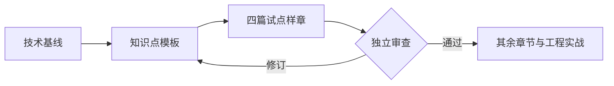
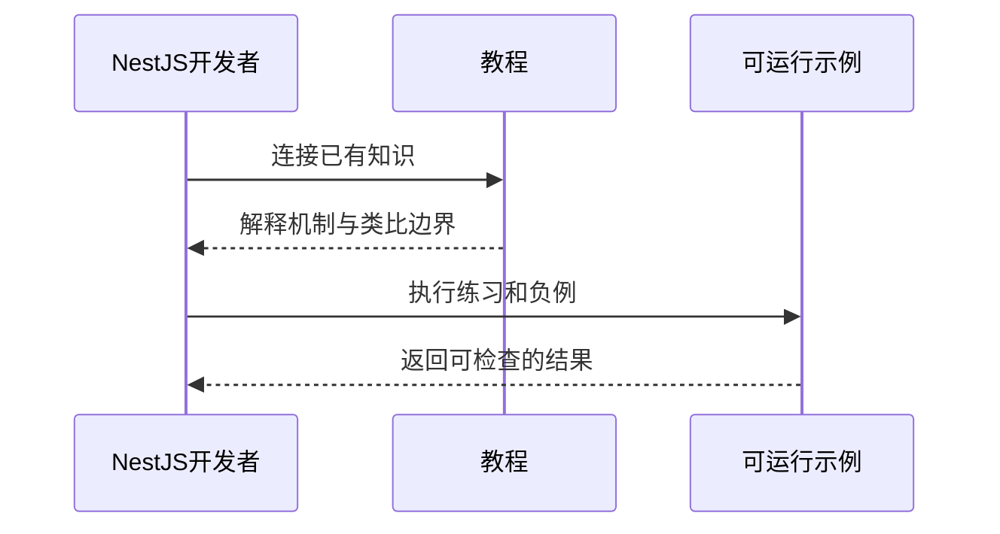

# 图表与阅读说明

本教程使用Mermaid说明参与者、执行顺序和数据流。图表帮助建立直觉，技术结论仍须结合代码和验证证据。

## 课程建设流程

这是一张文档站能力演示图，不代表样章或后续课程已经完成。

## 对照阅读顺序

每张图下方可展开文字源码。图形加载失败时仍可读取源码；浅色与深色外观切换后会重新绘制。小屏幕下宽图可横向滚动。

## 编写图表

在Markdown中使用语言标识为`mermaid`的代码块即可。图表在浏览器按需渲染，构建阶段不依赖浏览器环境。保持节点文字简短，用正文说明条件、反例和机制边界。

当前启用Mermaid严格安全模式，不支持将图表节点用作执行脚本或交互跳转。源代码是仓库内维护的文档，不接收读者任意输入。
