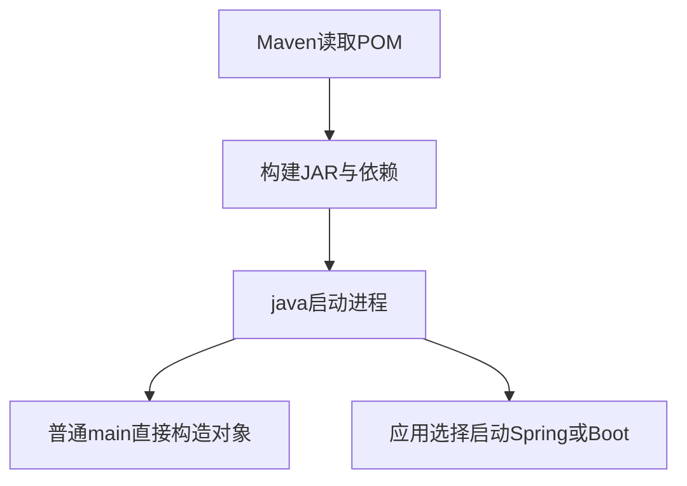

# 01 · Java生态地图

## 章节范围与先修

面向能运行Nest项目、尚未接触Java的读者。本章先辨认“谁编译、谁执行、谁装配应用”，不要求先学Spring。所有命令从仓库根执行，环境准备见[第03章](03-development-environment.md)，原理见[第02章](02-runtime-model.md)。本章复用已有完整示例，不为生态名词另写一份重复业务程序。实际命令与验收证据统一见[P2-01](../progress/P2-01.md)和[基础实验说明](../../examples/java-basics/runtime-lab/FOUNDATIONS.md)。

## 知识点

### ch01-kp01 · JDK、运行环境与JVM

#### 1. 一句话定义

JDK是开发工具包；JVM执行class格式；应用运行还需要标准库和其他运行组件，不能只带一个虚拟机二进制。

#### 2. 为什么需要它

已有`java`命令却找不到`javac`，与拥有Node却未安装TypeScript编译器类似：执行工具存在，不代表开发工具齐全。

#### 3. 生活类比

| 角色/动作 | 技术对象 | 失效条件 |
|---|---|---|
| 工坊整套工具 | JDK的编译、诊断、运行工具 | 工具组成依发行版而异 |
| 执行图纸的机器 | JVM | JVM还执行验证/JIT/GC，不是静态机器 |
| 机器配套物料 | 标准类库和运行组件 | 应用第三方依赖不自动包含其中 |

#### 4. Node.js / TypeScript / NestJS 技术对照

部分可比：Node发布物包含V8及Node API，不能把Node整体只对应JVM；`javac`与`tsc`都做编译，但产物不同。现代Java运行环境可来自完整JDK或定制运行映像；不要按旧教程寻找所有发行商都提供的独立JRE21下载。

#### 5. 两端代码对照

TS入口为[main.ts](../../examples/nestjs-reference/src/main.ts)，Java入口为[GreetingCli.java](../../examples/java-basics/greeting-cli/src/main/java/dev/javafornestjs/cli/GreetingCli.java)。TS需先构建再执行JS，Java需先构建再执行class/JAR。仓库根运行`npx --yes pnpm@10.34.9 examples:build`和`examples:start`；Java命令见实验说明。双端默认输出契约是`Hello, NestJS!`，由现有契约脚本验证。

工具检查使用`java -version`、`javac -version`、`node --version`；它们只报告被实际解析的程序，不证明全部路径一致。

#### 6. 原理与流程图

第三方JAR同样必须进入应用运行路径；JDK不会自动下载它们。

#### 7. 类比边界与错误直觉

安装JDK不是安装Spring，JVM也不是HTTP服务器。JIT实现、发行商、支持期限和授权条件均需分别核对。本课程Java21语言主线在Temurin21/25上验证，不表示任意第三方库任意版本都兼容。

#### 8. 企业应用场景与选型

CI使用完整JDK编译诊断，部署可选择与依赖兼容的运行映像。减小映像前必须核对运行模块、代理/反射和诊断需求；不能用更小作为唯一标准。

#### 9. 常见错误与排查

| 现象 | 定位 | 修复与回归 |
|---|---|---|
| java能运行，javap不存在 | 核对实际JDK的bin目录；IDE附带运行时可能不完整 | 换完整JDK，再执行基础验证 |
| 编译21，启动却是旧Java | 比较`JAVA_HOME`与PATH解析 | 统一工具链后重新启动进程 |

#### 10. 实操练习与验收

基础题：记录java/javac/node的实际版本与路径。迁移题：解释Node整体为何不等于JVM。思考题：JDK存在为何应用仍可能缺类？验收：能指出开发工具、运行组件、应用依赖三个不同层次，并实际运行双端问候契约。

完成后查看提示

查找工具属于“命令解析”，查找应用类属于“运行类路径”，不要混用PATH与classpath修复问题。

### ch01-kp02 · Java SE、规范与实现

#### 1. 一句话定义

Java SE提供平台规范与标准API；JDK发行版实现这些能力，语言版本不等于某个厂商产品名。

#### 2. 为什么需要它

看到Temurin、Microsoft、Oracle和HotSpot时，先分清发行版与VM实现，才能判断课程命令是否依赖特定实现。

#### 3. 生活类比

| 角色/动作 | 技术对象 | 失效条件 |
|---|---|---|
| 插座规格 | 平台契约 | 规范不描述所有性能细节 |
| 某厂商插座产品 | JDK发行版 | 同接口不代表支持政策相同 |
| 内部结构 | VM实现 | 特定诊断参数可能不可移植 |

#### 4. Node.js / TypeScript / NestJS 技术对照

部分可比：ECMAScript规范与V8实现的区别可以帮助理解；Java SE还包括广泛的标准库平台契约。npm、Maven是依赖与构建生态的工具，不能用“Java SE就是npm”来映射。

#### 5. 两端代码对照

[MemoryLab.java](../../examples/java-basics/runtime-lab/src/main/java/dev/javafornestjs/runtime/MemoryLab.java)只用Java语言及标准类型，不依赖Spring。[memory-lab.ts](../../examples/nestjs-reference/src/runtime/memory-lab.ts)同样不依赖Nest，编译后在Node运行。固定观察值为primitive=1、shared=2、身份比较false、文本比较true；后两项两端对象模型不同，见第05章。Java编译使用release21，不使用预览特性。

#### 6. 原理与流程图

语言/平台契约→具体JDK实现→目标版本class→兼容运行环境。此处为层次关系，文字链路足够；不要从它推导不同实现的执行耗时相同。`--release 21`约束编译期可用平台API与目标，不会自动处理所有第三方依赖兼容问题。

#### 7. 类比边界与错误直觉

LTS主要涉及发行商维护承诺，不能仅凭“LTS”断言某版本对自己的部署免费受支持。课程选择精确工具链是为了可复现，不是为所有部署环境提供许可或维护保证。

#### 8. 企业应用场景与选型

选择发行版时同时检查架构、支持期、许可和安全更新来源。用CI覆盖目标JDK，保留第三方库测试；不能把“能编译”扩写成生产行为完全兼容。

#### 9. 常见错误与排查

| 触发 | 根因 | 回归 |
|---|---|---|
| 复制HotSpot的`-XX`选项到其他VM失败 | 实现专用选项并非通用平台契约 | 删除该参数验证功能，再查目标VM文档 |
| 使用高版本API却要求21运行 | 源码语言级别与平台API目标混淆 | 用release21重新编译并在21实际运行 |

#### 10. 实操练习与验收

基础题：从版本输出辨认版本和发行商。迁移题：列出规范、实现、包管理器各一项。思考题：25上运行release21产物成功能否证明21也成功？验收：回答不能，并给出在21复跑的命令。

完成后查看提示

把高版本运行成功与低版本支持分开；使用目标平台API、字节码和真实运行环境共同核验。

### ch01-kp03 · Spring、Spring Boot与构建工具

#### 1. 一句话定义

Spring提供容器等应用基础能力，Spring Boot在其上提供应用装配与运行约定；Maven负责构建和依赖，不代替应用容器。

#### 2. 为什么需要它

Nest开发者容易把Maven module、Java package、Spring Bean和Nest module全部叫“模块”，从而混淆构建边界与运行可见性。

#### 3. 生活类比

| 角色/动作 | 技术对象 | 失效条件 |
|---|---|---|
| 采购/组装清单 | Maven POM | 清单不创建运行中的Bean |
| 装配与调度处 | Spring容器 | 并非每个Java对象都由其管理 |
| 按约定开办的工坊 | Boot应用 | 自动配置有条件，不能自动猜出所有业务设计 |

#### 4. Node.js / TypeScript / NestJS 技术对照

部分可比：Maven与pnpm均参与依赖管理，但Maven生命周期和Reactor不等于pnpm workspace。Nest DI与Spring容器可对照；Boot不是Java语言，更不能将Nest一对一拆成Spring/Boot两个同名层。

#### 5. 两端代码对照

[GreetingPolicy.java](../../examples/java-basics/greeting-core/src/main/java/dev/javafornestjs/greeting/GreetingPolicy.java)没有Spring依赖；[GreetingCli.java](../../examples/java-basics/greeting-cli/src/main/java/dev/javafornestjs/cli/GreetingCli.java)直接调用它即可工作。对照[Nest入口](../../examples/nestjs-reference/src/main.ts)显式创建application context；它没有开启HTTP监听。两者都能输出问候，装配机制并不相同。运行整个问候契约使用`npx --yes pnpm@10.34.9 examples:verify`，需先构建Java和TS。

#### 6. 原理与流程图

分支表示两种应用选择，不表示运行Java必定先启动Spring。

#### 7. 类比边界与错误直觉

Maven父POM继承Boot的依赖管理，不会让每个子模块在运行时自动成为Boot应用。包可见性、JPMS导出、Spring扫描与Nest exports是不同规则，后续分别学习。

#### 8. 企业应用场景与选型

纯计算规则可放在不依赖Web框架的库中，CLI与Web共享；需要容器、配置与Web集成时再由应用层接入。不是所有小程序都应启动完整Web服务器。

#### 9. 常见错误与排查

| 误判 | 核查 | 修复 |
|---|---|---|
| POM有Boot父项，所以CLI会监听端口 | 查看main是否启动Web环境 | 分清构建继承与运行入口 |
| Nest createApplicationContext等于HTTP app | 检查是否调用listen | 选正确启动方式，按应用契约测试 |

#### 10. 实操练习与验收

基础题：定位core/CLI/Nest三个入口。迁移题：用自己的话区分Maven模块、Java包和DI容器。思考题：为什么共享规则不依赖Spring？验收：指出至少三项机制差异，并在无数据库环境运行现有CLI。

完成后查看提示

依赖图回答“构建需要谁”，容器回答“运行时由谁创建/提供实例”；先说清问题，再选择工具。

## 章末验收与审查记录

三点的自检重点分别是工具/运行环境、规范/实现、构建/容器。真实验证及独立评分见[P2-01记录](../progress/P2-01.md)；当前draft，不用结构完整冒充教学效果通过。

## 参考资料与变更

2026-11-10参考：[Java21工具规范](https://docs.oracle.com/en/java/javase/21/docs/specs/man/index.html)、[Java21虚拟机规范](https://docs.oracle.com/javase/specs/jvms/se21/html/index.html)、[Spring Framework概览](https://docs.spring.io/spring-framework/reference/6.2/overview.html)。精确版本与验证来源见[兼容矩阵](../00-introduction/compatibility-matrix.md)；命令的已执行范围以实验记录为准。
