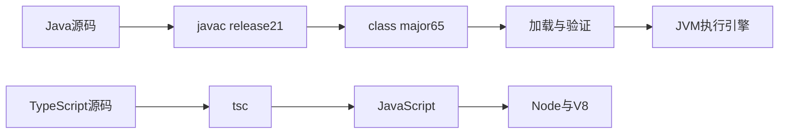
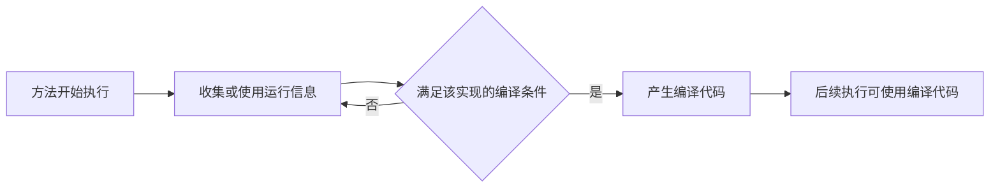
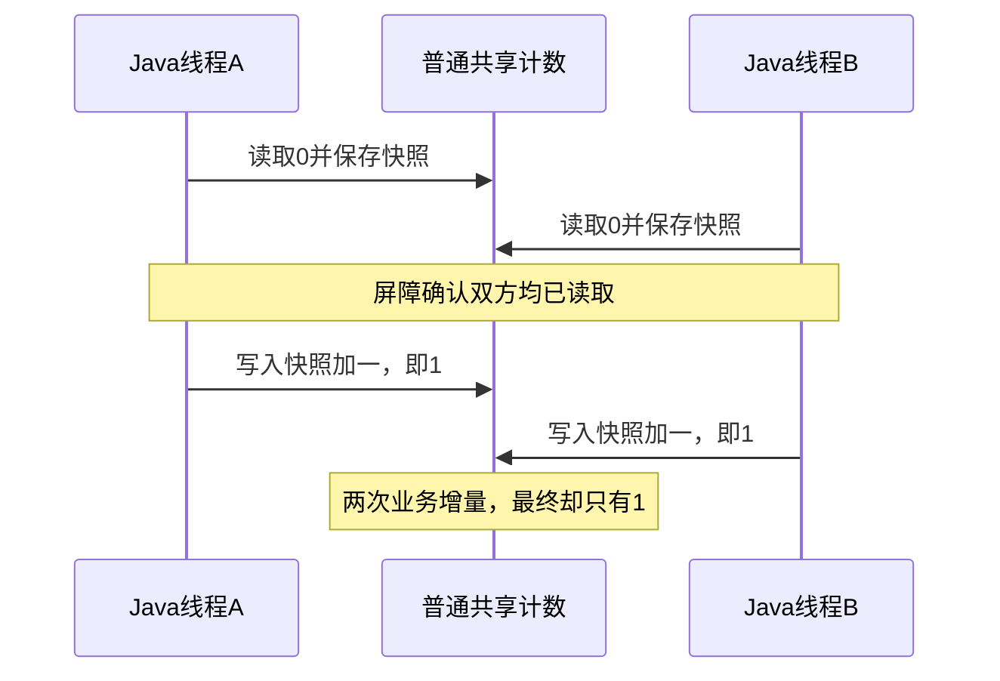

# 02 · Node.js 与 JVM 运行模型

## 章节范围与先修

目标：能追踪源码到执行的路径，解释预热和GC为何影响测量，区分事件循环、操作系统线程及共享状态竞争。需要能够在Node中运行TS构建产物，并理解函数、数组和基本异步；第01章仍未交付，可先阅读[兼容矩阵](../00-introduction/compatibility-matrix.md)和[工作区指南](../00-introduction/workspace.md)。

本章不讲字节码指令全集、GC调优、Java内存模型证明或虚拟线程调度器。JIT/GC实验使用HotSpot系实现的诊断参数；JVM规范没有要求所有实现采用相同JIT、收集器或内存布局。

同题契约是“计算0到99999的`31*i+7`之和，按有符号32位回绕”。Java `int`与JS普通`number`语义不同，所以TS显式使用`Math.imul`和`|0`，不能用这个实验推断两种数值类型等价。

完整运行步骤在[实验README](../../examples/java-basics/runtime-lab/README.md)；Java生产/测试源码和TS生产/测试源码在chapter-map.yml登记。每节代码标明是完整文件的片段，不是可以脱离上下文直接复制的完整应用。

## 知识点

### ch02-kp01 · 源码、字节码与执行引擎

#### 1. 一句话定义

JVM执行class文件描述的指令和元数据；javac把Java源码编译为class，实际机器执行方式由具体JVM实现决定。

#### 2. 为什么需要它

在Nest项目里，`tsc`通过不代表Node能解析所有模块或运行所有依赖。Java也有编译和运行两个边界：编译目标、运行时版本和类路径共同决定能否启动。

#### 3. 生活类比

把跨地区演出看作“剧本→统一舞台说明→当地剧团执行”。统一说明让不同舞台理解动作，但不保证所有年代的剧团都识别新说明。

| 角色或动作 | 技术对象 | 失效边界 |
|---|---|---|
| 原始剧本 | Java源码 | 源码不是class文件 |
| 统一舞台说明 | class指令与元数据 | 不等于某CPU机器码 |
| 当地剧团 | 具体JVM实现 | 不保证支持未来class版本 |

类比只说明中间格式的作用，不描述验证器、类加载器或执行成本。

#### 4. Node.js / TypeScript / NestJS 技术对照

部分可比：TS先转成JS再由Node/V8执行，Java通常先产出class再由JVM执行。重要差异是`tsc`主要删除类型并转换语法，产物仍是JS源码；class是独立的二进制格式。V8自己也有内部字节码与优化编译过程，不能概括为“JS解释、Java编译”。

#### 5. 两端代码对照

TS片段，完整文件为[运行时TS实验](../../examples/nestjs-reference/src/runtime/runtime-lab.ts)：

```ts
export function mix(value: number): number {
  return (Math.imul(value, 31) + 7) | 0
}
```

Java片段，完整文件为[RuntimeLab](../../examples/java-basics/runtime-lab/src/main/java/dev/javafornestjs/runtime/RuntimeLab.java)：

```java
public static int mix(int value) {
    return value * 31 + 7;
}
```

先按实验README构建，再运行`pnpm runtime:verify`。脚本用被测JDK的javap反汇编真实产物，要求class major为65（Java21），再运行两端计算，预期均为380327344；不是比较源码长得像不像。

#### 6. 原理与流程图



图中两条路径不是逐节点等价映射。class验证也不等于TS静态类型检查；TS类型不能在Node运行时自动验证HTTP输入。

#### 7. 类比边界与错误直觉

相似处是运行前存在准备阶段。不同处是产物格式、兼容约束和类型系统不同。不能推出“带上class就完全无需依赖”：运行时仍要找到引用类。依据为JVMS第2节与实验javap输出；完整构建也验证了实际类路径，而不只是某一源文件。

#### 8. 企业应用场景与选型

交付JAR时要把编译语言级别和运行时镜像版本一起锁定。本仓库以release21构建，在21和25运行；不要让开发者本机新JDK默默产出更高版本class。上线排障先看产物版本与实际java版本，再判断业务错误。

#### 9. 常见错误与排查

| 触发 | 现象 | 根因 | 修复与回归 |
|---|---|---|---|
| 用旧JVM加载较新的class | UnsupportedClassVersionError | 运行时不支持class版本 | 核对java/javap来自同一JAVA_HOME；使用已验证JDK或重新按兼容release构建 |
| 只编译TS却遗漏部署依赖 | Node启动时报模块缺失 | 类型检查未保证运行文件齐全 | 锁文件安装并真实运行构建产物 |

上述是诊断模式，不宣称本仓库已运行所有旧JDK负例；本章实际断言的是major65、可执行产物及双端输出。

#### 10. 实操练习与验收

- 基础题：用javap找到mix的乘法/加法和checksum对mix的调用。验收：能指出class版本65及调用字节码。
- 迁移题：解释为什么`number`要显式收窄到int32；验收：举出大整数回绕与JS普通加法不同的例子。
- 思考题：Java25运行release21产物成功，能否推断任意第三方库都兼容25？验收：明确回答不能，并说明还要验证依赖与运行行为。
- 命令：实验README的构建步骤后执行`npx --yes pnpm@10.34.9 runtime:verify`，退出0且打印bytecodeMajor65。

<details><summary>完成后查看提示</summary>

`mix(Integer.MAX_VALUE)`得到2147483624；TS测试显式验证相同值。小整数例子看不出number和int的差异，应检查溢出附近。虚拟机读取class成功也不证明库没有使用不兼容的内部API。

</details>

### ch02-kp02 · JIT与可观察的预热

#### 1. 一句话定义

JIT是在程序运行期间把部分代码编译为机器码的实现策略，热点识别和优化策略取决于具体执行引擎。

#### 2. 为什么需要它

直接比较第一次Node函数调用和一次Java服务请求，常把模块加载、类初始化、编译、缓存和业务耗时混在一起。应先知道是否出现运行期编译，再讨论测量方法。

#### 3. 生活类比

新厨师先逐条看菜谱，熟悉后为常点菜准备操作顺序。常点次数对应热度，预先整理操作对应优化；但厨房不会像JIT一样做机器码生成或去优化，因此类比不提供优化规则。

| 现实角色或动作 | 技术对象 | 边界 |
|---|---|---|
| 反复制作一道菜 | 热点执行 | 并非所有函数都会编译 |
| 整理常用操作 | 运行期优化 | 不保证耗时一定下降 |
| 条件变化重新调整 | 某些实现的去优化 | 不是所有实现都按相同条件触发 |

#### 4. Node.js / TypeScript / NestJS 技术对照

部分可比：V8与HotSpot都有运行时优化，但不存在稳定的“一套编译层级对应另一套”的关系。本章的`-Xint`、PrintCompilation、CompileThreshold是HotSpot实验工具；不能作为Node命令，也不能从本次mix日志推断整个应用已进入稳定态。

#### 5. 两端代码对照

两端复用上一节的mix/checksum，避免换算法导致对照失真。TS端运行真实构建文件而非ts-node即时转译；Java端对同一class分别运行解释模式和受控JIT模式：

```sh
java -Xint -cp examples/java-basics/runtime-lab/target/classes dev.javafornestjs.runtime.RuntimeLab compute
java -Xbatch -XX:-TieredCompilation -XX:CompileThreshold=100 -XX:+PrintCompilation -XX:CompileCommand=compileonly,dev.javafornestjs.runtime.RuntimeLab::mix -cp examples/java-basics/runtime-lab/target/classes dev.javafornestjs.runtime.RuntimeLab compute
node examples/nestjs-reference/dist/runtime/runtime-lab.js
```

预期两种Java模式及Node计算结果都是380327344；受控JIT输出包含`RuntimeLab::mix`的编译记录。验证脚本检查结果和记录，不比较两次进程总耗时。

#### 6. 原理与流程图



此图是概念模型。本实验为稳定观察而关闭分层编译并限制只编译mix，刻意没有模拟默认生产配置，不能用图来推断某条日志与每次调用一一对应。

#### 7. 类比边界与错误直觉

不能推出“第100次调用一定由JIT执行”：阈值、循环回边、编译队列和实现细节都会影响时机。也不能推出“解释与JIT可以产生不同业务答案”；相同规范下应保留可观察语义。实验检查结果一致，未测量去优化或V8各阶段行为。

#### 8. 企业应用场景与选型

评估Java计算热点时，先固定输入和正确性，再用适当基准工具区分预热、稳态和GC；评估HTTP服务还要包括池、I/O与尾延迟。本章没有生产吞吐量承诺。短命CLI启动延迟和长驻服务吞吐也应分别评估。

#### 9. 常见错误与排查

| 触发 | 现象 | 根因 | 修复与回归 |
|---|---|---|---|
| 给非HotSpot引擎使用诊断参数 | JVM拒绝启动 | 参数属于实现而非语言规范 | 核对发行商和版本；本实验按兼容矩阵使用HotSpot系JDK |
| 测第一轮耗时就下结论 | 结果随启动次数波动 | 混入加载/编译/缓存 | 先验证日志和结果，再另做预热、多轮测量 |

#### 10. 实操练习与验收

- 基础题：运行两种Java模式并找到编译记录。验收：保留相同CHECKSUM和JIT方法名。
- 迁移题：把本章实验直接叫作“Java比Node快”的证据有什么问题？验收：指出没有同条件稳态基准，且双方执行策略被人为改变。
- 思考题：一个方法被编译是否等于服务预热完成？验收：列出至少两个尚未覆盖的因素，例如连接池和其他热点。
- 命令：`npx --yes pnpm@10.34.9 runtime:verify`，JIT与解释结果不一致或缺日志应非零退出。

<details><summary>完成后查看提示</summary>

看编译记录是回答“有没有观察到编译”，看多轮测量是回答“在这些条件下多快”。两者不能互相代替。把方法或循环改短后可能不再出现编译记录，这是实验负例而不是偷偷放宽断言的理由。

</details>

### ch02-kp03 · 可达性、分配与垃圾回收

#### 1. 一句话定义

GC自动回收不再可达等条件下的对象存储；何时回收、怎样分代或移动对象取决于收集器和实现，而不是变量离开某行代码就立即释放。

#### 2. 为什么需要它

Nest服务里请求结束后，对象仍可能被缓存或闭包引用；Java里的静态集合或长生命周期Bean也能保留对象。自动回收不等于“不会发生内存泄漏”，更不替代关闭文件、连接和线程池。

#### 3. 生活类比

用“保管员根据仍有效的领取单整理库房”的小模型代替按固定时间倒垃圾：领取单对应根和引用链，找不到有效领取链的箱子才可能清理。模型只表达可达性，不描述实际GC算法。

| 模型元素 | 技术对象 | 失效边界 |
|---|---|---|
| 有效领取单与转交关系 | 从GC roots出发的引用链 | 不是引用次数等于0的简单计数 |
| 库房箱子 | 对象占用的存储 | 不保证每个对象最终都分配在可观察堆位置 |
| 保管员整理 | 收集器工作 | 不能承诺立即归还操作系统内存 |

#### 4. Node.js / TypeScript / NestJS 技术对照

部分可比：V8和JVM都有自动内存管理，长寿命引用都可能造成保留。不同点是堆配置、对象布局、收集器、Worker隔离和本地内存范围；Node的process内存与JVM堆上限也不是同一指标。Java对象可能经优化避免实际分配，规范中的运行时数据区不是某张固定物理内存图。

#### 5. 两端代码对照

Node可在独立诊断进程开启V8的GC跟踪；以下是可选观察命令，不作为本章自动通过条件：

```sh
node --trace-gc examples/nestjs-reference/dist/runtime/runtime-lab.js
```

这个Node计算实验没有故意制造同等分配压力，日志数量不可直接横比。Java完整实验的allocate模式持续替换一个volatile byte数组引用：

```java
// RuntimeLab.main中的片段；保留最后一个对象，让前面的对象可回收。
for (int i = 0; i < 256; i++) {
    allocationSink = new byte[256 * 1024];
}
```

自动验证为Java显式选SerialGC、小堆和GC日志，检查出现young collection且程序完成。这验证一组受控条件下的行为，未承诺某个对象在哪次GC回收。

#### 6. 原理与流程图

分配新数组→更新持有引用→旧数组不再由该字段持有→收集器在其规则下识别可回收对象→后续分配复用空间。此处用文字链路即可表达关键因果，不画假定对象地址移动的物理图。其他引用若仍持有旧对象，“更新字段”本身并不足以使它不可达。

#### 7. 类比边界与错误直觉

不能推出“赋null就立即释放”或“总分配64MiB就要求64MiB同时存活”。本例只有最后一块由字段持有，累计分配与存活集不同。还不能把Java SerialGC日志推广到默认G1或V8的停顿特性；各自需要独立实测。GC调优指南和受控日志是本节依据。

#### 8. 企业应用场景与选型

缓存无上限、队列积压或一次加载所有数据库记录，都可能扩大存活集。先定位引用保留和请求模型，再调整堆或收集器。文件句柄、数据库连接等外部资源采用明确的生命周期管理；不要等GC来履行业务上的关闭约定。

#### 9. 常见错误与排查

| 触发 | 现象 | 根因 | 修复与回归 |
|---|---|---|---|
| 静态列表持续保留结果 | GC后占用仍高 | 数据仍可达 | 限制容量/淘汰并对存活集重新观测 |
| 只看RSS判断Java堆泄漏 | 与-Xmx不匹配 | 进程还有线程栈、本地内存等 | 区分堆指标与进程指标；本章不伪造未采集的heap dump |

#### 10. 实操练习与验收

- 基础题：解释为什么小于累计分配量的堆仍能完成本实验。验收：区分累计分配和同时存活。
- 迁移题：Nest的单例缓存和Spring单例Bean字段为什么都有保留风险？验收：给出引用链，而不是说“两个框架GC一样”。
- 思考题：将所有数组保存在列表中会怎样？验收：预测存活集扩大，但不要在CI里无限分配；可在隔离进程和固定堆下另做受限实验。
- 命令：`pnpm runtime:verify`须观察到young GC及ALLOCATION_DONE；不检查停顿毫秒数。

<details><summary>完成后查看提示</summary>

“不再由一个字段引用”和“全局不可达”是不同结论。只检查有没有GC日志不能证明业务没有泄漏；本实验只展示可回收分配压力与有限堆的关系。

</details>

### ch02-kp04 · 事件循环、线程与共享状态

#### 1. 一句话定义

Node单个JS执行环境的回调通常串行执行；JVM线程可并发执行代码。它们都需要明确调度、I/O等待及共享状态的边界。

#### 2. 为什么需要它

在Nest请求里加入很长的同步循环，会延迟同一事件循环上的其他回调。迁移到Java也不能简单“多开线程”：共享计数、集合和CPU预算可能成为新问题。

#### 3. 生活类比

单个前台按顺序处理来电，对应一个JS执行环境上的回调；把计算任务送给另一个有独立桌面的同事，对应Worker。Java多个工作人员共同更新一张白板，对应线程共享对象；共同看见白板不保证“读、加一、写”整体不可分割。

| 现实动作 | 技术对象 | 边界 |
|---|---|---|
| 一个前台一次处理一件事 | 一条JS执行路径 | 不代表Node进程只有一个OS线程 |
| 同事独立桌面 | Worker的独立JS环境 | 可通过SharedArrayBuffer等显式共享部分数据 |
| 多人改白板 | JVM共享堆上的状态 | 看见对象不等于更新是原子的 |

#### 4. Node.js / TypeScript / NestJS 技术对照

部分可比的是“把工作交给可独立执行的单元”。Java线程**无直接等价于Promise的对应物**：Promise表达异步结果，创建Promise不会自动分派CPU工作。Node还使用OS异步I/O和libuv线程池；并非所有I/O都走线程池。Worker能执行CPU任务，不能据此说所有JS对象自动跨Worker共享。

Spring MVC默认Servlet请求处理与Nest所选HTTP适配器的请求模型也不同，后续章节再验证。虚拟线程适合的等待模型不等于增加CPU核心；本实验明确用两个平台线程，而不是拿名字类似的机制强行配对。

#### 5. 两端代码对照

TS完整文件中的eventLoopOrder先注册0延迟定时器，再同步计算；输出次序为`sync-start,cpu-finished,timer`。0表示到期门槛，不是对正在执行JS的抢占。workerChecksum真正创建Worker并通过消息返回同题计算结果，测试比较主线程和Worker答案，不比较速度。

Java完整文件中的sharedCounter用两个线程和CountDownLatch强制两边都先读到0，再分别写回1；旁边用AtomicInteger增量作对照。输出`COUNTERS=1,2`。这里的屏障用于稳定复现读改写丢失，不是对业务计数的正确修复；正确对照采用原子操作。

#### 6. 原理与流程图



线程join/Future.get提供等待完成的边界；“两个线程都结束”不会把已经丢掉的那次更新补回来。原子增量把每次增量作为不可分割操作，最终为2。

#### 7. 类比边界与错误直觉

至少保留三条边界：Node不是整个进程单线程；Promise不是新线程；JVM共享对象不自动线程安全。第四条：串行JS也可能有跨await的逻辑竞争，例如两次操作先读余额、等待后再按旧余额写回；这不是本例的同一内存数据竞争，但同样可能违反业务一致性。本例没有声称测试所有Node异步竞争。

#### 8. 企业应用场景与选型

CPU密集任务可评估有界Worker池或线程池，避免每请求无限创建执行单元。I/O场景优先理解库的等待与连接池模型。Java服务迁移时共享单例计数需要原子性设计；涉及数据库还要验证事务，而不是只给内存变量加锁就宣称分布式一致。

#### 9. 常见错误与排查

| 触发 | 现象 | 根因 | 修复与回归 |
|---|---|---|---|
| 在Promise构造器里同步做重计算 | 定时器仍被延迟 | 构造器函数本身同步执行 | 使用真正Worker/任务池；用事件顺序实验确认 |
| 多线程用counter++ | 结果可能小于业务增量数 | 读改写不是整体原子操作 | 按语义选择AtomicInteger或锁；运行受控负例及正确对照 |

#### 10. 实操练习与验收

- 基础题：运行Node事件顺序测试和Java受控丢失更新。验收：能逐步解释两组输出。
- 迁移题：说明把Nest里的Promise代码换成Java线程会引入什么共享状态问题。验收：写出一次丢失更新交错，并解释AtomicInteger修复的范围。
- 思考题：Node单个回调串行是否能保证数据库余额业务正确？验收：给出跨await或跨进程反例，明确需要另外验证事务/并发控制。
- 命令：`pnpm examples:test`及`pnpm runtime:verify`；Worker异常、答案不一致或计数错误都必须非零退出。

<details><summary>完成后查看提示</summary>

本例两线程都用同一个旧快照，所以各自写回1；“等待两线程完成”解决完成时机，不解决丢失更新。Worker消息传递隔离了本次输入/结果；启用共享内存后还必须额外设计同步，不能沿用这里没有共享对象的推理。

</details>

## 章末验收与审查记录

1. 按[实验README](../../examples/java-basics/runtime-lab/README.md)完成Java verify、TS build/test和runtime:verify。
2. 不看提示解释：class与JS产物的差异；为何JIT日志不能证明吞吐量；累计分配为何不等于存活集；Promise、Worker和JVM线程至少三条边界。
3. 修改一项契约让测试失败，再恢复并完整重跑。不要提交故意破坏的生产文件。

| 知识点 | 可检查证据 | 独立审查 |
|---|---|---|
| ch02-kp01 | javap major65、双方算术测试与进程契约 | 独立评分10，代码/文档审查通过；待CI及用户验收 |
| ch02-kp02 | -Xint/JIT相同答案及实际方法编译记录 | 独立评分9，排除日志误判已修订；待CI及用户验收 |
| ch02-kp03 | 受控SerialGC日志及程序完成 | 独立评分9，范围限定通过；待CI及用户验收 |
| ch02-kp04 | Java丢失更新/原子对照、Node事件顺序与真实Worker测试 | 独立评分10，事件顺序断言已修订；待CI及用户验收 |

本地实际版本和运行结果见[P1-01验证记录](../progress/P1-01.md)，逐知识点评分及发现闭环见[独立审查](../reviews/P1-01.md)。当前处于待验收状态，G1尚未完成；不把结构检查通过写成教学验收通过。

## 参考资料与变更

官方资料于2026-11-10核对入口可访问；核心结论按相应规范/实现范围使用：

- [JVMS21第2节](https://docs.oracle.com/javase/specs/jvms/se21/html/jvms-2.html)：class格式、运行时数据区及实现自由度，尤其2.1/2.5/2.13。
- [Java21 GC调优指南](https://docs.oracle.com/en/java/javase/21/gctuning/)：内存管理、收集器与诊断；本实验显式选Serial，不推广默认收集器结果。
- [Node事件循环说明](https://nodejs.org/en/learn/asynchronous-work/event-loop-timers-and-nexttick)：回调、定时器门槛与阶段。
- [Node Worker文档](https://nodejs.org/api/worker_threads.html)：并行JS执行、CPU工作、消息及显式共享内存边界。

术语入口见[术语表](../00-introduction/glossary.md)。本章不改变版本基线或支持范围；G0用户接受及仍保留的本机Windows Docker限制见[G0记录](../progress/G0.md)。
