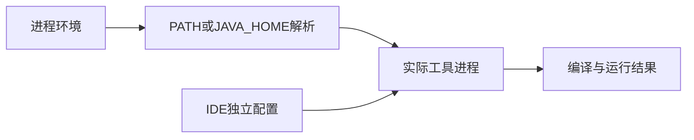

# 03 · 开发环境与调试

## 章节范围与先修

先阅读[生态地图](01-java-ecosystem.md)。本章建立命令行可复现基线，不依赖特定IDE，也不要求Docker。完整命令、工作目录和固定结果见[基础实验](../../examples/java-basics/runtime-lab/FOUNDATIONS.md)，实测记录见[P2-01](../progress/P2-01.md)。Windows使用PowerShell与mvnw.cmd，Linux使用mvnw。下述IDE设置是操作建议，不表示本次已经在IDE中逐项点击验证。

## 知识点

### ch03-kp01 · 识别真正使用的工具链

#### 1. 一句话定义

命令行、构建工具和IDE各自选择JDK，必须核对实际路径与版本，不能只看电脑装过什么。

#### 2. 为什么需要它

Nest项目可能终端Node22、IDE却用另一版本；Java也可能java来自PATH、Maven来自JAVA_HOME、IDE又使用内置运行时。

#### 3. 生活类比

| 对照 | 技术对象 | 边界 |
|---|---|---|
| 仓库有多把尺子 | 多个已安装JDK | 安装不等于当前选择 |
| 工位实际拿到的尺子 | 当前进程解析的工具 | 改环境后旧进程未必刷新 |

#### 4. Node.js / TypeScript / NestJS 技术对照

部分可比：Node版本管理器切换和JDK选择都影响进程；Maven Wrapper固定Maven版本，不下载或固定所有场景下的Java。pnpm的packageManager字段也不代替Node版本选择。

#### 5. 两端代码对照

TS的[package.json](../../examples/nestjs-reference/package.json)与根锁文件固定构建依赖；Java的[根POM](../../pom.xml)声明release21及Boot基线。[verify-foundations.mjs](../../scripts/verify-foundations.mjs)使用JAVA_HOME下同一组java/javac/javap/jar工具，未设置时才使用PATH。

Windows运行`Get-Command java,javac`、`$env:JAVA_HOME`及`.\mvnw.cmd -version`；Linux运行`command -v java`、`command -v javac`及`./mvnw -version`。Node运行`node --version`，pnpm使用固定的`npx --yes pnpm@10.34.9`。记录输出后再构建实验。

#### 6. 原理与流程图

版本字段是要求，实际启动进程才是观察对象。

#### 7. 类比边界与错误直觉

同一大版本还可能有不同发行商、补丁、架构和工具组成。不能因为java可执行就假设javap/jdb可用；本仓库已遇到IDE运行时缺javap的真实情况。

#### 8. 企业应用场景与选型

把语言版本、依赖锁、Wrapper和CI矩阵一同纳入仓库。IDE项目SDK、Maven importer与运行配置应与目标一致，容器环境也要独立记录。

#### 9. 常见错误与排查

| 症状 | 原因候选 | 回归 |
|---|---|---|
| 无效target release21 | Maven运行的JDK过旧 | mvnw -version核对后重编译 |
| 本机成功CI失败 | 未记录缓存/环境差异 | frozen-lockfile及Wrapper在CI实际执行 |

#### 10. 实操练习与验收

基础题：记录四个工具的版本与路径。迁移题：说明Wrapper与Node版本管理器解决的问题有何不同。思考题：切换JAVA_HOME后为何IDE仍失败？验收：在新终端用实验README命令成功构建，能指出IDE独立配置的可能性。

完成后查看提示

先确认实际进程，再清缓存。盲目删缓存不能修复指向旧JDK的配置。

### ch03-kp02 · 断点、调用栈与变量观察

#### 1. 一句话定义

调试器在特定执行位置暂停程序，展示该时刻的栈帧与变量；源码窗口本身不是执行证据。

#### 2. 为什么需要它

看到对象修改了却调用者变量没被重新绑定，需要在函数入口和返回前分别查看状态，而不是只加一句“Java按引用传递”。

#### 3. 生活类比

| 对照 | 技术对象 | 失效条件 |
|---|---|---|
| 录像暂停点 | 已命中的断点 | 设置断点不代表路径一定经过 |
| 每层工位的记录 | 调用栈与局部变量 | 优化代码或缺调试信息可能无法查看所有变量 |

#### 4. Node.js / TypeScript / NestJS 技术对照

部分可比：Node inspector和Java调试器都能查看调用栈；TS源映射把JS位置映回TS，Java行号/变量表来自class调试信息。source map不是Java字节码调试表的同一格式，不能复制调试配置直接套用。

#### 5. 两端代码对照

比较[memory-lab.ts](../../examples/nestjs-reference/src/runtime/memory-lab.ts)与[MemoryLab.java](../../examples/java-basics/runtime-lab/src/main/java/dev/javafornestjs/runtime/MemoryLab.java)的change函数。先运行foundations:verify产生-g产物，再按[手动步骤](../../examples/java-basics/runtime-lab/FOUNDATIONS.md)启动jdb，在change入口停下并执行locals。

入口primitive=1，box指向value=1的对象；修改字段后调用者可见2，重新绑定形参不会更换调用者引用。调试练习必须实际命中断点后记录观察；自动脚本仅证明调试表存在，不冒充手动调试成功。

#### 6. 原理与流程图

调用observe→复制实参到change形参→断点暂停→观察当前帧→单步修改→继续执行。此链路用文字足够，不引入第二套对象示意；第05章提供引用图。

#### 7. 类比边界与错误直觉

暂停会影响线程调度、超时和性能。调试窗口求值可能调用方法并产生副作用；不要在事务/生产排错时随意执行写操作表达式。

#### 8. 企业应用场景与选型

先在隔离可复现环境调试；日志、指标和追踪用于无法暂停的现场。远程调试端口具备控制进程的能力，不能无鉴权暴露公网；本地实验不需要改服务器防火墙。

#### 9. 常见错误与排查

| 现象 | 核查 | 回归 |
|---|---|---|
| 断点不命中 | 实际运行类、产物目录、是否经过该路径 | 重新编译，入口设断点再run |
| 看不到变量名 | 是否有LocalVariableTable | javap -verbose核对，javac -g重编 |

#### 10. 实操练习与验收

基础题：change入口查看primitive。迁移题：指出TS source map与Java调试信息解决的共同问题。思考题：断点下没有超时是否证明生产不会超时？验收：提交真实暂停位置、变量值与继续后结果；没有运行则明确未执行。

完成后查看提示

在入口观察1，在字段修改后观察2，在局部重新绑定后仍需回到调用者验证原对象，不能只看change最后的box变量。

### ch03-kp03 · 按失败阶段诊断

#### 1. 一句话定义

先判断失败发生于编译、启动加载还是应用执行，再选择对应证据，避免用一个“构建失败”覆盖所有原因。

#### 2. 为什么需要它

tsc错误、Node找不到模块与业务抛错需要不同修复；Java编译诊断、主类找不到、业务异常也分别属于不同阶段。

#### 3. 生活类比

| 关卡 | 技术对象 | 边界 |
|---|---|---|
| 图纸审查 | 编译 | 通过不代表业务正确 |
| 开门找设备 | 类/模块加载 | Java也可在运行中延迟加载 |
| 实际加工 | 应用执行 | 失败未必来自输入，也可能是基础设施 |

#### 4. Node.js / TypeScript / NestJS 技术对照

部分可比：`Cannot find module`和ClassNotFoundException都可能指向路径/产物问题，但Node解析扩展、ESM/CJS与Java二进制类名、classpath规则不同。不要机械替换文件后缀。

#### 5. 两端代码对照

Java[基础验证](../../scripts/verify-foundations.mjs)故意启动Absent主类与空classpath，要求非零且异常包含指定类名。TS负编译例见[泛型实验](../../examples/nestjs-reference/src/generics/generics-lab.ts)的未调用夹具；业务失败则可运行RuntimeLab的未知mode，入口switch抛IllegalArgumentException。

#### 6. 原理与流程图

编译产物存在？→主类/依赖能加载？→程序进入业务了吗？沿最早的实际失败收窄。完整异常cause链与首个相关业务栈帧都要保留，不能只截最后一行。

#### 7. 类比边界与错误直觉

程序已启动也可能随后缺类；NoClassDefFoundError可能涉及依赖缺失或初始化失败，不能一律等同主类拼错。负例断言要验证预期原因，而非“任何非零都算成功”。

#### 8. 企业应用场景与选型

CI区分安装、编译、测试、启动检查，便于定位责任边界。排错报告包含实际命令、工作目录、版本、退出码和关键日志，不上传业务密钥或全量环境变量。

#### 9. 常见错误与排查

| 错误修法 | 问题 | 正确回归 |
|---|---|---|
| 缺主类就重装JDK | 未确认classpath根 | 用正确-cp运行同一class |
| 用skipTests消除红色构建 | 隐藏失败而非修复 | 恢复测试并核对原断言 |

#### 10. 实操练习与验收

基础题：运行两个预期启动失败。迁移题：分别写出编译失败与业务失败的观察方法。思考题：非零退出为什么还不足以验证负例？验收：foundations:verify退出0，同时内部两个子进程预期失败且类名断言通过。

完成后查看提示

总验证进程成功表示“符合预期的失败被正确识别”，不是失败程序真的成功执行。

## 章末验收与审查记录

工具链、调试、错误分层三点均需按各自证据判断。自动化范围与手动调试范围分开，见[P2-01](../progress/P2-01.md)。当前draft，独立审查待执行。

## 参考资料与变更

2026-11-10参考：[javac工具](https://docs.oracle.com/en/java/javase/21/docs/specs/man/javac.html)、[jdb工具](https://docs.oracle.com/en/java/javase/21/docs/specs/man/jdb.html)、[Node调试](https://nodejs.org/en/learn/getting-started/debugging)。IDE按钮和特定版本插件不作为本章跨平台保证。
