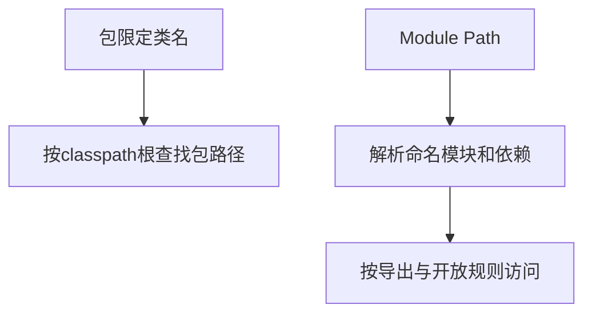

# 04 · Java编译和执行

## 章节范围与先修

先完成[工具链检查](03-development-environment.md)。本章不用Spring，直接编译[MemoryLab.java](../../examples/java-basics/runtime-lab/src/main/java/dev/javafornestjs/runtime/MemoryLab.java)。仓库根运行`npx --yes pnpm@10.34.9 foundations:verify`；完整前置、实际命令和输出在[实验说明](../../examples/java-basics/runtime-lab/FOUNDATIONS.md)，执行证据见[P2-01](../progress/P2-01.md)。以下是显式编译class再执行的路径，未覆盖所有Java源码启动模式。

## 知识点

### ch04-kp01 · javac与java各自负责什么

#### 1. 一句话定义

javac检查源码并生成class；java启动运行环境、加载入口并执行，两步的失败条件不同。

#### 2. 为什么需要它

从`ts-node`或开发服务器迁移时，容易把转译和启动看成同一个动作，从而不知道应该检查源码、产物还是启动命令。

#### 3. 生活类比

| 动作 | 技术对象 | 边界 |
|---|---|---|
| 制作标准图纸 | javac生成class | class不是目标CPU机器码 |
| 按图组织加工 | java启动并执行 | JVM仍可能解释/JIT，不是只读图纸 |

#### 4. Node.js / TypeScript / NestJS 技术对照

部分可比：tsc输出JS而javac输出class；Node不执行Java class，JVM也不直接把本例TS当Java运行。TS类型多数被移除，Java保留运行所需的类型与成员描述，泛型擦除另见第08章。

#### 5. 两端代码对照

TS先`examples:build`再用Node运行dist测试；Java验证脚本执行`javac --release 21 -g -d <输出目录> <MemoryLab源码>`，再`java -cp <输出目录> dev.javafornestjs.runtime.MemoryLab`。源码声明package，输出按package生成目录。固定输出为`Result[primitive=1, shared=2, sameReference=false, sameText=true]`。

`javap -verbose`必须显示major version65。脚本用明确断言验证，不从文件扩展名猜测目标版本。

#### 6. 原理与流程图

类名不是源码文件相对路径；Java嵌套类型可产生多个class文件。

#### 7. 类比边界与错误直觉

编译成功不证明业务结果正确；release21也不保证任意第三方JAR都支持21。Java支持一些源码直接启动方式，但本课程使用显式两阶段以便观察产物，不将它描述为唯一入口。

#### 8. 企业应用场景与选型

CI从干净源码产生可追溯产物，部署运行已验证的同一产物。不要在线上临时重新编译一份未校验的文件替换CI构建物。

#### 9. 常见错误与排查

| 触发 | 原因 | 修复与回归 |
|---|---|---|
| 运行Java文件名却期望加载class | 混淆启动模式 | 使用包限定类名及-cp |
| 旧运行时拒绝新class | class版本超出运行时支持 | 在目标JDK重编/运行，核对javap major |

#### 10. 实操练习与验收

基础题：找到MemoryLab及嵌套类型的class文件。迁移题：比较tsc与javac产物。思考题：为什么只检查javac退出0不够？验收：major65与固定输出同时满足。

完成后查看提示

代码版本契约、产物格式、业务输出分别断言，不能相互替代。

### ch04-kp02 · JAR与入口清单

#### 1. 一句话定义

JAR是归档格式；使用java -jar启动时需要正确入口元数据与可用依赖，并非所有JAR都可直接启动。

#### 2. 为什么需要它

看到Maven package成功后，很容易认为得到的每个库JAR都可以像Node脚本一样独立执行。

#### 3. 生活类比

| 对照 | 技术对象 | 边界 |
|---|---|---|
| 装箱 | JAR归档 | 装箱不自动带齐依赖 |
| 箱外启动说明 | manifest Main-Class | 入口存在仍可能在运行中缺类 |

#### 4. Node.js / TypeScript / NestJS 技术对照

无直接等价物：npm包、JS bundle与JAR都有分发作用，但npm包入口、Node加载规则、JAR manifest以及嵌套依赖规则不同。Boot可执行JAR还有其自己的加载器布局，不能当普通classpath JAR理解。

#### 5. 两端代码对照

[基础脚本](../../scripts/verify-foundations.mjs)执行`jar --create --file <jar路径> --main-class dev.javafornestjs.runtime.MemoryLab -C <输出目录> dev`，随后`java -jar <jar路径>`，期望与-cp模式相同。该例仅依赖标准库，因而不需要打包第三方JAR。[greeting-cli的POM](../../examples/java-basics/greeting-cli/pom.xml)另用shade将core依赖合并；TS示例仍用dist与已安装依赖运行，并未虚构“等价可执行npm归档”。

#### 6. 原理与流程图

class文件→jar归档→读取manifest入口→加载入口类→运行。简单顺序用文字即可。java -jar模式不使用通常的命令行-cp来补充普通类路径；依赖应遵循对应归档及加载机制。

#### 7. 类比边界与错误直觉

JAR不是容器，不包含操作系统或必然包含JVM；普通库JAR、shade产物和Boot可执行JAR不能互换启动假设。不要在Boot JAR内部随意移动目录再认为签名、资源和加载关系仍有效。

#### 8. 企业应用场景与选型

库发布提供依赖坐标，应用发布提供入口与运行说明。以部署契约选择普通classpath、shade或Boot方式，检查资源合并、服务描述文件、许可和大小代价。

#### 9. 常见错误与排查

| 现象 | 核查 | 回归 |
|---|---|---|
| no main manifest attribute | 是否为库JAR，manifest是否有Main-Class | 按声明入口重新打包，再实际启动 |
| 有入口但缺依赖 | 归档依赖布局及启动模式 | 在隔离运行环境启动同一产物 |

#### 10. 实操练习与验收

基础题：用jar --list查看归档包含什么。迁移题：说明分发包与可执行入口的差别。思考题：为什么把-cp加在java -jar旁边不能当通用依赖修复？验收：用本例JAR真实运行并核对固定输出，明确它没有外部依赖。

完成后查看提示

先说清是普通JAR、shade还是Boot产物，再按相应加载规则排查；“文件都叫.jar”不足以选择命令。

### ch04-kp03 · Classpath、包名与Module Path

#### 1. 一句话定义

classpath指定查找普通应用类和资源的根；Module Path参与命名模块解析，模块的依赖与导出规则不等于包目录。

#### 2. 为什么需要它

把-cp指向最后一级包目录后找不到主类，常被误诊为JDK坏了；把Maven模块当JPMS模块则会错误理解运行封装。

#### 3. 生活类比

| 对照 | 技术对象 | 边界 |
|---|---|---|
| 总目录起点 | classpath根 | 不是任意包含class的最深目录 |
| 图书分类名 | package/二进制类名 | 包不是运行隔离容器 |
| 有借阅规则的馆区 | 命名模块 | exports与opens分别限制访问和反射，不能混用 |

#### 4. Node.js / TypeScript / NestJS 技术对照

部分可比：Node模块解析也依赖入口、路径与模式，但ESM/CJS不是JPMS的直接等价物。Maven Reactor子模块是构建项目；没有module-info.java也能构建多个Maven模块。Spring组件扫描与Nest exports属于另一层。

#### 5. 两端代码对照

MemoryLab二进制名是`dev.javafornestjs.runtime.MemoryLab`，classpath应是包含dev目录的根。验证脚本用正确根运行，再用空根启动同一主类，必须得到ClassNotFoundException且指出该类。另实际执行`java --describe-module java.base`，核对其导出java.lang；这只是JDK模块观察，不是自定义JPMS应用实验。TS参照的相对导入见[memory-lab.test.ts](../../examples/nestjs-reference/src/runtime/memory-lab.test.ts)，其`.js`后缀跟随实际编译产物，不能改成Java包名语法。

#### 6. 原理与流程图

图中两路区分加载入口模型，不声称两种机制完全互斥；自动模块、未命名模块及混合场景留待工程化章节。

#### 7. 类比边界与错误直觉

package名不自动下载依赖。JPMS强封装也不是权限沙箱或业务授权；exports不等于允许深反射的opens。将JAR放到Module Path上不能自动修复所有缺依赖、重复包或框架反射问题。

#### 8. 企业应用场景与选型

初学实验用明确classpath降低变量；引入JPMS需评估第三方模块元数据与反射要求。不能为了使用“模块化”名词就与既有Boot布局和依赖体系冲突。

#### 9. 常见错误与排查

| 错误 | 核对 | 回归 |
|---|---|---|
| 主类找不到 | -cp根、包名、产物存在 | 同一class换正确根启动 |
| Windows多项-cp在Linux失败 | 分隔符不同：Windows分号，Linux冒号 | 按目标平台重组并引用整个参数 |

#### 10. 实操练习与验收

基础题：运行正确与空classpath。迁移题：区分Java包、Maven模块、JPMS模块。思考题：java.base导出java.lang是否表示能反射修改其所有私有字段？验收：回答不能，指出opens与exports差别，不声称本章已运行反射攻击实验。

完成后查看提示

目录解决在哪里找，模块规则解决可读性/可访问性；找到了类也不代表所有访问都被允许。

## 章末验收与审查记录

foundations:verify同时验证javac目标、调试信息、classpath、JAR和两个启动负例；模块部分仅观察java.base。实测见[P2-01](../progress/P2-01.md)，[独立审查](../reviews/P2-01.md)无剩余阻断，当前in_review。

## 参考资料与变更

2026-11-10参考：[java启动器](https://docs.oracle.com/en/java/javase/21/docs/specs/man/java.html)、[jar工具](https://docs.oracle.com/en/java/javase/21/docs/specs/man/jar.html)、[JLS21模块声明](https://docs.oracle.com/javase/specs/jls/se21/html/jls-7.html#jls-7.7)。类路径/模块路径和框架容器分层保持一致。
