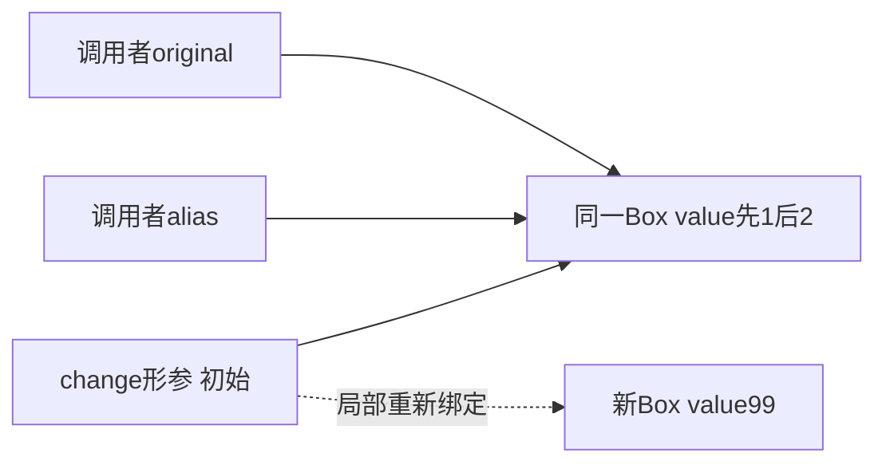
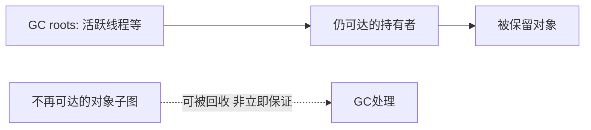

# 05 · 内存与对象模型

## 章节范围与先修

先完成[编译执行](04-compile-and-run.md)。本章讲对象身份、引用和资源责任，不是完整Java Memory Model并发规范；happens-before、volatile与锁在后续并发章展开。源码为[MemoryLab](../../examples/java-basics/runtime-lab/src/main/java/dev/javafornestjs/runtime/MemoryLab.java)与[TS参照](../../examples/nestjs-reference/src/runtime/memory-lab.ts)，命令、固定输出和调试步骤见[基础实验](../../examples/java-basics/runtime-lab/FOUNDATIONS.md)。实测与独立审查见[P2-01](../progress/P2-01.md)。

## 知识点

### ch05-kp01 · 值复制、别名与形参重新绑定

#### 1. 一句话定义

Java始终按值传参：基本类型复制其值，引用类型复制引用值；共享对象修改可见，形参重新绑定不会改写调用者变量。

#### 2. 为什么需要它

函数内`box.value=2`影响外部，但`box=new Box(99)`没有替换外部对象；把这两种动作都叫“传引用”会产生错误直觉。

#### 3. 生活类比

| 角色/动作 | 技术对象 | 失效条件 |
|---|---|---|
| 两张写着同一柜号的纸 | 两个引用值指向同一对象 | 引用不是可做地址算术的裸指针 |
| 修改柜内物品 | 修改共享对象字段 | 并发下还需考虑可见性/同步 |
| 改自己纸上的柜号 | 形参重新绑定 | 不会改调用者手中的纸 |

#### 4. Node.js / TypeScript / NestJS 技术对照

部分可比：JS对象参数同样可共享修改，局部重新绑定不会重写调用者变量。Java基本类型与引用类型有静态区分，JS number不等于Java int；本例只比较1、2、99，不推广数值范围、溢出或对象布局。

#### 5. 两端代码对照

两端observe先令primitive=1、box.value=1，change内部将primitive改99、共享字段改2，再将形参改绑到value99的新对象。返回调用者后必须primitive=1、shared=2。Java[MemoryLabTest](../../examples/java-basics/runtime-lab/src/test/java/dev/javafornestjs/runtime/MemoryLabTest.java)及TS[memory-lab.test.ts](../../examples/nestjs-reference/src/runtime/memory-lab.test.ts)直接断言固定结果；不是只比较两端碰巧一致。运行README中的Maven verify、examples:build/test和foundations:verify。

#### 6. 原理与流程图

虚线是同一形参后续换向，不是一个变量同时指两个对象。primitive副本独立于调用者的1。

#### 7. 类比边界与错误直觉

“引用值被复制”不等于对象被深拷贝，也不等于对象参数按引用传递。图描述语言语义，未保证对象物理地址或优化后的存储位置。局部副本、共享对象和线程安全是三个不同问题。

#### 8. 企业应用场景与选型

DTO在多层传递时，修改嵌套对象可能影响上游缓存；若要隔离，应明确复制策略或不可变设计。只把局部变量设final不能阻止它指向的可变对象被修改。

#### 9. 常见错误与排查

| 错误 | 观察 | 修复/回归 |
|---|---|---|
| 以为赋值alias会深拷贝 | 两引用读到同一字段修改 | 显式复制所需层级并验证独立性 |
| 以为形参new会替换外部 | 外部仍读到旧对象的2 | 返回新值并由调用者赋值 |

#### 10. 实操练习与验收

基础题：先预测1/2再运行。迁移题：用TS经验解释共享修改与重新绑定。思考题：给alias加final能禁止value修改吗？验收：回答不能并指出final约束引用赋值，不声称它提供线程同步。

完成后查看提示

先画变量到对象的箭头，再分别模拟修改对象和移动局部箭头；不要把两个动作合并。

### ch05-kp02 · 身份相等、内容相等与字符串

#### 1. 一句话定义

Java引用的==比较身份，equals按类型的实现定义相等；String的equals比较内容，不能用偶然的字符串共享推导通用规则。

#### 2. 为什么需要它

TS开发者习惯用===比较字符串内容，迁到Java后同样写==，在字面量例子中似乎正确，接收真实输入时却失败。

#### 3. 生活类比

| 对照 | 技术对象 | 失效条件 |
|---|---|---|
| 是不是同一本册子 | 引用身份 | 身份不是内容 |
| 册子文字是否相同 | String.equals | 普通类不一定覆盖equals，业务相等规则各异 |

#### 4. Node.js / TypeScript / NestJS 技术对照

无直接等价物：Java String是不可变对象，JS字符串是原始值。本例TS用两个不同对象的text字段演示“对象身份false、文本相等true”，只是相关问题模型，不能声称JS string就是Java String引用或两端字符串驻留相同。

#### 5. 两端代码对照

MemoryLab用两个`new String(char[])`确保两个不同String对象，==必须false、equals必须true；TS用两个对象包装同样的`'ok'`，对象===为false、text===为true。固定四元组1/2/false/true由两端测试断言。不要把Java例子改为两个相同字面量后仍要求身份false，因为那改变了实验条件。

#### 6. 原理与流程图

两个引用→两个String实例→内容都为ok；==只观察两个引用是否指同一实例，equals执行String内容比较。文字链路足够，不把String内部存储格式画成跨版本保证。

#### 7. 类比边界与错误直觉

String不可变不表示引用变量不能重新赋值。equals也不是所有类型的深度比较；数组的默认equals不按元素内容比较。null引用调用equals会失败，需要按业务语义选择非空保证或Objects.equals。

#### 8. 企业应用场景与选型

状态码、权限名、外部输入的字符串通常按内容比较。实体相等则需结合标识、持久化状态与集合规则设计，不能把String的实现当作所有领域对象的默认约定。

#### 9. 常见错误与排查

| 症状 | 根因 | 回归 |
|---|---|---|
| 本地字面量相等，接口输入却不相等 | 用==比较内容 | 用独立构造同内容对象的负例验证 |
| 用equals比较数组仍失败 | 默认数组身份语义 | 根据一维/嵌套场景选Arrays比较并测试 |

#### 10. 实操练习与验收

基础题：解释false/true。迁移题：为什么Java String==不能照抄TS string===？思考题：自定义Box两个字段相同就一定equals吗？验收：指出需查看是否覆盖equals，不使用字符串字面量的偶然共享证明内容比较。

完成后查看提示

先问比较身份还是业务值，再问该类型如何定义equals。Map键还需遵守equals/hashCode契约，留给集合章。

### ch05-kp03 · 堆、栈与GC可达性

#### 1. 一句话定义

调用帧保存执行中的局部状态，对象可能由多处引用持有；GC依据可达性管理内存，不按离开某个函数就立即销毁对象。

#### 2. 为什么需要它

函数结束但对象仍在缓存中，内存不会因此自动释放；反之累计分配量超过堆上限也未必OOM，因为对象可能已可回收。

#### 3. 生活类比

| 对照 | 技术对象 | 失效条件 |
|---|---|---|
| 当前办事窗口记录 | 调用帧/局部状态 | 不保证所有局部量物理放在栈上 |
| 仍有有效领取凭证的仓物 | 从GC roots可达的对象 | 不是引用计数；循环引用不必然泄漏 |

#### 4. Node.js / TypeScript / NestJS 技术对照

部分可比：两端均有自动内存管理，长期容器引用都可能延长对象存活。V8与HotSpot的堆组织、优化、暂停策略不同；JS闭包可以捕获状态，Java也可经对象/闭包持有，不从语法局部作用域推导回收时刻。

#### 5. 两端代码对照

[RuntimeLab](../../examples/java-basics/runtime-lab/src/main/java/dev/javafornestjs/runtime/RuntimeLab.java)的allocate循环累计分配64MiB，每次只由allocationSink保留最后256KiB。现有runtime:verify以16~32MiB堆及SerialGC运行，要求观察young GC与完成输出。TS参照只用MemoryLab的局部/共享引用解释存活，不伪造V8与SerialGC同构日志。此处复用第02章真实GC实验，没有新增“几毫秒必回收”的测试。

#### 6. 原理与流程图

这是可达关系图，不是分代布局；JIT逃逸分析可能改变物理分配方式，不能用“对象必在堆、变量必在栈”代替语言语义。

#### 7. 类比边界与错误直觉

GC不保证及时关闭文件、连接、线程或外部事务。设置null只移除一个引用，其他持有者可能仍在。System.gc不是确定回收时点的证明；Java try-with-resources解决的是确定性资源关闭，不能与GC混同。

#### 8. 企业应用场景与选型

排查泄漏先查缓存、监听器、线程局部变量等保留链，再结合堆证据和负载。没有证据就增大-Xmx可能只是延迟失败；堆dump可能含敏感业务数据，需要受控保管。

#### 9. 常见错误与排查

| 错误直觉 | 反例/证据 | 回归 |
|---|---|---|
| 累计64MiB分配一定超过32MiB堆 | 仅少量存活可经历GC后完成 | 运行受控分配而非只算累计字节 |
| null就关闭连接 | GC不等于资源关闭 | 使用显式生命周期并验证close |

#### 10. 实操练习与验收

基础题：画出allocationSink最后保留什么。迁移题：说明Node缓存与Java缓存共有的保留风险。思考题：循环引用是否必然泄漏？验收：运行runtime:verify并区分累计分配、存活内存和资源关闭，不从日志推导回收所有对象。

完成后查看提示

问“谁还持有它”优先于“离开哪个花括号”；内存释放与外部资源责任分开验证。

### ch05-kp04 · 类加载与初始化不是对象创建

#### 1. 一句话定义

加载类、执行类初始化与创建实例是不同事件，读取字节码或取得Class不等于已执行所有业务初始化。

#### 2. 为什么需要它

看到class文件存在就以为静态配置一定初始化成功，会在首次真正使用类型时遭遇初始化异常；把每次new都当重新初始化类也会误判共享状态。

#### 3. 生活类比

| 动作 | 技术对象 | 边界 |
|---|---|---|
| 找到设备图纸 | 加载类 | 类身份还与定义加载器相关 |
| 一次开机准备 | 类初始化 | 不是每个实例都重新执行静态初始化 |
| 生产一个产品 | 构造实例 | 对象构造失败与类初始化失败不同 |

#### 4. Node.js / TypeScript / NestJS 技术对照

部分可比：JS模块求值与缓存能帮助理解“代码可用”和“初始化副作用”，但Java加载/链接/初始化规则与Node ESM/CJS规则不同。Java类不是Nest Provider，static初始化不是onModuleInit的同义词。

#### 5. 两端代码对照

[InitializationLab](../../examples/java-basics/runtime-lab/src/main/java/dev/javafornestjs/runtime/InitializationLab.java)在新进程中先取得Lazy.class，再两次读取非编译期常量Lazy.VALUE。foundations:verify固定断言`INITIALIZATIONS=0,1;VALUES=42,42;TYPE=Lazy`：class字面量后尚未初始化Lazy，第一次主动读取初始化一次，第二次不重做。MemoryLab另实际new Box，区分类初始化与对象创建。TS参照的observeMemory是函数，导入含函数声明的模块与调用该函数也不同；不声称这就是Java初始化规则。完整触发规则仍以JLS12.4为准。

#### 6. 原理与流程图

加载→链接（验证/准备/解析规则）→初始化→特定实例构造，是帮助定位事件的概念顺序；解析可按实现及规范条件延迟。文字足够，不能把每一次方法调用都画成重新走完整加载流程。

#### 7. 类比边界与错误直觉

类名相同但定义加载器不同，类身份可能不同。类初始化也有失败和并发规则；“static只跑一次”要限定具体类身份/加载器生命周期，不能扩写为整个分布式系统只跑一次。

#### 8. 企业应用场景与选型

避免在static块内承担不可控网络调用或依赖启动顺序的业务装配；需要可测试生命周期时使用明确启动过程。插件隔离需识别加载器边界，不凭类名字符串做类型安全判断。

#### 9. 常见错误与排查

| 现象 | 核查 | 回归 |
|---|---|---|
| 首次调用时初始化失败 | 异常cause与static初始化逻辑 | 新进程重现，修复原始原因 |
| 同名类转换失败 | 定义加载器与依赖重复 | 对齐加载边界，不只改强制转换 |

#### 10. 实操练习与验收

基础题：区分class产物、类型初始化、Box实例。迁移题：解释static块为何不等于Nest模块Hook。思考题：多JVM是否共享同一次static初始化？验收：回答不共享，并说明每个进程及加载器边界；本章不声称已经实现插件隔离实验。

完成后查看提示

把“类身份的一次初始化”与“许多对象的构造”“多个应用进程”分别画出来。

## 章末验收与审查记录

固定语义用双端测试验证，GC用受控真实进程日志，类初始化用独立进程断言字面量/主动读取差异，并按官方来源核对范围。四点各十段，作者证据见[P2-01](../progress/P2-01.md)，分轴评分见[独立审查](../reviews/P2-01.md)，当前in_review。

## 参考资料与变更

2026-11-10参考：[JLS21变量与类型](https://docs.oracle.com/javase/specs/jls/se21/html/jls-4.html)、[JLS21类初始化](https://docs.oracle.com/javase/specs/jls/se21/html/jls-12.html#jls-12.4)、[JVMS运行时区域](https://docs.oracle.com/javase/specs/jvms/se21/html/jvms-2.html#jvms-2.5)、[String API](https://docs.oracle.com/en/java/javase/21/docs/api/java.base/java/lang/String.html)。图示为语义模型，不构成具体JVM布局保证。
