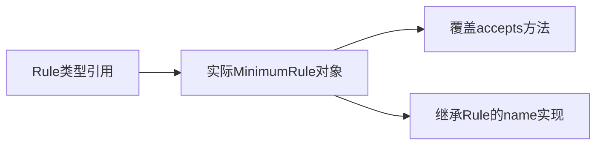

# 07 · 类、接口、record与sealed

## 章节范围与先修

先阅读[类型系统](06-type-system.md)。本章不讨论DI容器；对象模型本身不需要Spring。完整Java定义与TS参照在[语言实验](../../examples/java-basics/language-lab/README.md)，运行与审查记录见[P2-02](../progress/P2-02.md)。

## 知识点

### ch07-kp01 · 封装与名义接口

#### 1. 一句话定义

Java类通过访问控制保护内部状态，接口实现通常需要声明implements，不因方法形状碰巧相同就自动成为该接口类型。

#### 2. 为什么需要它

TS接受一个含name方法的普通对象传入Named参数；将同样的“鸭子类型”直觉用于Java会导致编译失败。

#### 3. 生活类比

| 元素 | 对应 | 失效条件 |
|---|---|---|
| 声明持证参与 | implements接口 | 不代表业务行为自动正确 |
| 只开放服务窗口 | public API与private状态 | 封装不是安全授权边界 |

#### 4. Node.js / TypeScript / NestJS 技术对照

部分可比：TS接口主要按结构检查，Java接口具名义约束。TS private/protected成员会影响类兼容性，不能概括成“TS所有类型完全结构化”；Java反射也不是正常业务访问控制的替代路径。

#### 5. 两端代码对照

TS[NameOf](../../examples/nestjs-reference/src/language/language-lab.ts)接受对象字面量`{ name: () => 'n' }`，运行测试返回n。Java[CompilationTest](../../examples/java-basics/language-lab/src/test/java/dev/javafornestjs/language/CompilationTest.java)定义形状相同但未implements的LooksNamed，赋给Named必须命中类型不兼容诊断。正例Rule明确implements Named，生产模块真实编译通过。

#### 6. 原理与流程图

声明类型关系→编译检查可赋值性→运行时调用实现。语言层次关系不同于Nest Provider导出或Spring扫描；此链路简单，用文字分层即可。

#### 7. 类比边界与错误直觉

接口只约束签名，不自动执行权限、校验或实现正确性。private限制一般源码访问，不应保存“反射绝不可能触及”的安全假设；业务秘密应通过真正安全机制保护。

#### 8. 企业应用场景与选型

接口适合表达可替换的业务能力，封装让不变量在构造/方法入口集中维护。不要为每个无替换需求的类机械创建同名接口，也不要暴露可变内部集合让调用者绕过不变量。

#### 9. 常见错误与排查

方法名字一样却不能赋值，先核对implements与签名，而非强制转换；强转不会给对象补出接口实现。修复后跑真实正负编译测试。

#### 10. 实操练习与验收

基础题：运行名义类型负例。迁移题：解释TS对象字面量为何可传而Java失败。思考题：接口能否证明业务不变量？验收：能区分类型合约、行为测试与访问控制。

完成后查看提示

“有这个方法”与“属于这个声明的类型关系”是两种不同的可赋值规则。

### ch07-kp02 · 继承、抽象类与多态

#### 1. 一句话定义

抽象类可共享状态和部分实现，多态根据实际对象选择覆盖方法；继承必须表达可替换关系。

#### 2. 为什么需要它

将所有重复代码都靠继承合并，容易把业务角色绑死；反之只看引用声明类型，又会误判运行时选择了哪个方法。

#### 3. 生活类比

| 元素 | 对应 | 边界 |
|---|---|---|
| 统一规则入口 | Rule抽象能力 | 统一签名不保证遵守业务可替换性 |
| 某种具体检查员 | MinimumRule覆盖实现 | 静态方法/字段不按同样规则动态分派 |

#### 4. Node.js / TypeScript / NestJS 技术对照

部分可比：TS class也支持继承和覆盖；Java单类继承与多接口实现、构造链和可见性细节不能照抄JS原型机制。函数参数也可表达策略，不一定需要继承体系。

#### 5. 两端代码对照

TS参照以Named函数能力传给nameOf，不强行创建相同继承层次。Java[LanguageLab](../../examples/java-basics/language-lab/src/main/java/dev/javafornestjs/language/LanguageLab.java)的Rule持有label，MinimumRule覆盖accepts；测试用Rule引用持有MinimumRule(10)，name为minimum、accepts(10)为true。代码刻意区分“可对照的能力”与“相同内部类层次”。

#### 6. 原理与流程图

构造时先建立父类状态；调用时选实际覆盖方法，不是复制一份父对象来执行。

#### 7. 类比边界与错误直觉

继承不是DI；创建对象仍需构造或外部装配。父类构造器中调用可覆盖方法可能过早触及未完成初始化的子类状态，不能据此搭建安全初始化流程。

#### 8. 企业应用场景与选型

只有稳定的is-a关系且可维护替换语义时使用继承；规则组合或第三方扩展常用接口/函数与组合。继承的共享实现也形成耦合，改变父类必须回归调用方。

#### 9. 常见错误与排查

误写重载而非覆盖时，加@Override让编译器核对；行为仍错误则用父类型引用运行测试，不只直接调用子类来掩盖契约问题。

#### 10. 实操练习与验收

基础题：解释同一Rule引用的name与accepts来源。迁移题：何时用函数策略取代抽象类？思考题：父构造器调用覆盖方法有什么风险？验收：画出实际对象和方法选择，不把继承图当容器依赖图。

完成后查看提示

复用代码不是继承的充分理由；先检查调用者是否仍能按父契约使用替代对象。

### ch07-kp03 · record的值语义与浅不可变

#### 1. 一句话定义

record为组件声明生成访问器及equals/hashCode等成员，组件引用不可重新赋值，但引用到的对象不自动深度不可变。

#### 2. 为什么需要它

把record当作“深冻结DTO”，随后从roles列表外部修改权限，可能破坏快照和HashMap键的稳定性。

#### 3. 生活类比

| 元素 | 对应 | 边界 |
|---|---|---|
| 固定栏目表单 | record组件 | 固定的是栏目引用，不是全部嵌套内容 |
| 收件时复印附件 | 本例List.copyOf | 只满足字符串元素的边界，不是任意深拷贝 |

#### 4. Node.js / TypeScript / NestJS 技术对照

无直接等价物：TS type/Readonly仅静态约束，Object.freeze默认浅冻结；Java record有真实运行时类与生成相等方法。两端可实现同一快照契约，但机制不同。

#### 5. 两端代码对照

TS account显式复制roles并冻结数组/对象；Java Account紧凑构造器检查id并List.copyOf。测试先传reader列表，再向原列表加入admin，已创建Account仍只含reader；Java访问器返回列表写入会抛UnsupportedOperationException。Java编译负例另验证record不能被继承。此处roles仅字符串，未声称深冻结嵌套对象。

#### 6. 原理与流程图

输入可变列表→构造器验证并复制→record保存新快照引用→访问器暴露该受限视图。输入变更不再改写快照；流程直接，用文字足够。

#### 7. 类比边界与错误直觉

record不自动校验非空或格式；equals组件中若包含数组，也不会自动递归按数组内容比较。Java相等性与JS对象引用键差别在下一章继续验证。

#### 8. 企业应用场景与选型

不可变值对象、返回模型或消息快照可用record；具有复杂身份/可变生命周期的实体需要另行设计。不要仅为少写getter就忽略集合复制与敏感字段暴露。

#### 9. 常见错误与排查

record内部集合变了，先查构造时是否复制、元素是否仍可变；修复后保留“改变输入”和“尝试改变返回集合”两条回归，而非只测字段值。

#### 10. 实操练习与验收

基础题：运行角色列表快照测试。迁移题：解释Readonly、freeze、record分别保证什么。思考题：roles改为可变Role对象后还保证哪些性质？验收：指出仍可能共享元素，不能宣称全图不可变。

完成后查看提示

区分引用固定、容器不可修改、元素不可变、深快照四层承诺。

### ch07-kp04 · sealed封闭层次与穷尽分支

#### 1. 一句话定义

sealed限制直接子类型，配合模式switch可让编译器检查已知变体的分支覆盖。

#### 2. 为什么需要它

新增一种支付方式却没有更新处理逻辑，普通字符串分支可能静默落入默认分支；类型层次可以将这类遗漏尽早暴露。

#### 3. 生活类比

| 元素 | 对应 | 边界 |
|---|---|---|
| 列明准入名单 | permits | 不是用户权限名单 |
| 各类别都要安排工位 | 穷尽switch | null与外部输入仍需单独约束 |

#### 4. Node.js / TypeScript / NestJS 技术对照

部分可比：TS判别联合配合never检查也能约束静态分支；Java sealed是真实名义层次，TS联合不会在运行时阻止外部JSON带未知kind。两端仍需运行校验。

#### 5. 两端代码对照

TS Payment联合分card/cash并在default赋never；Java Payment只permits Card/Cash，describe用Java21模式switch。共同输出card:1234、cash:20由两端测试断言；Java额外编译夹具加入未许可B实现，要求真实sealed诊断，而不是只检索源码关键字。

#### 6. 原理与流程图

声明允许的类型→编译核对继承资格→switch按实际变体解构→返回描述。简单决策文字即可；不把sealed图误作业务状态转换图。

#### 7. 类比边界与错误直觉

允许的子类可以按规则再次sealed、final或non-sealed，封闭程度不能脱离声明分析。本例两个record是final，不代表所有sealed层次都永久封闭到叶节点。

#### 8. 企业应用场景与选型

稳定的结果类型、命令或领域变体适合封闭建模；第三方自由扩展的插件接口可能不适合。对外协议仍需考虑版本演进及未知值处理。

#### 9. 常见错误与排查

新增变体后编译失败，应补齐明确语义而非随手加default吞掉遗漏；外部未知数据应在反序列化/验证入口处理，不能假设TS联合自动拦截。

#### 10. 实操练习与验收

基础题：运行两个支付描述。迁移题：比较never穷尽检查与permits。思考题：何时应允许non-sealed扩展？验收：能说明封闭集合与扩展性代价，负例命中预期编译诊断。

完成后查看提示

封闭的是声明层次，不是业务授权；类型穷尽也不能代替输入校验。

## 章末验收与审查记录

四知识点逐点完成十段式；类型负例、值快照和支付分支均有真实测试。当前draft，待[P2-02](../progress/P2-02.md)独立审查。

## 参考资料与变更

2026-11-10参考：[JLS21类与record](https://docs.oracle.com/javase/specs/jls/se21/html/jls-8.html)、[JLS21接口](https://docs.oracle.com/javase/specs/jls/se21/html/jls-9.html)、[TS类型兼容](https://www.typescriptlang.org/docs/handbook/type-compatibility.html)。
