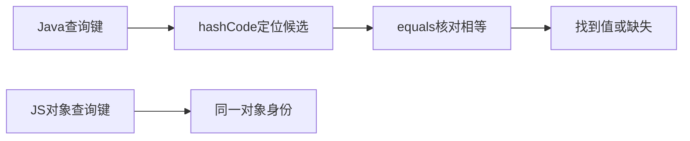

# 09 · 集合、相等性与键设计

## 章节范围与先修

先读[record与接口](07-classes-and-records.md)及[泛型](08-generics.md)。完整代码、命令见[语言实验](../../examples/java-basics/language-lab/README.md)。本章不做数据结构微基准，不将某实现的平均复杂度当作所有负载下的耗时保证。

## 知识点

### ch09-kp01 · List与集合快照

#### 1. 一句话定义

List表达有序、可重复序列；是否允许修改、null和共享元素取决于具体构造与实现。

#### 2. 为什么需要它

把入参列表直接存进缓存，调用者后续修改可能影响已有业务对象；接口类型List本身没有替你提供快照。

#### 3. 生活类比

| 元素 | 对应 | 失效条件 |
|---|---|---|
| 有编号的名单 | List顺序与重复 | 不表示索引访问对所有实现都同样便宜 |
| 留存副本 | 本例List.copyOf | 元素引用仍可能共享，不是全图深复制 |

#### 4. Node.js / TypeScript / NestJS 技术对照

部分可比：JS Array与List均可处理序列，但JS稀疏数组、长度行为和Java实现规则不同。TS readonly是静态承诺，不会自动冻结数组；本例需显式复制并冻结。

#### 5. 两端代码对照

TS account对roles做展开复制及Object.freeze；Java snapshot/Account使用List.copyOf。测试复制reader/admin后清空原列表，快照仍保留原值，写入Java快照抛UnsupportedOperationException。两端完整源码在[LanguageLab](../../examples/java-basics/language-lab/src/main/java/dev/javafornestjs/language/LanguageLab.java)及[TS参照](../../examples/nestjs-reference/src/language/language-lab.ts)，输出按固定列表而非两端互相比对断言。

#### 6. 原理与流程图

输入容器→按顺序复制元素引用→返回不可修改容器；原容器结构变更不传播，但共享可变元素仍可改变。链路短，文字可完整表达。

#### 7. 类比边界与错误直觉

List.of/copyOf不允许null，且不是“所有List都不允许null”。不可修改视图、不可修改快照、不可变元素是不同性质；别把Collections.unmodifiableList对原列表的包装当作本例快照。

#### 8. 企业应用场景与选型

事件载荷、缓存返回、权限角色清单应明确是否允许调用者修改。大数据快照有复制成本，应结合访问频率与隔离需求选择，不一律深拷贝。

#### 9. 常见错误与排查

UnsupportedOperationException先查返回容器契约，别盲目改成可变集合消除错误；共享状态污染则追踪原容器及元素持有链。用改变输入后的回归验证真正隔离。

#### 10. 实操练习与验收

基础题：复制后清空原列表。迁移题：比较TS readonly与Java不可修改List。思考题：元素换成可变对象会怎样？验收：说清结构快照与深快照差别，运行输入变化/输出写入两条测试。

完成后查看提示

不变量要覆盖输入别名与输出别名两端，不能只隐藏字段名。

### ch09-kp02 · Set、Map与相等性契约

#### 1. 一句话定义

Java常见哈希集合依据equals/hashCode判等，JS Map/Set的对象键按身份区分；同内容对象不一定是同一个键。

#### 2. 为什么需要它

Java record可用新建的相等键查到记录；同样新建JS对象查询Map却返回undefined，迁移去重逻辑会悄悄改变结果。

#### 3. 生活类比

| 元素 | 对应 | 失效条件 |
|---|---|---|
| 按登记信息识别同一条目 | Java值键equals | 普通类默认可能仍按身份 |
| 按同一张领取凭证识别 | JS对象键身份 | JS原始值键有其自身相等规则 |

#### 4. Node.js / TypeScript / NestJS 技术对照

部分可比：双方都有Map/Set，但名称相同不代表键规则相同。JS使用SameValueZero比较键，原始字符串按值；Java HashMap对相等对象要求相同hashCode，哈希相同不代表equals相同。

#### 5. 两端代码对照

Java测试以Account(u1,reader)作键，另建相等Account查询得到20，Set大小1。TS两个同内容Account对象查询为undefined，Set大小2；规范化到id字符串后可查询到20。源码测试刻意分别断言不同结果，不用“同题”掩盖不同键语义。

#### 6. 原理与流程图

图只是查找概念模型，不是HashMap全部桶/树化实现图。

#### 7. 类比边界与错误直觉

覆盖equals必须同时维护hashCode契约。作为哈希键的相等相关状态在存储期间应稳定；record含可变组件也可能破坏稳定性。不要用toString作为通用键编码，它未必无歧义或稳定。

#### 8. 企业应用场景与选型

去重、幂等、缓存键要明确业务标识范围。示例id字符串适合其小模型，生产多租户键还需包含租户等维度；不能仅按显示名称去重。

#### 9. 常见错误与排查

Map查不到先检查比较规则、hashCode及键是否变过；不要仅打印两个对象字段相同就断言集合坏了。回归使用独立构造的相等/不相等键，并验证业务标识范围。

#### 10. 实操练习与验收

基础题：预测两端Set大小1/2。迁移题：为什么字符串规范化会改变JS查找？思考题：hashCode相同能否直接视为相等？验收：回答不能，并说明equals决定最后判等。

完成后查看提示

先定义“业务上同一条”，再选择值键或身份键；容器不会替你设计身份。

### ch09-kp03 · HashMap选型、顺序与并发边界

#### 1. 一句话定义

HashMap是常用哈希键值实现，不保证迭代顺序，也不自动保证多线程复合操作原子性。

#### 2. 为什么需要它

JS Map保留插入顺序的经验直接迁到HashMap，可能使接口返回顺序不稳定；把get再put当成原子更新则可能丢失结果。

#### 3. 生活类比

| 元素 | 对应 | 失效条件 |
|---|---|---|
| 按索引归档柜 | 哈希查找 | 冲突、负载和键质量影响代价 |
| 归档不承诺参观顺序 | HashMap迭代 | 若需顺序应另选契约 |

#### 4. Node.js / TypeScript / NestJS 技术对照

部分可比：JS Map插入顺序与Java LinkedHashMap更接近，但删除/重插、并发和相等性仍须分别分析。TreeMap需要有序键规则，ConcurrentHashMap解决部分并发访问需求，不能一律替换所有Map。

#### 5. 两端代码对照

TS测试Map以指定字符串取值，不依赖Java迭代顺序；JavaLanguageLab.lookup同样按键查20，测试不对HashMap打印次序做断言。并发复合更新的真实丢失更新模型复用[RuntimeLab](../../examples/java-basics/runtime-lab/src/main/java/dev/javafornestjs/runtime/RuntimeLab.java)，不谎称本例已经对所有Map并发方法做基准。

#### 6. 原理与流程图

键分布/负载→冲突处理→查找代价；业务读取后再写入之间存在交错窗口。顺序、原子性与查找性能是三个维度，文字列明比一个“快”的标签准确。

#### 7. 类比边界与错误直觉

平均常数查找不表示最坏情况或网络接口整体耗时恒定。换ConcurrentHashMap也不能自动把跨多个键的业务规则变成事务；应分析原子方法或外部同步边界。

#### 8. 企业应用场景与选型

接口输出排序应显式排序或使用有序契约；本地缓存应限制容量与生命周期。不能把ConcurrentHashMap当Redis分布式共享状态，跨进程问题属于另一层。

#### 9. 常见错误与排查

测试只在某机器顺序稳定就通过，会把实现偶然性锁成错误规范；用明确业务排序测试替代。并发错误要控制交错并核对原子操作，不用sleep碰运气。

#### 10. 实操练习与验收

基础题：说明为什么查值测试没有比较打印顺序。迁移题：JS Map有序经验如何迁移？思考题：ConcurrentHashMap能否保证跨键转账原子？验收：回答不能，指出需要更高层一致性边界。

完成后查看提示

先列顺序、键相等性、修改能力、并发及容量要求，再选实现。

## 章末验收与审查记录

当前in_review，快照与值键/身份键有真实正反例；HashMap性能/全部并发API未做实测。证据与独立审查见[P2-02](../progress/P2-02.md)。

## 参考资料与变更

2026-11-10参考：[Collections API](https://docs.oracle.com/en/java/javase/21/docs/api/java.base/java/util/package-summary.html)、[HashMap](https://docs.oracle.com/en/java/javase/21/docs/api/java.base/java/util/HashMap.html)、[MDN Map](https://developer.mozilla.org/en-US/docs/Web/JavaScript/Reference/Global_Objects/Map)。
