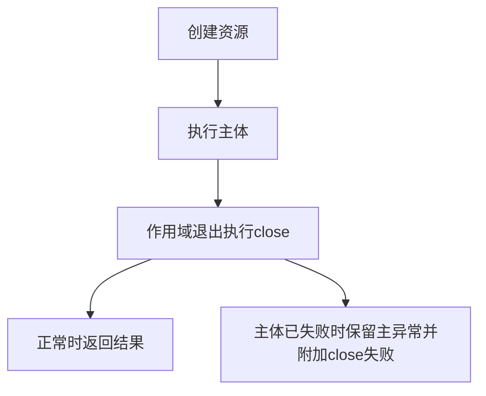

# 11 · 异常、资源关闭与注解

## 章节范围与先修

先读[类与接口](07-classes-and-records.md)。本章不引入Web异常映射或安全框架；异常类别、资源责任和元数据读取先独立验证。[语言实验README](../../examples/java-basics/language-lab/README.md)给出两端完整代码与运行命令，证据见[P2-02](../progress/P2-02.md)。

## 知识点

### ch11-kp01 · checked、unchecked与因果链

#### 1. 一句话定义

Java对受检异常要求捕获或声明；运行时异常通常无此编译要求，异常类别不自动决定业务恢复或事务策略。

#### 2. 为什么需要它

JS函数签名通常不要求声明可能throw哪些Error，直接迁到Java调用IO方法时可能无法编译；为了变绿吞掉异常会丢失真实失败。

#### 3. 生活类比

| 元素 | 对应 | 边界 |
|---|---|---|
| 流程明确签收的故障单 | checked编译要求 | 签收不等于有能力恢复 |
| 未要求签收仍可能发生的故障 | unchecked | 不是都可忽略，也不都是程序员错误 |

#### 4. Node.js / TypeScript / NestJS 技术对照

无直接等价物：普通TS Error没有Java checked编译约束。Java声明throws只描述类型规则，不会自动生成HTTP状态或决定Spring回滚；后者在[第27章](../05-database/27-transactions.md)另有真实实验。

#### 5. 两端代码对照

TS closeTrace可抛Error但调用方无需throws声明；Java closeTrace声明IOException。JavaCompiler负例在caller中不捕获也不声明risky的IOException，必须命中unreported.exception诊断。Future测试还核对ExecutionException.getCause保留原IllegalArgumentException与bad-input，不把包装异常的外层信息当全部原因。

#### 6. 原理与流程图

方法调用→正常返回或抛错→沿调用栈寻找适用处理器→必要时包装并保留cause。编译期先核对受检异常责任，运行时仍按异常传播处理；文字链路可明确两个阶段。

#### 7. 类比边界与错误直觉

catch Exception不等于恢复成功；捕获InterruptedException后应按上下文传播或恢复中断标记，不能任意吞掉。业务可恢复性与checked/unchecked并非严格一一对应。

#### 8. 企业应用场景与选型

在边界转换异常时保留cause，给调用者稳定错误合约，日志避免重复堆栈泛滥或敏感输入泄漏。重试前先判断幂等、超时预算和失败类型，不对所有异常循环重试。

#### 9. 常见错误与排查

只看到ExecutionException时继续读取cause链；编译报未处理异常时决定由谁承担责任，而非随意空catch。回归既检查外部可观察错误，也检查内部原始原因未丢。

#### 10. 实操练习与验收

基础题：运行受检异常编译负例。迁移题：解释TS Error为何没有同等throws约束。思考题：声明throws能否保证调用者恢复？验收：回答不能，并为重试或上抛给出明确业务理由。

完成后查看提示

异常类型、错误合约、恢复策略、事务规则是相关但独立的四个决定。

### ch11-kp02 · try-with-resources与suppressed异常

#### 1. 一句话定义

try-with-resources按作用域关闭AutoCloseable资源；当主体和close都失败时，主体异常保留，关闭异常可作为suppressed记录。

#### 2. 为什么需要它

普通finally里再次throw可能覆盖原始业务错误，导致只看见关闭失败；把连接释放寄希望于GC也会造成资源耗尽。

#### 3. 生活类比

| 元素 | 对应 | 失效条件 |
|---|---|---|
| 签借时约定归还 | AutoCloseable作用域 | close不保证一定成功或幂等 |
| 主事故附加归还事故 | suppressed异常 | 不等同cause，也不是自动重试 |

#### 4. Node.js / TypeScript / NestJS 技术对照

部分可比：普通JS try/finally能表达清理，但其再次throw会覆盖原异常。本仓库TS例采用这一明确负例，不声称已使用JS显式资源管理提案或与Java相同的suppressed协议；两端有不同语言/运行版本边界。

#### 5. 两端代码对照

TS closeTrace(false,false)返回body/close，true/true最终抛close-failure；Java同名函数使用TraceResource，true/true要求IOException消息body-failure、一个suppressed且消息close-failure。Java测试实际检查数组长度与内容，不只确认“抛了某异常”。本例是受控资源模型，未操作真实数据库连接。

#### 6. 原理与流程图

若创建资源本身失败，需要分析此前已创建资源的责任；多资源按声明逆序关闭，不由图推导外部系统回滚。

#### 7. 类比边界与错误直觉

自动关闭不等于事务提交/回滚，也不等于GC回收。资源close策略仍需遵循资源API；不要把同一个资源跨越多个并发作用域后指望局部try替你协调生命周期。

#### 8. 企业应用场景与选型

文件、流、连接等有确定关闭责任时优先作用域管理。池化连接close常表示归还池，不等同每次销毁物理连接；错误日志要保留suppressed帮助排查原始与清理失败。

#### 9. 常见错误与排查

日志只剩关闭错误时检查finally是否覆盖；修复后用主体和close同时失败的回归，而非只测正常关闭。若本身没有正确关闭协议，应先梳理所有权再包装AutoCloseable。

#### 10. 实操练习与验收

基础题：运行正常/双失败测试。迁移题：解释JS finally负例为何输出不同。思考题：关闭成功是否证明业务事务提交？验收：区分生命周期、内存和事务三类责任，能找到suppressed信息。

完成后查看提示

cause回答“由什么引起”，suppressed可回答“处理原异常时还发生了什么”，不要互相替代。

### ch11-kp03 · 注解、保留策略与反射读取

#### 1. 一句话定义

Java注解表达元数据，运行时能否读到取决于保留策略；业务行为需要编译工具、框架或代码显式解释它。

#### 2. 为什么需要它

看到@Tag或@Controller就以为语言自动执行相应业务，会混淆元数据与处理器，也会在保留策略错误时查不到注解。

#### 3. 生活类比

| 元素 | 对应 | 失效条件 |
|---|---|---|
| 表单标签 | 注解元数据 | 标签本身不执行工作 |
| 阅读标签的人员 | 反射/框架处理器 | 处理器必须存在且规则正确 |
| 是否留在存档 | Retention | SOURCE/CLASS/RUNTIME可见阶段不同 |

#### 4. Node.js / TypeScript / NestJS 技术对照

部分可比：本项目TS启用experimentalDecorators，采用legacy装饰器；装饰器函数在类定义时执行，可显式注册WeakMap元数据。Java注解不是这类函数执行。标准TS新装饰器模型与legacy也不能混为一套API，Nest反射元数据并非普通TS接口自动存在。

#### 5. 两端代码对照

TS @tag('risk')实际将TaggedRule构造函数注册到WeakMap，readTag显式读取risk，未标记类读undefined。JavaTag使用RUNTIME/TYPE，测试通过Class.getAnnotation取得value=risk。二者共同目标是读取标签，内部机制不同；本例没有注册任何鉴权、路由或代理逻辑。

#### 6. 原理与流程图

Java源码注解→编译按Retention保留→运行时反射查找→解释值；TS legacy装饰器→定义时调用注册函数→WeakMap存取。两条文字链路刻意分开，避免画成同一执行模型。

#### 7. 类比边界与错误直觉

反射可见不代表任意私有访问都合法；JPMS开放、继承注解规则与代理类也会影响读取。不能把RUNTIME注解称为自动执行的安全保障，更不能认为加注解就完成权限测试。

#### 8. 企业应用场景与选型

注解适合声明框架可解释的规则，处理器与测试要明确。反射扩展应限制扫描范围、核对启动失败和版本兼容；简单业务分支未必需要自建注解框架。

#### 9. 常见错误与排查

读取null先核对Retention、Target、查找的是原类还是代理、是否需要继承查询；TS先核对legacy/标准装饰器配置及注册是否执行。用真实标记/未标记两类对象回归。

#### 10. 实操练习与验收

基础题：读取risk与未标记结果。迁移题：说明Java注解与TS装饰器函数的差别。思考题：将Retention改为CLASS后运行时读取应如何变化？验收：基于保留规则预测不可读；未实际改动执行时不能记成已测。

完成后查看提示

声明信息、保留信息、读取信息、执行行为四步分别找证据。

## 章末验收与审查记录

当前draft。受检编译诊断、主/清理异常与运行时标签均有测试，未执行Web/鉴权框架。记录见[P2-02](../progress/P2-02.md)。

## 参考资料与变更

2026-11-10参考：[JLS异常](https://docs.oracle.com/javase/specs/jls/se21/html/jls-11.html)、[try-with-resources](https://docs.oracle.com/javase/specs/jls/se21/html/jls-14.html#jls-14.20.3)、[Retention](https://docs.oracle.com/en/java/javase/21/docs/api/java.base/java/lang/annotation/Retention.html)、[TS legacy decorators](https://www.typescriptlang.org/docs/handbook/decorators.html)。
