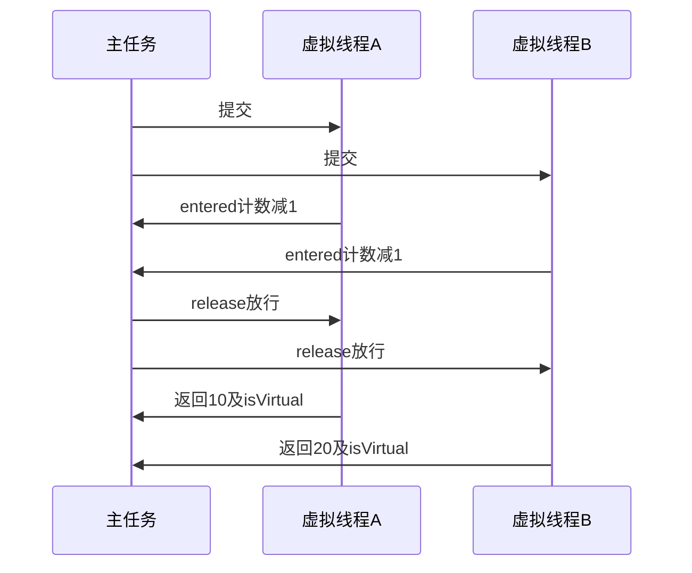

# 12 · 线程、Future与虚拟线程

## 章节范围与先修

先读[运行模型](../01-java-runtime/02-runtime-model.md)和[异常](11-exceptions-and-annotations.md)。本章使用闩锁控制交错，不通过sleep猜时序，不做生产吞吐或pinning基准。Java完整实现[ConcurrencyLab](../../examples/java-basics/language-lab/src/main/java/dev/javafornestjs/language/ConcurrencyLab.java)，TS参照与命令见[语言实验](../../examples/java-basics/language-lab/README.md)。

## 知识点

### ch12-kp01 · Thread、虚拟线程与Promise

#### 1. 一句话定义

虚拟线程是Java线程的轻量实现形式，Promise是JS异步结果机制；创建Promise不等于创建线程或CPU并行执行单元。

#### 2. 为什么需要它

把虚拟线程叫“Java Promise”会忽略阻塞调用、线程局部状态、调度和共享内存问题；反向也可能错误地期待Promise.all把CPU循环并行化。

#### 3. 生活类比

| 元素 | 对应 | 失效条件 |
|---|---|---|
| 可暂停续办的办事人员 | 虚拟线程执行栈 | 不意味着无限CPU或无成本 |
| 结果领取凭条 | Promise | 凭条不是执行人员 |
| 多份申请已受理再统一放行 | 闩锁/异步门 | 只证明受控重叠，不证明性能优越 |

#### 4. Node.js / TypeScript / NestJS 技术对照

无直接等价物：Java线程可执行同步阻塞风格，Node异步继续通常在各自JS执行环境调度；真正JS并行可用Worker但仍不是虚拟线程同构实现。虚拟线程也不应被池化来限制数量，稀缺资源容量应在资源边界控制。

#### 5. 两端代码对照

TS promiseTasks让两async函数都记录start并等待同一gate，再放行收集[10,20]；测试只证明异步继续顺序，不声称JS线程并行。JavavirtualTasks用newVirtualThreadPerTaskExecutor，两个任务各自实际调用Thread.isVirtual，计数闩锁证明两者都进入等待区后才释放。返回10/20来自各任务，不是主线程写死的伪结果；测试要求bothVirtual=true。

#### 6. 原理与流程图

返回图示不约束实际完成次序；测试按提交顺序get收集。闩锁提供明确同步，而非碰巧输出的顺序。

#### 7. 类比边界与错误直觉

轻量不代表无限数据库连接、内存或下游容量。CPU密集任务仍受核心与调度限制；JDK21与25在虚拟线程实现细节上有演进，不能从本例推广所有锁/本地调用的pinning性能结论。

#### 8. 企业应用场景与选型

大量等待型任务可评估虚拟线程，配合连接池、信号量、超时和背压；CPU任务按真实负载选并行度。迁移时先核对库兼容和线程局部状态，不只替换executor一行。

#### 9. 常见错误与排查

两任务一直进不来，检查是否在单线程平台池里都等待“另一任务进入”；资源受限应控制准入而非堆积无界任务。回归必须实际核对执行线程类型和同步条件。

#### 10. 实操练习与验收

基础题：运行bothVirtual断言。迁移题：解释Promise与Thread分别是什么。思考题：两端都得[10,20]为何不证明机制等价或更快？验收：指出执行单元、等待机制和测量范围三个边界。

完成后查看提示

结果相同只证明业务契约相符；并发能力、并行程度、容量和性能需分别测量。

### ch12-kp02 · Executor所有权与Future失败

#### 1. 一句话定义

Executor管理任务提交与执行，Future表示提交任务的结果；等待结果和关闭执行器都有明确生命周期责任。

#### 2. 为什么需要它

仅调用submit后忽略Future，任务异常可能没有以预期方式呈现；不关闭自建执行器也可能让资源或进程生命周期失控。

#### 3. 生活类比

| 元素 | 对应 | 边界 |
|---|---|---|
| 调度处 | Executor | 不替业务决定任务失败策略 |
| 可领取结果的工单 | Future | 领取会等待，不能到处无预算阻塞 |
| 承办异常附原始原因 | ExecutionException/cause | 不能只记录外层包装 |

#### 4. Node.js / TypeScript / NestJS 技术对照

部分可比：Promise与Future都可表达延迟成功/失败，但Future.get阻塞当前线程，await是JS异步继续语义。Promise并不管理Java式Executor线程池；Node Worker也需单独生命周期管理。

#### 5. 两端代码对照

TS await Promise.all得到结果，失败Promise会使相应等待拒绝，不能据此推出其他任务被自动取消。Java failureCause在单线程executor中提交抛IllegalArgumentException的任务，get得到ExecutionException后读取cause；测试核对原类型与bad-input。try-with-resources关闭本例自建executor，框架管理的共享执行器不能由任意业务方法随手关闭。

#### 6. 原理与流程图

submit→队列/调度执行→Future记录成功或失败→get等待并取值/抛包装异常→所有者关闭executor。文字链路足够，任务执行与调用者等待不是同一步。

#### 7. 类比边界与错误直觉

Future失败不表示其副作用自动回滚；关闭executor也不是任务事务。无限队列可能把压力变成长延迟和内存增长；本例少量受控任务不能证明生产容量合理。

#### 8. 企业应用场景与选型

批处理汇总需定义结果顺序、部分失败与重试边界；应用级执行器由应用生命周期统一管理。提交前考虑拒绝、容量和调用链超时预算，而非只给get加大超时。

#### 9. 常见错误与排查

异常不见时检查是否读取Future或配置统一处理；程序不退出时查执行器所有权与活跃任务。修复必须验证cause、清理及最终状态，不只增加catch打印。

#### 10. 实操练习与验收

基础题：读取bad-input原始cause。迁移题：解释get与await的等待模型差异。思考题：关闭共享执行器会影响谁？验收：明确所有者、任务失败责任和关闭时机。

完成后查看提示

“谁创建谁管理”是本例明确策略；框架托管资源应遵守框架契约，不能机械套用局部close。

### ch12-kp03 · 超时、取消与共享状态

#### 1. 一句话定义

等待超时只限制调用者等待多久，不自动取消正在执行的任务；取消、中断与业务回滚也不是一回事。

#### 2. 为什么需要它

HTTP已超时却后台仍写入，或重试产生重复结果，常源于把“我不等了”误当“工作已停止”。

#### 3. 生活类比

| 元素 | 对应 | 失效条件 |
|---|---|---|
| 客户停止等候 | get超时 | 承办人员可能仍继续 |
| 发出停止请求 | cancel/interrupt协作 | 不保证所有操作立即停止 |
| 撤销业务结果 | 事务/补偿 | 不由线程中断自动完成 |

#### 4. Node.js / TypeScript / NestJS 技术对照

部分可比：Promise.race超时通常也不自动取消底层工作；AbortSignal需调用链和库协作。Java cancel(true)涉及中断请求而非强杀，双方都不能把超时包装器当完整取消协议。

#### 5. 两端代码对照

TS gate模型显示工作在显式release前等待，不用计时器伪造取消。Java timeoutDoesNotCancel让任务进入闩锁等待，get(0,NANOSECONDS)确定抛TimeoutException；检查Future既未cancelled也未done，再finally释放门、等待42结果并关闭executor。共享状态的丢失更新/原子计数复用RuntimeLab的真实屏障测试，不把任务结束等同复合更新原子。

#### 6. 原理与流程图

任务已进入→阻塞在受控门→调用者零等待get超时→任务仍活跃→finally放行→任务完成。该顺序不靠sleep，且清理始终放行，避免测试失败后留下等待线程。

#### 7. 类比边界与错误直觉

本例只证明等待超时不取消，没有主动取消/中断实验，不能声称所有IO会响应interrupt。Future完成产生的可见性保证也不能修复任务内部已发生的非原子竞争。

#### 8. 企业应用场景与选型

长操作应结合截止时间传播、取消支持、幂等键和补偿设计。后台任务一旦产生不可撤销副作用，客户端超时后重试尤其要明确去重与结果查询。

#### 9. 常见错误与排查

超时后仍有副作用，先追踪任务是否取消、底层是否支持、是否已越过提交点；不要仅缩短超时。并发计数错误用受控交错复现，而不是循环压测后凭概率断言。

#### 10. 实操练习与验收

基础题：运行超时后仍活跃断言。迁移题：说明Promise.race为何不能通用取消底层工作。思考题：cancel成功是否自动撤回数据库提交？验收：回答不能，区分等待、执行与业务一致性三个层次。

完成后查看提示

先找超时发生在哪一层，再找停止信号如何向下传播，最后分析已经发生的副作用。

## 章末验收与审查记录

当前draft。真实虚拟线程、闩锁重叠、Future cause和超时不取消均有测试；未测生产容量、取消/中断、外部IO和pinning性能。记录见[P2-02](../progress/P2-02.md)。

## 参考资料与变更

2026-11-10参考：[Executors](https://docs.oracle.com/en/java/javase/21/docs/api/java.base/java/util/concurrent/Executors.html)、[Future](https://docs.oracle.com/en/java/javase/21/docs/api/java.base/java/util/concurrent/Future.html)、[虚拟线程JEP444](https://openjdk.org/jeps/444)、[Node Worker](https://nodejs.org/api/worker_threads.html)。
