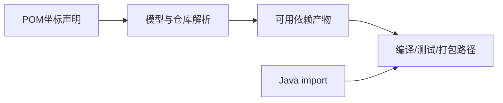

# 13 · 从pnpm到Maven

## 章节范围与先修

先读[Java编译执行](../01-java-runtime/04-compile-and-run.md)。本章使用真实greeting-core/cli和Nest工作区，不为包管理类比引入第二份业务。命令、模型生成与断言见[构建实验](../../examples/java-basics/BUILD-LAB.md)，记录见[P2-03](../progress/P2-03.md)。

## 知识点

### ch13-kp01 · 坐标、仓库与依赖声明

#### 1. 一句话定义

Maven依赖以groupId/artifactId/version等坐标标识，通过本地/远端仓库解析；源码package名不是下载坐标。

#### 2. 为什么需要它

看到Java的import便以为自动安装依赖，或将npm包名直接当Java包名，会把构建解析与编译可见性混在一起。

#### 3. 生活类比

| 元素 | 对应 | 边界 |
|---|---|---|
| 出版社/书名/版次 | group/artifact/version | 类型、classifier也可能影响产物 |
| 书库 | Maven仓库 | 本地有书不代表项目已声明依赖 |

#### 4. Node.js / TypeScript / NestJS 技术对照

部分可比：pnpm包名/版本与Maven坐标都选择依赖，但解析、发布与构建生命周期不同。Node依赖目录和Maven本地仓库也不是同样的运行加载路径。

#### 5. 两端代码对照

TS依赖声明在[Nest package.json](../../examples/nestjs-reference/package.json)及根锁文件；Java[greeting-cli POM](../../examples/java-basics/greeting-cli/pom.xml)依赖dev.javafornestjs:greeting-core:${project.version}。源码import只使用类，实际构建要由Reactor或已解析产物提供类。实验以-pl cli -am clean verify验证同一源码树的上游构建，不要求提前手工install。

#### 6. 原理与流程图

两路在编译处会合，import本身不会执行包下载。

#### 7. 类比边界与错误直觉

SNAPSHOT与发布版本的更新策略不同；本例内部SNAPSHOT由当前Reactor构建，不表示生产可以不控制版本。仓库地址、镜像与凭据属于构建环境配置，不能把凭据写进教学POM。

#### 8. 企业应用场景与选型

私有制品库需明确发布/消费权限与可追溯版本；分发共享库时应提供稳定API和版本策略。不能用复制JAR到源码目录代替可复现依赖声明。

#### 9. 常见错误与排查

找不到artifact先查坐标、仓库、网络和是否为未选中的本地模块；找不到类还需核对实际产物内容和scope。不要一律删除整个本地仓库重新下载。

#### 10. 实操练习与验收

基础题：指出core坐标与Java包名。迁移题：对比pnpm包名和Maven三段坐标。思考题：import能否替代POM？验收：完成子Reactor构建并从真实CLI JAR运行问候。

完成后查看提示

先解决产物从哪里来，再解决类从哪里加载，两者不是同一个路径配置。

### ch13-kp02 · 传递依赖与scope

#### 1. 一句话定义

直接依赖可带入传递依赖，scope等规则决定其在编译、测试、运行及下游传播中的可用性。

#### 2. 为什么需要它

只看POM写了一行JUnit，就忽略解析出的多个测试库；反之把依赖管理中的Spring条目误当core运行依赖，也会误判架构。

#### 3. 生活类比

| 元素 | 对应 | 边界 |
|---|---|---|
| 套件带附件 | 传递依赖 | optional/exclusion与scope会改变传播 |
| 仅检验室可用的工具 | test scope | 不应据此推断主业务可使用其类型 |

#### 4. Node.js / TypeScript / NestJS 技术对照

部分可比：dependencies/devDependencies与Maven scopes都有使用阶段含义，但不是一一对应表。Maven provided、runtime、test的类路径/传递规则与Node安装、打包、运行加载应分开分析。

#### 5. 两端代码对照

TS package.json把typescript放devDependencies，并由pnpm构建脚本调用。Java core仅直接声明test范围JUnit。实际dependency:tree JSON解析出8项依赖节点，均为测试用途；守卫递归拒绝core非test Spring依赖，夹具验证深层泄漏也会失败。不以在有效POM里搜到Spring字样认定运行耦合。

#### 6. 原理与流程图

直接依赖→传递图→scope/排除/可选规则→特定阶段实际类路径。文字链路强调实际图；范围传播规则有细节，具体问题用真实dependency:tree核查。

#### 7. 类比边界与错误直觉

test库不应被主源码引用；provided不表示生产环境一定正确提供实现。把scope改成compile可能消除编译错误却把不该发布的依赖带到消费者。

#### 8. 企业应用场景与选型

共享core保持框架边界，Web和数据库依赖由应用/适配层承担；测试工具保留在test范围。审查变更时同时看直接POM和解析树，避免传递泄漏。

#### 9. 常见错误与排查

编译成功但运行缺类，先核对运行scope与实际打包布局；多出框架依赖时沿JSON图找直接引入点。用产物jdeps与依赖树交叉验证，而非只读声明。

#### 10. 实操练习与验收

基础题：生成core真实依赖树。迁移题：解释为何test不能机械等于npm某个字段。思考题：provided依赖谁负责部署？验收：运行守卫并使嵌套Spring运行依赖夹具被拒绝。

完成后查看提示

声明、解析结果、实际打包与部署环境是四份相关证据。

### ch13-kp03 · 版本管理、锁文件与本地缓存

#### 1. 一句话定义

Maven版本管理规定依赖/插件的选取规则，本地仓库缓存产物；两者不等于pnpm完整依赖图锁文件或构建输出缓存。

#### 2. 为什么需要它

“我本机有JAR，所以构建可复现”忽略了缓存污染、SNAPSHOT变化与隐藏环境配置；误将BOM当锁文件也会过度承诺。

#### 3. 生活类比

| 元素 | 对应 | 边界 |
|---|---|---|
| 选版目录 | dependencyManagement/BOM | 不自动下载所有条目，也非完整锁图 |
| 已采购库存 | 本地仓库 | 库存不说明本次用了哪件 |

#### 4. Node.js / TypeScript / NestJS 技术对照

部分可比：pnpm-lock.yaml与frozen-lockfile限制安装解析漂移；Maven本例用固定版本、父管理、Wrapper与CI实际验证。普通POM不提供同一形式的完整锁图，不能说机制相同。

#### 5. 两端代码对照

TS CI执行pnpm固定版本install --frozen-lockfile。JavaWrapper固定3.9.11，根父POM固定Boot3.5.16；元数据实验固定dependency插件3.8.1、help插件3.5.1。本机使用既有TEMP仓库的-o缓存结果，CI不加-o；二者命令环境在记录中分开。实际模型与字节码由脚本核对，不凭缓存目录存在宣布通过。

#### 6. 原理与流程图

版本规则→解析图→本地命中或远端下载→构建产物。离线只禁止必要网络解析，不证明缓存是完整/可信，也不证明此前构建输出可直接复用。

#### 7. 类比边界与错误直觉

clean删除项目输出，不会清空Maven本地仓库；install写入本地仓库，不等于发布到远端。Wrapper固定Maven不固定所有JDK和环境变量。

#### 8. 企业应用场景与选型

可复现流程应控制JDK、构建工具、依赖/插件、仓库与配置来源。CI缓存用于节约下载，不能用它隐藏未声明的本地库或绕过测试。

#### 9. 常见错误与排查

本机成功CI失败时先对比实际模型和解析日志；只在必要时针对受损坐标修复缓存，不默认全量删除。下载失败与编译失败分开记录并针对性重跑。

#### 10. 实操练习与验收

基础题：说明clean/install分别写删什么。迁移题：解释BOM为何不是pnpm-lock.yaml。思考题：-o成功能否证明空环境可构建？验收：回答不能，并指出还需要无离线选项的CI证据。

完成后查看提示

缓存是优化，不是构建输入的替代声明。

## 章末验收与审查记录

当前draft，实际子Reactor、模型与产物边界证据见[P2-03](../progress/P2-03.md)；未做所有仓库认证和scope组合实验。

## 参考资料与变更

2026-11-10参考：[Maven依赖机制](https://maven.apache.org/guides/introduction/introduction-to-dependency-mechanism.html)、[POM](https://maven.apache.org/pom.html)、[pnpm install](https://pnpm.io/cli/install)。
