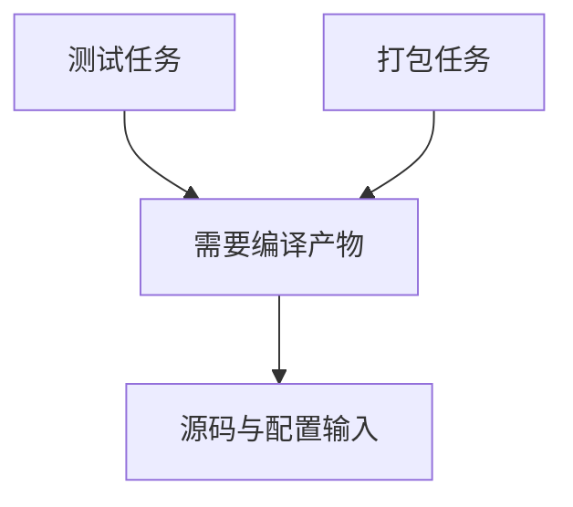

# 15 · Reactor、Gradle任务图与缓存

## 章节范围与先修

先读[POM与生命周期](14-pom-lifecycle.md)。Java主线使用Maven Wrapper；Gradle9.2.1另有[独立任务/缓存小实验](../../examples/gradle-reference/README.md)，不迁移业务构建，也不提供未经测量的性能比较。Maven实验见[BUILD-LAB](../../examples/java-basics/BUILD-LAB.md)，实际环境与结果见[P2-03](../progress/P2-03.md)。

## 知识点

### ch15-kp01 · Reactor选择与上游构建

#### 1. 一句话定义

Reactor收集选中的Maven项目并按依赖关系等规则排序，-pl选择项目，-am把所需上游项目纳入本次构建。

#### 2. 为什么需要它

只构建CLI却未提供它依赖的core，可能消费旧本地artifact或无法解析；仅按目录顺序手工构建也容易遗漏。

#### 3. 生活类比

| 元素 | 对应 | 边界 |
|---|---|---|
| 本次生产批次 | Reactor选择集 | 不是整个仓库所有项目自动执行 |
| 上游工件先完成 | 依赖排序 | 聚合清单顺序不是唯一依据 |

#### 4. Node.js / TypeScript / NestJS 技术对照

部分可比：pnpm过滤、Turbo/Nx依赖编排有相近目标，但过滤语法、任务配置与缓存模型不同。普通pnpm --filter单项目脚本不自动等于Maven -am；本仓库TS项目也没有额外内部workspace上游。

#### 5. 两端代码对照

TS用`pnpm --filter @java-for-nestjs/nestjs-reference build`选择tsc脚本。Java从根运行`mvnw -pl examples/java-basics/greeting-cli -am clean verify`，实际顺序包含根/聚合POM、core、CLI，再用CLI JAR输出Hello, NestJS!。core源码在同一Reactor提供，不能将已在本地install过旧库的成功冒充本次上游源码已重建。

#### 6. 原理与流程图

实际日志另有父/聚合项目，图只突出业务依赖主链。

#### 7. 类比边界与错误直觉

-am不构建所有下游；需要时另分析-amd。依赖关系、插件关系和排序规则应按Maven文档与实际日志核对，不能仅用文件夹层级推断。

#### 8. 企业应用场景与选型

大型仓库可按受影响模块缩小反馈范围，合并前仍跑必要整库验证。并行-T需评估插件线程安全与共享文件，不能据单模块成功就保证任意并行构建可靠。

#### 9. 常见错误与排查

选中模块失败先核对-pl路径与项目坐标、上游是否在选择集、消费的是哪版产物；修复后用clean与实际日志核验，不通过反复install掩盖依赖方向。

#### 10. 实操练习与验收

基础题：构建CLI及上游。迁移题：比较pnpm过滤与-am。思考题：为何选择一个模块不等于验证所有下游？验收：指出实际Reactor顺序和未被选中项目。

完成后查看提示

先看本次选择集，再看排序，最后看产物从哪里来。

### ch15-kp02 · 生命周期与任务图的选型差异

#### 1. 一句话定义

Maven通常围绕标准生命周期与插件绑定组织工作，Gradle以任务及其依赖构成执行图，两者都需要明确输入、输出和依赖。

#### 2. 为什么需要它

把Maven phase逐字替换成Gradle task，会忽略配置阶段、任务依赖和插件约定；把Gradle看作“随便执行脚本”也不准确。

#### 3. 生活类比

| 元素 | 对应 | 边界 |
|---|---|---|
| 标准工序路径 | Maven生命周期 | 可由插件扩展，并非完全不可定制 |
| 显式依赖工单网络 | Gradle任务图 | 插件也提供约定，不必全手工配置 |

#### 4. Node.js / TypeScript / NestJS 技术对照

部分可比：Turbo/Nx任务依赖图可帮助理解Gradle任务依赖，但缓存键、配置与执行模型不是同一协议。pnpm脚本本身只执行定义的命令，额外编排来自选用工具和配置。

#### 5. 两端代码对照

本仓库TS package scripts显式分build/test；Java POM显式绑定validate的Checkstyle与package的shade。Gradle[build.gradle](../../examples/gradle-reference/build.gradle)声明generateGreeting与依赖它的verifyGreeting，前者以learner为输入、greeting.txt为输出，后者核对文件内容。验证脚本实际dry-run要求生产任务在验证任务之前；本机真实执行输出Hello, NestJS!与改输入后的Hello, Java!。这是小型任务机制实验，不是第二套业务构建或Java编译兼容证明。

#### 6. 原理与流程图

箭头表示“依赖”，不是执行时间向前流动；图为编译/测试抽象示例，实际小实验的依赖为verifyGreeting→generateGreeting，两者由dry-run顺序断言验证，未将图示称为本仓库的Gradle Java构建。

#### 7. 类比边界与错误直觉

配置阶段与任务执行不同；把下载或写文件等副作用放配置阶段会影响可维护性与配置缓存。规则灵活不等于默认快速，约定稳定也不等于不能定制。

#### 8. 企业应用场景与选型

根据生态插件、团队熟悉程度、任务图复杂度、可维护性和测量结果选型。已有Maven工程仅为语法偏好重写Gradle，需承担依赖、发布和CI行为迁移成本。

#### 9. 常见错误与排查

任务漏依赖时，开发机已有产物可能掩盖问题；用干净环境和任务图核对。Maven插件绑定错误则按phase日志排查，两边不套用相同配置文件修复。

#### 10. 实操练习与验收

基础题：画出本仓库编译/测试/打包主链。迁移题：与TS脚本依赖顺序比较。思考题：若迁移Gradle应保留哪些外部行为？验收：至少列产物、依赖解析、测试发现、发布契约，不将画图当执行验证。

完成后查看提示

迁移目标是保留可验证的构建行为，不是仅让某个新命令退出0。

### ch15-kp03 · 下载缓存、增量检查与构建缓存

#### 1. 一句话定义

下载缓存复用依赖，增量检查决定是否重做任务，构建缓存复用匹配输入的输出；它们不是同一层优化。

#### 2. 为什么需要它

看到CI cache命中就以为测试不用重跑，或误把Maven本地仓库当Gradle build cache，会高估实际验证覆盖和提速来源。

#### 3. 生活类比

| 元素 | 对应 | 边界 |
|---|---|---|
| 库房已有原料 | 下载缓存 | 不是已制成的成品 |
| 核对工单是否变更 | 增量检查 | 输入声明不全会误判 |
| 按完整工单复用成品 | 构建缓存 | 任务需满足相应可缓存条件 |

#### 4. Node.js / TypeScript / NestJS 技术对照

部分可比：pnpm store缓存包，Turbo/Nx可另缓存任务输出；Maven本地仓库存制品，Gradle有up-to-date/build cache/configuration cache等不同机制。不能只用“缓存”两个字认定行为相同。

#### 5. 两端代码对照

本仓库CI setup-java cache:maven复用下载，仍执行clean verify；TS frozen安装后仍build/test。构建实验本机-o只证明当前下载缓存完整。另用[verify-gradle-reference.ps1](../../scripts/verify-gradle-reference.ps1)实际验证：同输入第二次UP-TO-DATE，删除唯一生成文件后FROM-CACHE且内容恢复，改learner输入后输出改变。@CacheableTask/Input/OutputFile提供本例跟踪条件；并未提供配置缓存、远端缓存或相对速度基准。

#### 6. 原理与流程图

输入/工具版本/配置→缓存键或增量判定→重用或执行→验证输出。对不受控时间、环境、网络副作用的任务，要明确哪些影响未进入输入契约；文字足够表达风险。

#### 7. 类比边界与错误直觉

错误输出也可能被缓存；命中不证明语义正确。配置缓存复用配置阶段工作，不等于所有任务输出已缓存，远程缓存还需要信任与访问控制。

#### 8. 企业应用场景与选型

先建立正确构建和基准，再优化瓶颈。下载慢与编译慢分别测量；共享缓存需保证跨分支/工具版本键合理，敏感产物不能随意发布到公共缓存。

#### 9. 常见错误与排查

清缓存才能成功时先检查缺失输入、污染或隐藏依赖，不把“每天清缓存”当正式修复。回归同时覆盖冷/热路径，并说明实际测试条件。

#### 10. 实操练习与验收

基础题：指出本仓库缓存保存什么。迁移题：比较pnpm store与任务输出缓存。思考题：缓存命中为何仍要验证正确性？验收：说清下载、配置、任务结果三类证据，不编造本轮未做的性能数据。

完成后查看提示

问复用的是哪一层、依据哪些输入、可能漏掉什么，而不是只问有没有cache。

## 章末验收与审查记录

当前in_review。Maven Reactor及Gradle任务/本地缓存小实验均有本机真实断言，跨平台新步骤另记；配置/远端缓存和速度比较未测。证据见[P2-03](../progress/P2-03.md)。

## 参考资料与变更

2026-11-10参考：[Maven多模块](https://maven.apache.org/guides/mini/guide-multiple-modules.html)、[Gradle9.2.1任务](https://docs.gradle.org/9.2.1/userguide/more_about_tasks.html)、[Gradle9.2.1构建缓存](https://docs.gradle.org/9.2.1/userguide/build_cache.html)、[ADR-0005](../adr/0005-gradle-comparison-runtime.md)。
