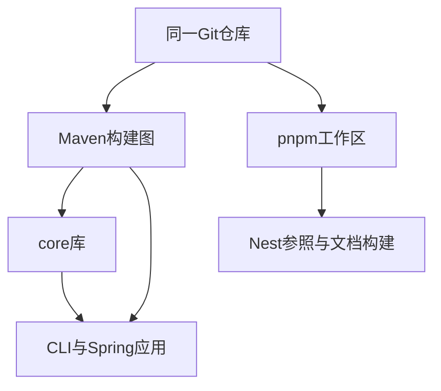

# 16 · Java Monorepo与模块边界

## 章节范围与先修

先读[Reactor与任务图](15-maven-and-gradle.md)。本章检验仓库当前示例的构建边界，不宣称毕业项目已完成。Java/TS工作区仍分别管理依赖，运行说明见[构建实验](../../examples/java-basics/BUILD-LAB.md)，证据见[P2-03](../progress/P2-03.md)。

## 知识点

### ch16-kp01 · 仓库、构建模块与部署单元

#### 1. 一句话定义

Monorepo是一种仓库组织方式，Maven模块是构建项目，部署单元由运行架构决定，三者不应混为一层。

#### 2. 为什么需要它

把每个Maven子模块当微服务，会引入多余网络和部署复杂度；把同仓库当单一运行进程，也会错误理解CLI、文档站和未来后端。

#### 3. 生活类比

| 元素 | 对应 | 边界 |
|---|---|---|
| 同一档案库 | Monorepo | 不代表全部文件编进同一程序 |
| 可单独构建的工件 | Maven模块 | 不必有main或独立部署 |
| 实际运行的设备 | 部署单元 | 可以消费多个模块产物 |

#### 4. Node.js / TypeScript / NestJS 技术对照

部分可比：pnpm workspace也组织多个包，但包、Nest module、Java package、JPMS模块和部署服务是不同概念。Gradle/Maven或pnpm不会自动替业务切出正确领域边界。

#### 5. 两端代码对照

TS Nest项目是独立workspace，Java根聚合java-basics与Spring示例；greeting-core没有main，CLI与Spring各自消费其规则。文档站又由VitePress发布。根Mavenverify与pnpm脚本各自执行，examples:verify启动三种问候运行物验证共享外部契约，而不是把所有产物打成一个包。

#### 6. 原理与流程图

图描述构建组织，不表示文档站运行时依赖Spring或Java依赖Node。

#### 7. 类比边界与错误直觉

共同发布节奏、进程隔离和数据库所有权需要另行设计；Monorepo不自动提供事务边界或运行安全隔离。模块化单体也不是“所有代码都放common”。

#### 8. 企业应用场景与选型

共享规范与跨模块原子变更可受益于Monorepo；CI需要按风险与依赖选择范围。组织和部署边界应服务业务，不因目录方便就强行合并或拆成微服务。

#### 9. 常见错误与排查

模块无main并不表示构建坏了，先判断它是库还是应用；新增目录未进Reactor/workspace时检查聚合声明，而非只看IDE是否显示。

#### 10. 实操练习与验收

基础题：分别列仓库、构建项目、可运行入口。迁移题：解释Nest module与Maven module差别。思考题：拆模块是否等于拆服务？验收：指出当前core被两个应用消费但自身不部署。

完成后查看提示

沿“源码组织→构建产物→运行进程→业务责任”逐层命名。

### ch16-kp02 · 依赖方向与无框架core

#### 1. 一句话定义

稳定业务规则不应依赖Web适配层；应用与适配层消费core，不能用共享模块掩盖反向耦合。

#### 2. 为什么需要它

把实体、DTO、SQL和Web工具全塞common，会让CLI也被迫拉起整套框架，改一个边界牵连所有消费者。

#### 3. 生活类比

| 元素 | 对应 | 边界 |
|---|---|---|
| 稳定工艺规则 | core业务能力 | 不是任意“大家都用”的杂物柜 |
| 不同接待窗口 | CLI/Web适配层 | 窗口差异不应倒灌到通用规则 |

#### 4. Node.js / TypeScript / NestJS 技术对照

部分可比：TS纯业务包也可由Nest适配器消费；共享workspace不自动保证依赖向内。import路径整齐也不证明运行依赖纯净，需要模型与产物验证。

#### 5. 两端代码对照

TS GreetingPolicy在Nest参照中由模块装配；Java GreetingPolicy是纯Java类，CLI与Spring适配层调用它。构建守卫检查core解析树无非test Spring依赖，jdeps实际JAR只有java.base；测试夹具注入嵌套运行Spring依赖时应拒绝。它验证本例可检查边界，不假称TS已拆出同构独立领域包。

#### 6. 原理与流程图

箭头表示编译依赖；同一规则可在不同入口直接调用，无须核心查容器。

#### 7. 类比边界与错误直觉

jdeps只见字节码静态依赖，不能证明全部动态反射或业务职责正确；依赖树也可能受profile/环境影响。脚本是守卫之一，不替代完整架构审查。

#### 8. 企业应用场景与选型

以稳定规则与明确接口切分，公共能力应有凝聚职责。需要外部系统时由适配器实现边界，避免为“纯净”制造层层无意义转发；本例只保留真正共享规则。

#### 9. 常见错误与排查

core泄漏框架时找直接和传递引入点；把依赖改provided并不自动消除字节码耦合。回归同时看解析图、实际产物和不同入口运行，而非只改POM颜色。

#### 10. 实操练习与验收

基础题：运行真实依赖/字节码守卫。迁移题：在Nest结构中指出对应适配职责。思考题：无Spring依赖能否证明模块职责合理？验收：回答不能，并给出仍需业务审查的例子。

完成后查看提示

依赖纯净是一个可自动检查的性质，模块深度与领域职责还要靠设计判断。

### ch16-kp03 · 独立构建、共享变更与验证范围

#### 1. 一句话定义

模块可按依赖选择构建，但共享规则变化必须验证消费者；局部成功不能冒充整库或部署验收。

#### 2. 为什么需要它

改core后只跑core测试，可能漏掉CLI参数合约或Spring装配问题；反之每个文案改动都跑生产数据库也会混淆验证目的。

#### 3. 生活类比

| 元素 | 对应 | 边界 |
|---|---|---|
| 检验单个工件 | 模块测试 | 不证明组装后行为 |
| 多窗口统一验收 | 消费者契约测试 | 不等于生产负载或灾备演练 |

#### 4. Node.js / TypeScript / NestJS 技术对照

部分可比：workspace过滤、受影响任务图和Maven选择都可缩短反馈，但必须明示范围。TS构建与Java构建不能互相替代，跨端共同契约需真正分别启动运行物。

#### 5. 两端代码对照

本仓库examples:verify对CLI、Spring应用上下文、Nest上下文执行同一组九项问候契约；Java rootverify覆盖所有当前Reactor模块。新增language-lab后本机44 Java、21 Node测试独立记录；事务项目另有真实数据库CI，不能由根verify冒充。具体跨平台结果见各progress，而非在本章预写全通过。

#### 6. 原理与流程图

变更规则→选相关模块快速回归→验证直接消费者→按变更范围执行整库/服务/部署检查。层次链路用文字即可；上游与下游测试不应凭一个父任务状态替代。

#### 7. 类比边界与错误直觉

共享仓库不强迫所有产物永远同版发布；若独立发布，要管理消费者兼容。离线实施或面板状态也不改变实际代码验证责任，读者试学更不能由CI分数替代。

#### 8. 企业应用场景与选型

团队可将快速反馈与合并/发布门禁分层，保留可追溯产物与失败恢复记录。CI优化应基于真实依赖与风险，不能静默跳过未覆盖的变更路径。

#### 9. 常见错误与排查

局部绿整库红，比较是否漏测消费者或环境前置；修复后重跑原失败路径。下载错误、编译错误、断言错误和发布错误分开记录，避免为基础设施抖动修改业务代码。

#### 10. 实操练习与验收

基础题：运行core+CLI与共同问候契约。迁移题：为共享规则变更列出两端所需检查。思考题：根verify能否证明事务实验成功？验收：回答不能，找到独立MySQL CI入口和未测范围。

完成后查看提示

把命令、选中项目、环境、实际断言与未覆盖范围写在同一份证据中。

## 章末验收与审查记录

当前in_review。P2阶段整体验收另行执行，不将本章说明当G2通过。构建/模型/字节码及消费者验证见[P2-03](../progress/P2-03.md)。

## 参考资料与变更

2026-11-10参考：[Maven多模块](https://maven.apache.org/guides/mini/guide-multiple-modules.html)、[jdeps](https://docs.oracle.com/en/java/javase/21/docs/specs/man/jdeps.html)、[pnpm workspace](https://pnpm.io/workspaces)。
