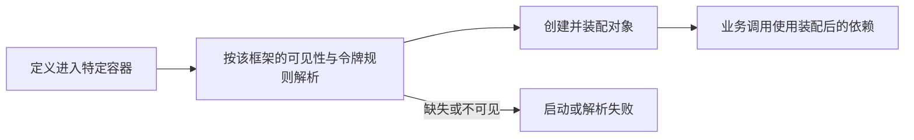
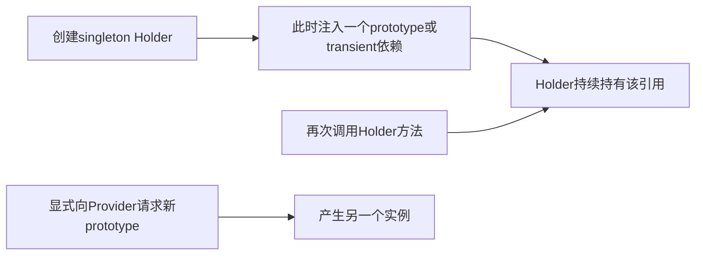
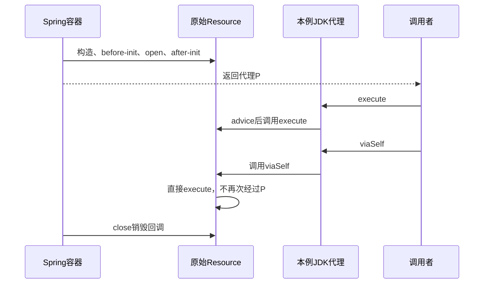

# 18 · IoC、DI与Bean

## 章节范围与先修

目标：能用构造器声明依赖，解释Bean/Provider定义、作用域和容器边界，复现缺失依赖、Nest未导出Provider、prototype固定注入、生命周期及代理自调用反例。

需要能阅读类、接口、函数参数及[第08章](../02-java-language/08-generics.md)中“TS接口不成为普通运行时值”的边界。第17章启动与自动配置尚未交付，本章用显式注册的小容器隔离机制，不假装已经覆盖Boot自动配置。实验无需HTTP、Docker或数据库。

同题业务是通过TimeSource提供09:00，Greeter输出`Hello @ 09:00`。Spring使用真实AnnotationConfigApplicationContext，Nest使用真实TestingModule；不手写一个字典冒充框架容器。源码在[Spring IocLab](../../examples/spring-boot-examples/src/main/java/dev/javafornestjs/ioc/IocLab.java)和[Nest ioc-lab](../../examples/nestjs-reference/src/ioc/ioc-lab.ts)，运行方式见[IoC实验说明](../../examples/spring-boot-examples/IOC-LAB.md)。

## 知识点

### ch18-kp01 · 容器、定义与模块可见性

#### 1. 一句话定义

容器根据Bean或Provider定义创建、装配和管理对象；一个类写在源码里并不表示它已经在某个容器中注册且对使用者可见。

#### 2. 为什么需要它

Nest开发者通常会先检查Module的providers/imports/exports。迁移到Spring时也要追问“定义从哪里来、哪个ApplicationContext拥有它”，而不能把每个Java类都自动当Bean。

#### 3. 生活类比

把容器看作按服务目录分配人员的调度处：类是岗位说明，Bean定义是登记的服务条目，实例是实际人员。两家调度处可以按同一岗位说明各雇一人；目录登记也不自动保证跨部门可见。

| 模型角色 | 技术对象 | 边界 |
|---|---|---|
| 岗位说明 | 类或实现类型 | 没注册就不属于当前容器 |
| 服务目录条目 | BeanDefinition / Provider注册 | 同类可有多条定义和多个实例 |
| 部门服务开放规则 | Nest模块导出等可见性规则 | Spring配置类不与Nest@Module一一等价 |

#### 4. Node.js / TypeScript / NestJS 技术对照

部分可比：Spring Bean与Nest Provider都可表达容器管理的依赖。不同点是Spring配置、组件扫描、ApplicationContext层次和Nest模块导出/作用域规则不同。Nest的Module不是Java语言的JPMS module，也不是Maven模块；一个Maven JAR里可以有许多Bean定义。

#### 5. 两端代码对照

Nest完整文件中TimeModule显式导出令牌，消费模块导入它：

```ts
@Module({ providers: [{ provide: TIME_SOURCE, useClass: FixedTimeSource }], exports: [TIME_SOURCE] })
export class TimeModule {}
@Module({ imports: [TimeModule], providers: [Greeter], exports: [Greeter] })
export class IocGreetingModule {}
```

Spring完整文件中显式配置条目：

```java
@Bean
TimeSource timeSource() { return new FixedTimeSource(); }
@Bean
Greeter greeter(TimeSource source) { return new Greeter(source); }
```

本例没有组件扫描；测试显式把IocLab.Config注册进ApplicationContext。生产文件放在`dev.javafornestjs.ioc`，与原Greeting应用扫描包分开，避免教学配置悄悄混入原有启动物。

#### 6. 原理与流程图



这不是两个框架内部调用栈的逐层同构图。扫描、显式注册、条件配置或自定义Provider还各有规则，本章只验证所列显式定义。

#### 7. 类比边界与错误直觉

不能推出“导入Nest模块就能用它所有Provider”：MissingExportModule实际编译失败。也不能把Spring配置类当成具有相同exports边界的Nest模块。本例按单个ApplicationContext解析，未实现父子容器隔离或Spring模块化系统。

#### 8. 企业应用场景与选型

将数据库访问或时间来源封装成明确可导出的服务，在入口处组合。不要为修复Nest可见性错误，在每个模块重复注册同一有状态服务，这会改变实例共享关系。Spring里则先核对定义、扫描范围、条件与容器，再修改业务类。

#### 9. 常见错误与排查

| 触发 | 现象 | 根因 | 修复与回归 |
|---|---|---|---|
| Nest只import却不export时间令牌 | compile拒绝Greeter依赖 | Provider未向消费模块开放 | 明确exports/imports；正负两个模块均有测试 |
| 只写Java类却没注册 | 依赖解析失败 | 当前上下文没有该定义 | 检查显式配置或实际扫描范围，不凭文件位置推断 |

#### 10. 实操练习与验收

- 基础题：在源码中指出实现类、注册定义和实际容器各在哪里。验收：不能把三者混称一个对象。
- 迁移题：为何Nest未导出Provider不能靠“Java配置类没有exports”解释？验收：明确不同框架可见性规则。
- 思考题：同一类在两个独立容器里都是singleton，会共享一个全局对象吗？验收：预测不会，并运行Spring跨容器身份测试。
- 命令：实验说明中的Maven verify和TS build/test；正例输出Hello @ 09:00，未导出负例被assert.rejects捕获。

<details><summary>完成后查看提示</summary>

先列出“当前容器→定义→令牌→消费方”的关系，再看类名是否相同。编译器能找到源码类型，不代表容器已有可见的运行时定义。

</details>

### ch18-kp02 · 构造器依赖与运行时令牌

#### 1. 一句话定义

构造注入让对象在构造时得到显式依赖；容器负责选择可见的候选定义，业务对象不需要在每次调用中主动查询容器。

#### 2. 为什么需要它

把容器当全局字典在业务方法里get某对象，会隐藏真实依赖和失败时机。本实验把“必须有时间来源”放在构造器或工厂装配中，使缺依赖在启动/编译容器阶段暴露。

#### 3. 生活类比

开工时发齐必要工具，工人按约定工作，而不是每次操作都跑调度处猜工具名称。工具清单对应构造参数；发不齐应及时拒绝开工。类比不意味着容器知道工具的业务质量，选择错的实现仍可能产生错误。

| 现实动作 | 技术对象 | 边界 |
|---|---|---|
| 工具清单 | 构造器依赖 | 不是自动验证工具所有业务行为 |
| 发放工具 | 按类型/令牌解析与注入 | 多候选仍须明确选择 |
| 开工前拒绝缺工具 | 装配失败 | 延迟解析可使失败时机不同，本例用急切解析 |

#### 4. Node.js / TypeScript / NestJS 技术对照

Java接口类型有运行时Class对象，可参与Spring按类型解析；TS接口本身不会成为普通运行时值。Nest例子用同一个TIME_SOURCE Symbol及@Inject明确指定令牌。不同位置重新`Symbol('TIME_SOURCE')`只会有相同描述，不会得到相同令牌。

#### 5. 两端代码对照

TS完整类的片段：

```ts
constructor(@Inject(TIME_SOURCE) private readonly source: TimeSource) {}
greet(): string { return `Hello @ ${this.source.now()}` }
```

Java完整类的片段：

```java
public Greeter(TimeSource source) { this.source = source; }
public String greet() { return "Hello @ " + source.now(); }
```

Java配置通过@Bean方法参数取得依赖，再显式传给构造器；没有伪称该片段本身带@Component。另一个负例只注册Greeter，刷新容器时真实抛出UnsatisfiedDependencyException。业务方法本身没有getBean或Nest ModuleRef查找。

#### 6. 原理与流程图

读取依赖声明→按框架规则查候选→选择定义→准备依赖实例→调用构造或工厂→把结果供业务使用。本例为清晰的直线链路，无需画更复杂循环依赖图；循环依赖不是构造注入应当自动“修好”的正常设计目标。

#### 7. 类比边界与错误直觉

接口令牌存在不代表实现已注册；多实现也不代表容器能按业务意图自动猜一个。Spring的Qualifier/Primary和Nest的显式令牌/Provider可用于明确选择，但它们不保证架构依赖方向正确。本章只验证一个明确实现和缺失/不可见失败，不宣称覆盖所有候选解析规则。

#### 8. 企业应用场景与选型

业务服务依赖窄接口，入口组合真实实现，测试组合受控实现。把查容器的操作限制在入口、框架适配或测试等合理边界。本例的容器getBean/module.get出现在测试端，不是鼓励业务对象变成服务定位器。

#### 9. 常见错误与排查

| 触发 | 现象 | 根因 | 修复与回归 |
|---|---|---|---|
| Spring仅注册Greeter | refresh失败 | 没有TimeSource定义 | 补充明确装配；缺失负例仍应验证失败 |
| Nest仅保留接口注解而无对应令牌 | 依赖解析错误 | 接口不是可注入运行时值 | 导出并复用TIME_SOURCE，使用@Inject与Provider定义 |

#### 10. 实操练习与验收

- 基础题：解释两端Hello @ 09:00来自哪里。验收：定位TimeSource实现，而非把字符串写进Greeter掩盖注入。
- 迁移题：从TS接口切到Java接口时，哪些令牌机制发生变化？验收：能区分Java接口Class、JS Symbol与接口源码。
- 思考题：用同描述的两个Symbol能否替换共享常量？验收：解释身份而非描述决定匹配。
- 命令：Maven缺失依赖测试与Nest导出正负例通过，启动失败必须被断言而不能静默返回空值。

<details><summary>完成后查看提示</summary>

构造器把对象需求表达清楚；工厂和容器把需求与实现组合。不要因为测试能自己new对象，就说实际正例不需要验证容器装配。

</details>

### ch18-kp03 · singleton、prototype与Nest作用域

#### 1. 一句话定义

作用域规定定义与实例的共享/创建边界；singleton不是整个操作系统全局唯一，prototype或transient也不保证每次业务方法调用自动重新注入。

#### 2. 为什么需要它

把用户ID放进共享单例字段，可能把请求状态混在一起；把prototype注入单例后又期待每次调用都是新对象，也会出错。仅比较作用域英文名不足以迁移这些行为。

#### 3. 生活类比

共享工具台对应容器内同一定义的singleton；每次向柜台领新的标记对应一次prototype查找。把一个新标记发给共享工具台管理员后，他一直拿着它，并不会因为其他人来问一句话就自动换新标记。

| 模型 | 技术对象 | 边界 |
|---|---|---|
| 一处工具台共享服务 | 同一容器/定义的singleton | 另一容器或另一条定义可有另一实例 |
| 每次向柜台领标记 | Spring prototype查找 | 不等于每次调用持有者方法都创建 |
| 按任务上下文分组 | Nest ContextId/request scope | 本章显式创建上下文，不冒充真实HTTP请求 |

#### 4. Node.js / TypeScript / NestJS 技术对照

Spring prototype与Nest TRANSIENT只有部分可比：两者都可减少共享，但生命周期、消费方和解析上下文规则不同。Nest REQUEST依赖上下文，且会影响依赖它的消费链；不是把该对象所有依赖都无条件改成request scope。默认单例依赖仍可以按其规则共享。

#### 5. 两端代码对照

Spring完整配置中PrototypeToken标为prototype；Holder是默认singleton且只在构造时得到一个token。测试验证两次getBean(token)不同、两次getBean(holder).token相同。若确实需要延迟领新实例，ProviderHolder使用ObjectProvider.getObject，并有两次结果不同的断言。

Nest完整配置中TransientToken和RequestToken分别使用TRANSIENT/REQUEST。测试验证Holder注入的TransientToken保持不变，独立resolve(TransientToken)得到不同实例；同一个ContextId解析RequestToken相同，新ContextId则不同。普通get不能获取作用域Provider，真实错误也被断言。

#### 6. 原理与流程图



图只表达“注入时机”与“之后调用”不同，不能据此合并两框架的所有缓存/上下文细节。请求上下文实验通过Nest自身resolve机制另行验证。

#### 7. 类比边界与错误直觉

不能推出“prototype自动销毁”：Spring测试在context.close后检查token未关闭，再由调用方显式close。不能推出“同类都是同一个singleton”，也不能把两个独立resolve调用的结果推广到所有相同上下文的解析。无状态服务通常不需要为了“安全”全部改成每请求创建，关键是正确的状态归属。

#### 8. 企业应用场景与选型

共享无状态服务可使用默认作用域；请求身份等状态应采用正确的请求上下文传播或显式参数。短寿命资源须有可追踪关闭责任，不能因对象标注prototype而省略资源管理。实验PrototypeToken只存内存标记，故意不持有真实连接以免演示造成泄漏。

#### 9. 常见错误与排查

| 触发 | 现象 | 根因 | 修复与回归 |
|---|---|---|---|
| 单例构造注入prototype后反复读字段 | 一直得到同一引用 | 注入只发生在创建持有者时 | 若语义确实需要新实例，用显式Provider；测试两路径身份 |
| 用Nest get获取request Provider | 抛scoped provider错误 | API忽略了上下文解析要求 | 使用resolve和明确ContextId；不要为消除错误偷改成共享单例 |

#### 10. 实操练习与验收

- 基础题：画出Holder与token的实际引用，再运行身份断言。验收：能解释“token定义prototype”与“字段仍相同”不矛盾。
- 迁移题：同一个Nest ContextId与新ContextId为何不应预期相同实例？验收：定位真实resolve测试，不用自行模拟的Map代替框架证据。
- 思考题：prototype对象持有外部文件时，谁负责close？验收：明确调用方或另行设计的生命周期管理，而非默认容器关闭。
- 命令：Spring作用域/销毁测试及Nest作用域测试通过，无需Docker。

<details><summary>完成后查看提示</summary>

把“对象定义要求新建”和“什么时候真正请求创建”分开。默认单例不代表线程安全，非单例也不自动保证请求身份传播正确。

</details>

### ch18-kp04 · 生命周期、后处理与代理

#### 1. 一句话定义

容器可在对象创建前后执行初始化、后处理和销毁流程，返回对象也可能是代理；这些阶段及适用范围不能只按两个框架的Hook名称配对。

#### 2. 为什么需要它

连接、订阅或后台任务需要明确何时可用、何时停止。若Bean被代理，拿到的引用还可能不是原始具体类；自调用绕过代理也是后续AOP/事务问题的重要入口。

#### 3. 生活类比

设备先组装、检查和开机，再经过接待台转交使用者；使用者经过接待台调用可以被登记，但设备内部自行触发的动作不一定再次经过接待台。类比只说明顺序与入口边界，不把所有容器都说成相同生产线。

| 模型 | 技术对象 | 边界 |
|---|---|---|
| 开机与关机 | init/destroy或应用生命周期Hook | Bean级与模块/应用级时机并不完全相同 |
| 接待台包装 | 本例BeanPostProcessor返回的JDK代理 | Spring并非每个Bean都会被这样代理 |
| 内部动作不经接待台 | target内部self invocation | 不覆盖所有代理技术或AspectJ织入 |

#### 4. Node.js / TypeScript / NestJS 技术对照

初始化/关闭能力部分可比，但Spring BeanPostProcessor**无直接等价于Nest Interceptor的对应物**。后者常服务于请求/消息执行链，不是自动包装所有Provider方法的Bean后处理钩子。Nest单例Hook与Spring单个Bean的initMethod也不能当作完全相同时间点。

#### 5. 两端代码对照

Spring实验显式配置Session的open/close，并由静态注册的BeanPostProcessor在初始化后返回ProxyFactory生成的JDK接口代理。测试要求构造、before-init、init、after-init，然后外部execute出现advice/use，viaSelf只追加use，最后容器关闭追加destroy。这里只对本例显式initMethod及处理器排序给证据，未推断所有PostConstruct/后处理器的统一次序。

Nest实验LifecycleProbe实现单例生命周期接口。TestingModule.compile只创建定义/对象；测试先观察constructed，再显式module.init得到module-init/bootstrap，module.close得到module-destroy/before-shutdown/shutdown。不要把TestingModule.compile特性推广为NestFactory.createApplicationContext也不会初始化；后者有自己的启动流程。

#### 6. 原理与流程图



该图描述实际显式代理实验，不等于全部Spring内部阶段。事务自调用的完整数据库行为由第27章验证；本章不以这个小模型替代真实事务断言。

#### 7. 类比边界与错误直觉

不能推出“构造结束就是整个应用已就绪”；不能推出“标注prototype就会在容器关闭时收到销毁”；不能推出“Nest request对象会收到应用销毁Hook”。实验实际验证request对象在module.close后closed仍false；单例Probe则有明确关闭日志。操作系统强制终止不保证这些显式关闭路径运行，本章没有声称测试所有退出信号。

#### 8. 企业应用场景与选型

通过明确的启动/关闭路径管理资源，避免在构造器里做不可控长I/O。需要代理的服务优先依赖稳定接口契约，而不是把返回对象强转成具体实现。若行为要求必须经过代理，应设计外部调用边界；不要靠自调用“应该也会被拦截”的直觉实现安全或事务。

#### 9. 常见错误与排查

| 触发 | 现象 | 根因 | 修复与回归 |
|---|---|---|---|
| target内部直接调另一个方法 | 本例没有第二条advice | 没再次经过代理引用 | 明确代理边界或重设计协作；外调与自调有日志对照 |
| 把request生命周期当应用生命周期 | 期待的销毁Hook没触发 | 作用域对象不参与该应用Hook流程 | 按真实请求/资源边界管理，不依赖本例未保证的回调 |

#### 10. 实操练习与验收

- 基础题：运行Spring日志断言，指出哪一步返回代理。验收：确认Proxy.isProxyClass为true且外调有advice。
- 迁移题：把Nest Interceptor叫做BeanPostProcessor为什么会误导？验收：区分请求执行链与Bean实例后处理。
- 思考题：为何viaSelf没有第二次advice但仍执行use？验收：沿图追踪原始target引用，而非说方法根本没运行。
- 命令：Spring生命周期/代理测试及Nest单例/request Hook对照均通过；预期缺失回调必须被明确断言。

<details><summary>完成后查看提示</summary>

比较两个框架前先标出对象级、模块/应用级和请求级三个生命周期边界。本例显式close是受控退出，不是证明Ctrl+C、进程崩溃或容器强杀都能优雅执行相同流程。

</details>

## 章末验收与审查记录

按实验说明运行双端测试后，至少能解释三条边界：Module导出与配置类不同、prototype不等于每次方法调用新对象、作用域销毁责任不同；再解释令牌与代理自调用的实际证据。

| 知识点 | 运行证据 | 独立审查 |
|---|---|---|
| ch18-kp01 | 双端同题装配、Nest缺export及Spring跨容器身份 | 待审 |
| ch18-kp02 | 构造注入成功、Spring缺依赖刷新失败 | 待审 |
| ch18-kp03 | prototype/Holder/ObjectProvider及Nest ContextId身份测试 | 待审 |
| ch18-kp04 | Spring生命周期/真实代理/自调用与Nest单例/request Hook测试 | 待审 |

版本、命令、实际结果及作者逐点自检见[P1-03验证记录](../progress/P1-03.md)。当前初稿不计完成，不把测试小容器通过扩写成完整Web/数据库兼容或G1验收。

## 参考资料与变更

2026-11-10核对官方入口，Spring资料按Boot3.5主线所用6.2系列阅读：

- [Spring Bean作用域](https://docs.spring.io/spring-framework/reference/6.2/core/beans/factory-scopes.html)：singleton/prototype边界及prototype销毁责任。
- [Spring容器扩展点](https://docs.spring.io/spring-framework/reference/6.2/core/beans/factory-extension.html)：BeanPostProcessor职责与注册注意事项。
- [Nest模块](https://docs.nestjs.com/modules)、[作用域](https://docs.nestjs.com/fundamentals/injection-scopes)、[生命周期](https://docs.nestjs.com/fundamentals/lifecycle-events)：导出、上下文及Hook适用范围。
- [兼容矩阵](../00-introduction/compatibility-matrix.md)与[术语表](../00-introduction/glossary.md)。
