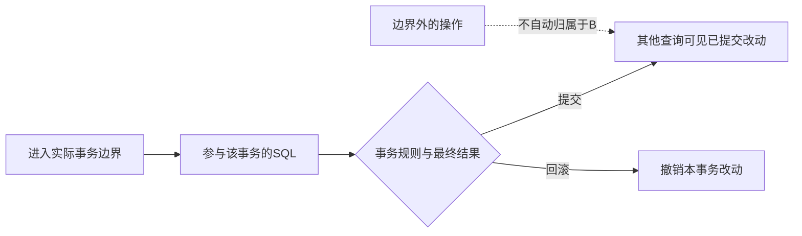
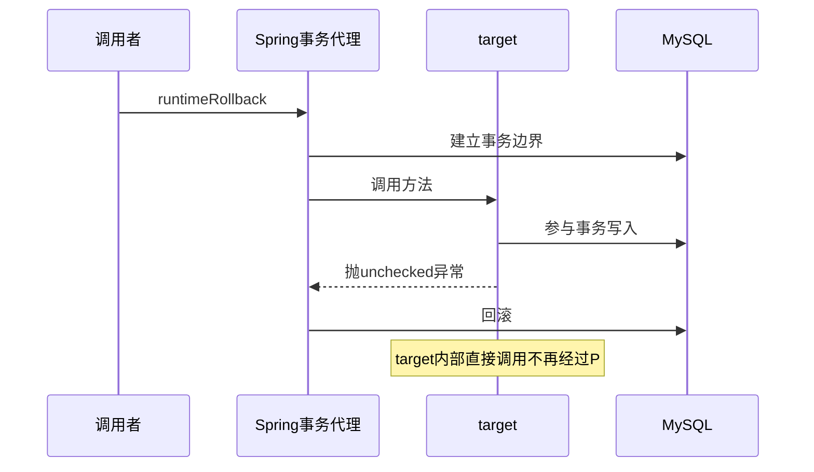
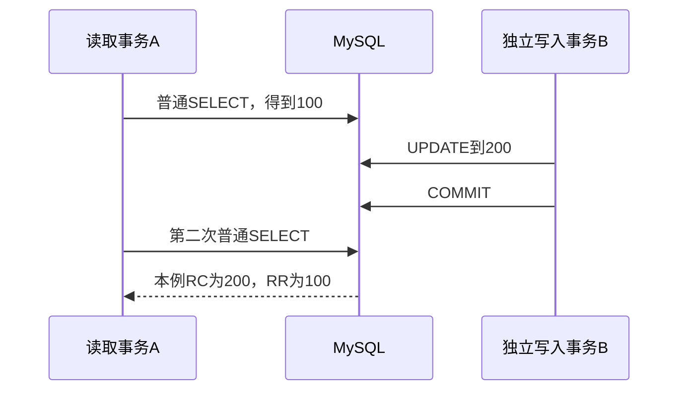

# 27 · Spring事务与Prisma $transaction

## 章节范围与先修

目标：能定位真正事务边界，解释checked异常和自调用反例，区分REQUIRED、REQUIRES_NEW与Prisma显式transaction client，并复现RC/RR读取差异。先阅读[第18章代理与作用域](../04-spring-boot/18-dependency-injection.md)，能阅读简单INSERT/SELECT及Promise即可运行隔离实验；第24/25章仍在计划中，本章不假装先修正文已交付。

共同契约是“在事务中写入一条commit记录，正常返回后可见；写入后抛出未捕获业务错误，记录应消失”。另设明确的失败对照来观察框架差异。余额amount仅用于隔离级别观察，不是生产金额或转账模型。

完整运行入口在[真实MySQL实验说明](../../examples/transaction-lab/README.md)。Spring为独立Maven项目，使用真实JDBC事务管理器、JDK代理及Flyway；Prisma为独立TS参照，使用官方适配器及真实MySQL。二者都没有使用H2、mock仓库或内存Map替代数据库。初始化会清理专用实验表，代码只接受回环主机的transaction_lab库。

## 知识点

### ch27-kp01 · 事务边界与ACID保证的范围

#### 1. 一句话定义

数据库事务把一组操作置于明确的开始、提交或回滚边界内；ACID描述其原子性、一致性、隔离性和持久性目标，不代表任意业务代码自动正确。

#### 2. 为什么需要它

在Nest服务中用Prisma分别写两条数据，或在Java方法上写一个注解，都还需要确认实际操作是否落入期望的数据库事务。应检查边界、连接/客户端和失败路径，而不是只看源码是否有“transaction”字样。

#### 3. 生活类比

用“同一份办理单下的一组改动，完成前确认或撤销”的小模型。办理单对应事务上下文，改动对应参与事务的SQL。拿另一份办理单或不走办理单的动作，不会因原单撤销而自动撤销。

| 模型元素 | 技术对象 | 边界 |
|---|---|---|
| 一份办理单 | 一个实际事务边界 | 方法名/注解存在不等于已进入边界 |
| 该单下的改动 | 同一事务参与的SQL | 另一连接/根client操作可能不属于它 |
| 确认或撤销 | COMMIT/ROLLBACK效果 | 不会撤销已经发送的邮件或外部服务副作用 |

模型只表达边界与归属，不模拟数据库日志、锁或故障恢复算法。

#### 4. Node.js / TypeScript / NestJS 技术对照

部分可比：Spring声明式事务和Prisma交互式事务都能围绕数据库操作建立边界。不同点是本例Spring通过代理与线程绑定的JDBC资源协调；Prisma回调显式传入tx。TS类型签名能表达传参意图，却不能普遍阻止实现内部误用全局根client。

#### 5. 两端代码对照

Prisma完整文件为[transactions.ts](../../examples/prisma-reference/src/transactions.ts)，片段：

```ts
export const commit = () => client.$transaction(tx => insert(tx, 'commit'))
export const callbackRollback = () => client.$transaction(async tx => {
  await insert(tx, 'runtime')
  throw new Failure('runtime-failure')
})
```

Spring完整文件为[TransactionLab](../../examples/transaction-lab/src/main/java/dev/javafornestjs/transactions/TransactionLab.java)，片段：

```java
@Transactional(timeout = 10)
public void runtimeRollback() {
    insert(jdbc, "runtime");
    throw new Failure("runtime-failure");
}
```

测试从真实代理调用方法，从回调使用真实tx；在另一次数据库查询中核对正常返回有commit行、未捕获运行时错误后无行。调用方必须等待事务方法/Promise完成再检查结果，不把“已发起异步操作”当作提交成功。

#### 6. 原理与流程图



图不把数据库事务扩写为跨服务分布式事务。事务中的业务一致性仍需正确算法和数据库约束；隔离与持久性还取决于选定级别、引擎和存储配置。

#### 7. 类比边界与错误直觉

不能推出“用了事务就不会超卖/死锁/余额错误”，也不能用一次回滚测试证明所有ACID特性。本章实际验证提交/回滚、部分传播与一致性读；没有做断电、崩溃恢复或任意隔离异常的演练。已发邮件、对象存储上传等外部副作用不因SQL回滚自动恢复。

#### 8. 企业应用场景与选型

在可由单一数据库事务维护的状态变更中，保持事务短、操作范围明确。外部支付、消息或长HTTP调用应单独设计失败恢复，不能把它们包进长事务就宣称原子。分布式Outbox等由后续章节另行验证，本章没有提前实现。

#### 9. 常见错误与排查

| 触发 | 现象 | 根因 | 修复与回归 |
|---|---|---|---|
| Prisma回调中误用根client | outside行在外层回滚后仍存在 | 写入不归属于tx | 显式传入并使用tx；wrongClient负例及正常rollback并排运行 |
| 不await事务Promise就响应 | 结果检查时序不明确 | 尚未确认提交/失败 | 等待事务完成，保留失败传播；不要吞Promise拒绝 |

#### 10. 实操练习与验收

- 基础题：运行两端提交与回滚用例。验收：正常返回后有commit行，未捕获错误后无行。
- 迁移题：说明为什么“把根client当Tx参数传进去”不能仅靠结构类型自动保证安全。验收：能指出实际数据库访问对象的归属。
- 思考题：事务内调用已成功发送邮件，随后SQL回滚会怎样？验收：明确数据库回滚不撤销外部副作用，不伪造分布式保证。
- 命令：实验说明的完整Java verify与transactions:test，退出0且SQL断言通过；仅test-compile或生成Client不算。

<details><summary>完成后查看提示</summary>

从“谁开启事务、SQL用了哪个资源、谁决定提交/回滚、调用方是否已等待完成”四问追踪。不要只在调用栈中搜索一个注解就停下。

</details>

### ch27-kp02 · 异常回滚规则与代理自调用

#### 1. 一句话定义

事务是否因异常回滚取决于实际拦截边界和回滚规则；本例Spring默认unchecked异常回滚、checked异常不自动回滚，Prisma以回调最终成功或拒绝为核心边界。

#### 2. 为什么需要它

从JS迁移时很容易把“throw任意Error都回滚”的经验直接套到Java checked异常。另一个误区是认为target内部调用带注解方法时，注解会像语言语法一样自动生效。

#### 3. 生活类比

接待台按办理规则决定是否撤销，规则手册区分几类故障。设备内部自行调用没有再次经过接待台时，就不会因为那条内部方法旁边写了规则而重新进入办理流程。类比同时要求检查“经过入口”和“入口采用什么规则”。

| 模型动作 | 技术对象 | 边界 |
|---|---|---|
| 经过接待台 | 经事务代理调用 | 原始target内部self invocation可能绕过本例代理 |
| 撤销故障分类表 | rollbackFor/默认规则 | 配置可改变规则，不能推广成所有Spring应用固定如此 |
| 最终办理失败 | Prisma回调拒绝 | 回调内部捕获并正常返回时结论可能不同 |

#### 4. Node.js / TypeScript / NestJS 技术对照

Java checked异常体系在TS里**无直接等价物**。本章Prisma Failure extends Error只是应用错误，不模拟Java编译器的throws检查。Spring全局或方法级回滚配置可改变默认行为；本例未启用全局ALL_EXCEPTIONS覆盖，显式rollbackFor作为对照。

#### 5. 两端代码对照

Spring两个真实方法分别使用默认规则和显式规则：

```java
@Transactional(timeout = 10)
public void checkedDefault() throws CheckedFailure {
    insert(jdbc, "checked-default");
    throw new CheckedFailure();
}
@Transactional(rollbackFor = CheckedFailure.class, timeout = 10)
public void checkedExplicit() throws CheckedFailure {
    insert(jdbc, "checked-explicit");
    throw new CheckedFailure();
}
```

测试要求前者checked-default行保留，后者无行。另一个未标事务的selfInvocation在确认没有外层事务后调用this.runtimeRollback，失败后runtime行仍保留；代理外调同一runtimeRollback则无行。Prisma对照是正常使用tx时回调拒绝会回滚，错误使用根client时outside行保留；这两种错误边界的成因不同，不说它们是相同的“自调用”。

#### 6. 原理与流程图



代理只控制实际经过它的边界。自调用如果本来处于外层事务中，SQL仍可能参与外层事务；本例刻意无外层事务，不推广为“所有自调用都完全没有事务”。

#### 7. 类比边界与错误直觉

不能推出“所有异常一律回滚”，也不能推出“加public/@Transactional就修好了所有内部调用”。本章用JDK代理验证；AspectJ织入或其它配置可能有不同机制。本例Jdbc事务资源按线程协调，不推广到reactive事务上下文或异步线程传播。

#### 8. 企业应用场景与选型

先明确业务希望哪些失败撤销，再配置相应回滚规则；避免在服务层吞掉错误后给调用方成功假象。需要事务的协作可通过清晰的外部服务边界进入代理，不以不透明的self injection或强转当前代理作为默认架构。

#### 9. 常见错误与排查

| 触发 | 现象 | 根因 | 修复与回归 |
|---|---|---|---|
| 抛checked异常却依赖默认规则 | 行仍提交 | 本例默认不对checked回滚 | 明确rollbackFor或重新定义异常语义；默认/显式两用例都验证 |
| 无外层事务的target内部调用 | 抛错后行保留 | 注解未经过代理拦截 | 设计真正外部事务入口；用自调用/代理调用结果对照 |

#### 10. 实操练习与验收

- 基础题：分别预测checked默认、checked显式和unchecked三个用例。验收：逐行解释保留/消失原因。
- 迁移题：为什么不能在TS里声明一个叫CheckedError的类就声称复现Java checked异常？验收：区分语言检查与运行时回调结果。
- 思考题：若selfInvocation的调用者本身已有事务，内部SQL一定自动提交吗？验收：回答不能如此推断，需追踪现有资源边界。
- 命令：Java完整verify中四种异常/自调用用例通过，Prisma callbackRollback/wrongClient也有真实SQL结果。

<details><summary>完成后查看提示</summary>

不要只看最后是否抛异常。把异常类型、是否经过代理、是否存在外层事务和配置规则逐个标出来，本章才会出现“都抛错但行是否保留不同”的结果。

</details>

### ch27-kp03 · 传播、rollback-only与独立事务

#### 1. 一句话定义

传播描述调用时如何处理已有事务；Spring REQUIRED可加入现有事务，REQUIRES_NEW建立独立物理事务，而Prisma普通函数调用没有同一套自动传播注解语义。

#### 2. 为什么需要它

外层catch了内层异常，为什么Spring最终仍可能提交失败？又为什么内层记录会在外层回滚后保留？这些问题必须追踪逻辑事务、实际连接和提交边界，而不是把“嵌套调用”都当成一个数据库嵌套事务功能。

#### 3. 生活类比

同一办理单的不同工位可以共同标记“整单作废”，后一个工位把投诉藏起来不等于撤销作废标记。另开独立办理单则有独立提交结果；它仍会占用另一个办理窗口。

| 模型元素 | 技术对象 | 边界 |
|---|---|---|
| 同单的多个工位 | REQUIRED加入现有事务的逻辑边界 | 不等于每个工位都有独立物理提交 |
| 作废标记 | rollback-only | catch原异常不会自动清掉标记 |
| 第二份独立单/窗口 | 本例REQUIRES_NEW及额外连接 | 需要池容量，外层仍可能持锁占用资源 |

#### 4. Node.js / TypeScript / NestJS 技术对照

Spring传播注解对Prisma显式tx传参**无直接等价物**。Prisma helper接收同一个tx，可以参与同一个事务，但本例普通应用Error被内部catch后，回调正常返回，没有Spring REQUIRED代理自动设置的rollback-only标记。本节不把这个结果推广成“所有数据库错误被catch都可提交”。

#### 5. 两端代码对照

Java requiredCaught通过另一个真实代理调用inner.requiredFailure；内层写入并抛unchecked，外层catch后再写，但最终commit抛UnexpectedRollbackException且两行都消失。Prisma catchApplicationError在同一个回调中把tx传给helper，catch本例应用Failure后正常返回，两个成功写入都提交。

Java independentCommitSurvives调用另一个Bean的REQUIRES_NEW方法，内层提交后外层故意抛错，最终只保留inner-independent。Prisma用根client显式再开一个独立$transaction，也观察到内层保留，但它不实现Spring挂起/恢复的全部框架语义，更不是在tx对象上调用嵌套事务API。

#### 6. 原理与流程图


本例池大小4，操作不同记录，避免故意造成同一行的锁等待。真实业务的锁、连接数和超时可能使这个调用失败；图不是“内层总能立即成功”的承诺。

#### 7. 类比边界与错误直觉

REQUIRES_NEW不是整个外层事务的savepoint，也不是把inner操作包进同一个物理事务后再独立撤销。Prisma第二个独立事务与Spring传播只有有限效果可比；不能因一组保留行相同就宣布两端拥有相同事务管理器。隔离级别、异常规则和资源挂起还需分别分析。

#### 8. 企业应用场景与选型

若审计记录必须独立于主流程失败保留，先验证这种业务语义是否合理，再评估独立事务、池资源及故障恢复。不要给所有内部方法都加REQUIRES_NEW，造成连接争用或破坏期望的整体原子性。需要外部消息最终送达时，数据库内层独立提交本身也不是完整Outbox方案。

#### 9. 常见错误与排查

| 触发 | 现象 | 根因 | 修复与回归 |
|---|---|---|---|
| REQUIRED内层失败被外层catch | 外层最终UnexpectedRollbackException | 共用事务已标rollback-only | 不把catch当作恢复事务；明确业务边界和错误传播，真实用例验证全回滚 |
| 池只有一个连接却在外层再借独立连接 | 等待或超时 | 外层仍占着连接 | 按并发与传播需求设计容量/边界，不仅增大超时时间 |

#### 10. 实操练习与验收

- 基础题：解释Java catch后为何无行、Prisma本例catch后为何两行。验收：明确错误是应用Error及传播机制不同。
- 迁移题：两端独立内层提交都保留inner行，为什么仍不能叫完全等价？验收：列出显式传参、挂起资源或代理规则的一项差别。
- 思考题：主业务失败后独立审计也失败，应向用户报告什么？验收：给出可追溯故障策略，不宣称事务自动解决业务决策。
- 命令：Java requiredCaught/independentCommitSurvives及Prisma对应两用例在真实MySQL上通过。

<details><summary>完成后查看提示</summary>

分别画逻辑调用边界和物理事务/连接。只有一张调用栈图时，很容易把“多次方法进入”误看成“多个独立事务”。

</details>

### ch27-kp04 · 隔离级别与受控的两次读取

#### 1. 一句话定义

隔离级别规定并发事务可观察到哪些变化；本章在MySQL8.4的普通一致性读上，对比READ COMMITTED与REPEATABLE READ的两次读取。

#### 2. 为什么需要它

给数据库操作包事务，不代表同一事务每次SELECT都看到相同结果。必须同时知道数据库引擎、级别、读类型和其他事务何时提交，不能仅凭注解名称预测所有锁/快照行为。

#### 3. 生活类比

一次查阅已公布账册，每次拿最新已发布版本对应本例RC；在同一次办理中继续看第一次取得的版本，对应本例RR一致性读。模型只说明这个普通读取场景，不描述更新、锁定读或全部幻读行为。

| 模型动作 | 技术对象 | 边界 |
|---|---|---|
| 每次查最新已公布版本 | 本例RC第二次读到已提交200 | 不能据此推断未提交数据可见 |
| 沿用首次取得的版本 | 本例RR一致性读快照 | 不等于所有读都是旧值；锁定读另有规则 |
| 另一个窗口先完成发布 | 独立连接写入并提交 | 必须控制提交先后，不能靠sleep碰概率 |

#### 4. Node.js / TypeScript / NestJS 技术对照

部分可比：两端都可向同一个MySQL指定相应隔离级别。Java注解用Isolation.READ_COMMITTED/REPEATABLE_READ，Prisma回调选项用ReadCommitted/RepeatableRead。名字可映射到本次引擎级别，但不意味着换一个数据库仍有完全相同行为。

本实验还显式选择默认RC来控制条件，不把它叫作MySQL的通用默认配置。读未提交和串行化仅作为完整等级概念：前者允许更弱读取保证，后者更强约束并发；本章没有为这两个等级编写相同异常矩阵，不能将未测范围写成通过。

#### 5. 两端代码对照

Java readCommitted/repeatableRead通过代理设置级别，在同一读取事务先读100，调用另一个REQUIRES_NEW写入事务把值改为200并提交，再读一次。Prisma readTwice先用reader读取，显式开启独立writer事务并等待提交，再用原reader读。

两端通过MySQL CONNECTION_ID核对读/写来自不同连接，避免把同一连接自己的写入当作并发可见性实验。预期RC为[100,200]，RR为[100,100]。新增连接身份断言与实际通过版本记录在验证报告；测试不依赖随机调度或定时睡眠。

#### 6. 原理与流程图



RR这里的快照与首次一致性读有关，不笼统写成“所有事务开始时就固定同一个快照”。测试没有使用SELECT FOR UPDATE；锁定读不能直接照抄这个推理。

#### 7. 类比边界与错误直觉

不能推出“RR下所有查询永远看旧值”“RC一定满足所有业务一致性”或“本例证明全部幻读已消除”。数据库约束、锁定读、更新条件、索引及重试策略都可能影响实际业务。本章只锁定了普通一致性读、两条受控事务和一个更新先后。

#### 8. 企业应用场景与选型

当业务在同一事务多次读同一数据时，先确定是否需要稳定视图、最新已提交值还是锁定/条件更新语义，再评估级别与并发成本。关键扣减还要用数据库约束、条件更新或合适并发控制，而不是仅把注解从RC换成RR就宣称无竞态。

#### 9. 常见错误与排查

| 触发 | 现象 | 根因 | 修复与回归 |
|---|---|---|---|
| 用同一连接读写来演示隔离 | 看见自己的更新就下结论 | 没有两个并发事务边界 | 核对CONNECTION_ID并控制独立writer提交 |
| 把普通SELECT结果推广到FOR UPDATE | 对结果/锁等待的预测错误 | 读取类型不同 | 分别设计实验，不扩写本章未测范围 |

#### 10. 实操练习与验收

- 基础题：运行RC/RR用例并画出写事务commit的位置。验收：RC[100,200]、RR[100,100]，连接身份不同。
- 迁移题：Prisma的级别名称为什么不能脱离数据库引擎解释？验收：说明本例固定MySQL8.4.7及普通读。
- 思考题：在第一次SELECT前就让writer提交会怎样？验收：预测RR的首次快照也可能读到200，并说明这不否定RR。
- 命令：完整Java verify和Prisma SQL测试，两种级别的断言都必须通过；只打印配置级别不算验证。

<details><summary>完成后查看提示</summary>

固定顺序是“首读完成→另一连接写入并提交→原事务再读”。若顺序变了，预期也要重新从数据库规则推导，而不是认为偶然输出就是隔离保证。

</details>

## 章末验收与审查记录

按实验说明运行真实服务，解释至少三条关键差异：checked回滚规则、代理自调用、REQUIRED rollback-only与Prisma显式回调、独立事务资源占用、RC/RR快照条件。不要只背诵四个ACID字母。

| 知识点 | 验证证据 | 独立审查 |
|---|---|---|
| ch27-kp01 | 两端正常提交/回滚与根client错误边界 | 独立评分10，两轴无剩余阻断 |
| ch27-kp02 | 默认/显式checked、unchecked及真实代理自调用 | 独立评分10，两轴无剩余阻断 |
| ch27-kp03 | REQUIRED捕获后回滚、独立内层提交保留 | 独立评分9，两轴无剩余阻断 |
| ch27-kp04 | 真实MySQL受控RC/RR，两条连接身份核对 | 独立评分10，两轴无剩余阻断 |

真实CI、版本、未测范围及作者逐点自检见[P1-04验证记录](../progress/P1-04.md)，发现与修订见[独立审查](../reviews/P1-04.md)。当前为in_review，不计完成；[G1](../progress/G1.md)仍需真实读者反馈与验收。

## 参考资料与变更

2026-11-10核对官方入口：

- [Spring回滚规则](https://docs.spring.io/spring-framework/reference/6.2/data-access/transaction/declarative/rolling-back.html)及[传播语义](https://docs.spring.io/spring-framework/reference/6.2/data-access/transaction/declarative/tx-propagation.html)，阅读时区分本例默认配置与可选全局覆盖。
- [Prisma事务](https://www.prisma.io/docs/orm/prisma-client/queries/transactions)：交互式回调、transaction client、选项与池/超时边界。
- [MySQL8.4隔离说明](https://docs.oracle.com/cd/E17952_01/mysql-8.4-en/innodb-transaction-isolation-levels.html)：普通一致性读与具体引擎语义。
- [ADR-0003](../adr/0003-transaction-reference-runtime.md)、[兼容矩阵](../00-introduction/compatibility-matrix.md)、[术语表](../00-introduction/glossary.md)。

Prisma7.10.1/官方适配器和Flyway唯一迁移源按计划v1.2登记，不使用Prisma8 RC，不改变课程Java主线。
