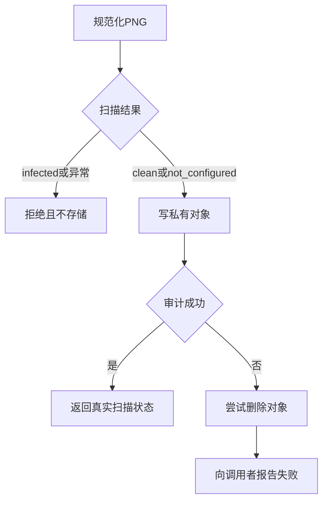

# 33 · 企业基础能力

## 章节范围与先修

先完成20/28/31/32章。文件示例为独立内部边界：[Java说明](../../examples/file-lab/README.md)、[PNG校验](../../examples/file-lab/src/main/java/dev/javafornestjs/files/PngSanitizer.java)、[私有对象](../../examples/file-lab/src/main/java/dev/javafornestjs/files/PrivateFiles.java)、[Node同题](../../examples/nestjs-security-reference/src/files.ts)。当前没有Multipart HTTP入口，trustedActor由测试直接传入，必须在整合时从认证上下文取得，不能接收客户端owner字段。SDK实验与真实认证HTTP测试的证据分别记录，不能相互冒充。

## 知识点

### 受限文件输入与解码预算 {#ch33-kp01}

#### 1. 一句话定义

上传先约束字节、结构、格式和解压输出，再解码并以新像素图重编码；文件名与客户端MIME只能作为待验证输入。

#### 2. 为什么需要它

只检查`.png`后缀会接受伪装HTML，只限制压缩文件大小仍可能遭遇解压膨胀。只看首IHDR也不够：宽松解码器可能接受后续头并覆盖尺寸，必须约束实际解码路径。

#### 3. 生活类比

收货先称重，再验封装清单，只把验过的零件装入新盒子。称重对应字节上限，清单对应块结构和CRC，新盒子对应像素重编码。箱子小不代表展开后体积小，正如压缩输入不代表解压内存有界；CRC只检查损坏，不证明安全来源。

#### 4. Node.js / TypeScript / NestJS 技术对照

Multer可负责Multipart接收，但不自动证明图片内容安全，本实验未接入Multer。Node Readable与Java InputStream都必须有读取上限；pngjs与ImageIO的容错、格式支持和内存路径不同，因此先施加共同的受限格式协议。

#### 5. 两端代码对照

完整源码见章首链接。两端仅收非交错8bit RGB/RGBA、IHDR/IDAT/IEND/tEXt，首头唯一、IDAT连续、IEND末尾、全块CRC正确。每次输入最多1MiB，宽高各1024，像素至多1048576。

```ts
const pixels = inflateSync(Buffer.concat(compressed), { maxOutputLength: expected })
if (pixels.length !== expected) throw new Error('Invalid PNG scanline length')
```

```java
byte[] pixels = inflater.readNBytes(expected + 1);
if (pixels.length != expected) {
    throw new IllegalArgumentException("Invalid PNG scanline length");
}
```

expected是`height * (1 + width * channels)`，包含每行filter字节；先验尺寸保证其最大约4MiB。然后才调用解码器，以新图像重编码，输出仍最多1MiB。不同语言输出不要求逐字节相同，要求像素与范围一致。

#### 6. 原理与流程图


基础校验失败均在存储前拒绝。真实元数据用tEXt标记夹具验证：有效像素保留，输出不含输入标记；尾随内容不属于本协议，IEND完整性检查直接拒绝。

#### 7. 类比边界与错误直觉

限制受支持格式是刻意取舍，不是完整PNG规范实现；调色板、灰度、交错和其他块均可能合法但被拒绝。重编码不能代替病毒扫描、请求超时和业务权限。解压预算证明单次像素数据有界，不证明高并发总内存已受控。

#### 8. 企业应用场景与选型

适合教学头像等小型受控图片；大图、动图、视频应采用隔离处理和明确资源配额。HTTP整合还须约束Multipart请求总量、并发、时限及代理限制，不能将当前内部流方法直接描述为完整上传网关。

#### 9. 常见错误与排查

文件很小却占内存先查解压而非只调上传大小。首尺寸正确而实际解码变大要查重复头。某些合法PNG拒绝时先确认受支持子集，不能直接放开全部解码器容错。初稿曾有重复头/交错膨胀漏洞，经早期审查发现后修订，不用旧编译结果掩盖。

#### 10. 实操练习与验收

基础题：区分字节预算、像素预算与解压预算。迁移题：解释Node maxOutputLength与Java读取expected+1的拒绝方式。思考题：为什么解码后才检查尺寸已经太晚？仓库根目录：

```powershell
.\mvnw.cmd -f examples/file-lab/pom.xml '-Dtest=PngSanitizerTest' verify
pnpm security:build
```

Node对应场景在完整`files.spec.js`中，需要章首README的一次性对象服务。验证合法像素、恶意名字/MIME/签名/尺寸、重复头、交错、小尺寸压缩膨胀及tEXt去除；不得以“抛了任意异常”代替预期拒绝原因。

### 私有对象存储与资源归属 {#ch33-kp02}

#### 1. 一句话定义

服务端生成对象键，在私有桶写入规范化内容，下载时按可信身份检查归属，再由服务端读取字节。

#### 2. 为什么需要它

客户端文件名成为路径可能造成穿越或覆盖；对象存在且知道URL也不代表有权读取。存储服务凭据权限和业务用户权限不同，不能把SDK调用成功当用户授权完成。

#### 3. 生活类比

仓库管理员生成储物柜号，柜门上记录领用人；来取货需核对身份。随机柜号对应UUID对象键，领用人对应owner元数据，柜门不公开对应私有桶。管理员持总钥匙仍可改记录，所以类比不能抵抗存储管理员恶意修改。

#### 4. Node.js / TypeScript / NestJS 技术对照

Java MinIO SDK与Node AWS S3 SDK通过S3协议操作同一类服务；客户端库不同，但业务归属规则相同。公开URL、presigned URL和服务端流式下载是不同方案，本例只演示最后一种内部读取，不发匿名链接。

#### 5. 两端代码对照

```ts
if (metadata.Metadata?.['owner-id'] !== String(trustedActor))
  throw new Error('Forbidden')
```

```java
if (!Integer.toString(trustedActor).equals(stat.userMetadata().get("owner-id"))) {
    throw new SecurityException("Forbidden");
}
```

这些语句位于各自PrivateFiles.download，前面拒绝匿名actor和非法对象键，后面经SDK读取。upload生成UUID，元数据由服务端写入owner-id；没有让客户端指定覆盖对象键的接口。构造时保守拒绝已有桶策略，真实匿名HTTP读取应403。

#### 6. 原理与流程图

上传：可信身份→规范化PNG→扫描状态→随机键写私有对象→审计。下载：可信身份→键语法→HEAD元数据→owner比较→GET有界字节→审计→返回。顺序简单且源码逐步对应；这里用文字流程，复杂补偿关系在下一点单列。

#### 7. 类比边界与错误直觉

trustedActor参数不是认证实现，HTTP整合不能信任JSON中的同名字段。元数据/桶策略由特权凭据控制，本例信任存储管理员；构造时检查也不防管理员随后改为公开。未审计完整AWS ACL/IAM，不宣称生产存储策略验收。

#### 8. 企业应用场景与选型

小文件可经服务端授权下载；大文件通常需要短期凭证、下载服务或受控网关，并处理撤销和缓存。对象键随机主要防覆盖与泄漏文件名，不可替代owner校验。权限元数据未来可迁移到数据库以支持组织、共享与审计关系。

#### 9. 常见错误与排查

跨用户可下载先核对actor来源及owner匹配，不能只增加随机键长度。匿名URL200先查桶策略和ACL。SDK403还可能是服务凭据或bucket权限问题，不应把所有403当成用户无权。测试凭据只用于环回临时服务。

#### 10. 实操练习与验收

基础题：区分对象键与访问凭证。迁移题：把Java statObject归属检查迁移到Node HeadObject。思考题：若同一凭据的管理员可覆盖owner，本模型信任谁？按README启动服务后：

```powershell
.\mvnw.cmd -f examples/file-lab/pom.xml '-Dtest=ObjectStoreTest' verify
node --test examples/nestjs-security-reference/dist/files.spec.js
```

验证实际SDK往返、合法owner下载、另一用户/匿名拒绝、匿名对象HTTP403及公有策略构造拒绝。这里没有证明Multipart请求经过认证链，需在后续整合重新验证。

### 扫描状态、审计脱敏与补偿 {#ch33-kp03}

#### 1. 一句话定义

扫描与审计必须保留真实状态：未配置不算clean，审计输出只包含必要字段，跨系统失败通过显式补偿处理。

#### 2. 为什么需要它

一个永远返回true的“扫描器”会误导读者；日志直接保存文件名或令牌会扩大泄漏。对象写入和SQL审计不是天然同一事务，需要清楚说明哪一步失败、可能留下什么。

#### 3. 生活类比

质检标签分为已检合格、不合格、未设质检；出入库账只记柜号和经手人，记账失败尝试退回货物。标签对应三种扫描状态，账页对应最小审计，退货对应补偿删除。退货也可能失败，不能把它比作可无限可靠倒带的事务。

#### 4. Node.js / TypeScript / NestJS 技术对照

Node Promise扫描函数与Java Scanner接口都是扩展点，不是病毒引擎。既有安全模块的任务写入/审计在同一MySQL事务，文件示例则跨对象服务和sink，两类保证不能混用。Node异步审计须await，不能后台丢弃失败。

#### 5. 两端代码对照

```ts
if (status !== 'clean' && status !== 'not_configured')
  throw new Error('Upload rejected')
```

```java
if (status == null || status == ScanStatus.INFECTED) {
    throw new SecurityException("Upload rejected");
}
```

默认实验返回not_configured，受限PNG仍可保存但明确未扫描。infected及扫描异常在存储前失败。审计事件只有actor/action/key，测试不含输入文件名；它不是对所有代理、错误堆栈和外部日志的全面脱敏证明。

#### 6. 原理与流程图



删除失败作为附加/聚合异常暴露；进程崩溃没有补偿保证。下载则先审计再返回字节，审计失败不返回内容。既有SQL审计有单事务回滚测试，不能用该证据宣称对象补偿同样原子。

#### 7. 类比边界与错误直觉

扫描接口测试注入infected只证明分支行为，不证明发现真实病毒。CRC、重编码、杀毒是不同能力。示例sink不是持久化审计库，不保证防篡改；未来可靠写入需要事务Outbox等机制，尚未在此实现。

#### 8. 企业应用场景与选型

高风险文件应隔离/检疫，扫描成功后才发布；本受限PNG教学允许not_configured，策略不可不加评估地搬到任意文档上传。审计最小化应明确保留周期和关联ID，避免把认证凭据当排障上下文。

#### 9. 常见错误与排查

存储有对象而调用失败先查审计和补偿，不直接让客户端覆盖重试同一键。NOT_CONFIGURED显示为“安全”是状态映射错误。日志泄漏必须检查真实输出字段和采集链，不能只搜索源码中有没有password字符串。

#### 10. 实操练习与验收

基础题：解释三扫描状态。迁移题：对照Java suppressed异常与Node AggregateError如何保留补偿失败。思考题：对象写成功后进程退出，如何用可靠事件恢复？

```powershell
.\mvnw.cmd -f examples/file-lab/pom.xml verify
node --test examples/nestjs-security-reference/dist/files.spec.js
```

检查感染/扫描异常未留下新对象、审计失败成功删除；当前测试尚未覆盖真实扫描引擎、删除失败后的自动恢复或进程崩溃。

### OpenAPI描述与真实运行契约 {#ch33-kp04}

#### 1. 一句话定义

OpenAPI是接口机器可读描述，生成成功不等于运行时权限、校验和全部错误行为都已被验证。

#### 2. 为什么需要它

只给调用者一份curl说明难以复用类型和发现漂移；但依赖注解生成的文档也可能漏字段、漏权限或与真实响应不符。文档存在和客户端可安全调用是两项不同验收。

#### 3. 生活类比

菜单列菜名、配料和价格，实际出餐还要验收。菜单对应schema，标注对应装饰器/注解，出餐检查对应HTTP测试。印好了菜单不能证明厨房一定照做，更不能证明没写上的安全规则不存在。

#### 4. Node.js / TypeScript / NestJS 技术对照

复用21/22章真正运行的Nest Swagger与springdoc任务API；Node DTO依赖显式ApiProperty，Java通过记录/校验与springdoc推导。泛型擦除、异步返回类型和认证规则不总能自动生成，须读取实际文档与响应。

#### 5. 两端代码对照

完整[Nest API](../../examples/nestjs-reference/src/api/api.ts)与[Java任务模型](../../examples/spring-web-lab/src/main/java/dev/javafornestjs/web/Tasks.java)继续作为同题运行物：

```ts
@ApiProperty({ minimum: 1, maximum: 5 })
priority!: number
```

Java请求端来自Tasks.PriorityRequest的真实片段：

```java
public record PriorityRequest(
        @Schema(type = "integer", format = "int32", minimum = "1", maximum = "5")
        @NotNull @DecimalMin("1") @DecimalMax("5") BigDecimal priority) {
    @AssertTrue
    @JsonIgnore
    public boolean isIntegral() {
        return priority == null || priority.stripTrailingZeros().scale() <= 0;
    }
    int asInt() { return priority.intValueExact(); }
}
```

文档范围与运行时整数性检查分开，不能仅由BigDecimal类型推断只接受整数。文档端点`/openapi.json`，HTTP测试同时检查任务请求/响应。文件原语尚未提供HTTP路由，因此没有编造上传OpenAPI；安全Feature的完整认证响应schema、生成客户端及管理端整合仍需补齐。

#### 6. 原理与流程图

DTO/路由元数据→生成OpenAPI→读取paths/schema→发送真实请求→核对成功/错误/权限→发现差异后修定义和测试。这是线性核对流程，无独立并发状态，文字顺序足以说明。根契约脚本另以两个独立进程比较任务HTTP结果，不由文档自证。

#### 7. 类比边界与错误直觉

公开读取schema不等于业务API匿名可写。生成的TypeScript类型不会执行服务端授权或替代客户端错误处理。Swagger UI页面能打开也不等于跨语言完整合同一致，更不代表上传路由已交付。

#### 8. 企业应用场景与选型

先稳定schema和错误代码，再生成受版本控制的客户端并做实际请求测试。文件接口未来应明确Multipart、限制、鉴权和下载响应头；未实现时保持缺口可见，不在文档里先虚构成功示例。

#### 9. 常见错误与排查

DTO文档空对象先查装饰器与泛型，字段约束不同查生成schema和运行验证是否来自不同定义。只有paths存在性检查不能证明完整schema正确。安全OpenAPI与生成客户端的后续补齐不得引用本点的基础测试冒充完成。

#### 10. 实操练习与验收

基础题：区分描述与执行。迁移题：在两端定位priority范围的定义及实际400负例。思考题：为什么仅检查`/tasks`路径存在还不足以证明可生成客户端？仓库根目录按21/22章前置运行：

```powershell
pnpm examples:build
pnpm examples:test
.\mvnw.cmd -pl examples/spring-web-lab -am verify
pnpm http:verify
```

核对真实任务契约与文档存在性；不要把该范围扩写成文件/安全全API描述或生成客户端已经验收。

## 章末验收与审查记录

本章in_review，修后[Files43815795277](https://github.com/zrayjay/java-for-nestjs/actions/runs/43815795277)在Temurin21/25各Java7项及Node6项真实服务成功。[独立全文审查](../reviews/P4-01-files.md)通过，后续HTTP/安全文档整合仍待实施。[进度](../progress/P4-01.md)逐提交区分编译、PNG单测、真实服务和审查。官方参考：[MinIO Java SDK](https://github.com/minio/minio-java)、[S3 SDK](https://docs.aws.amazon.com/AWSJavaScriptSDK/v3/latest/client/s3/)、[PNG规范](https://www.w3.org/TR/png/)、[Node zlib限额](https://nodejs.org/api/zlib.html)、[OWASP上传指南](https://cheatsheetseries.owasp.org/cheatsheets/File_Upload_Cheat_Sheet.html)、[Nest OpenAPI](https://docs.nestjs.com/openapi/introduction)。
