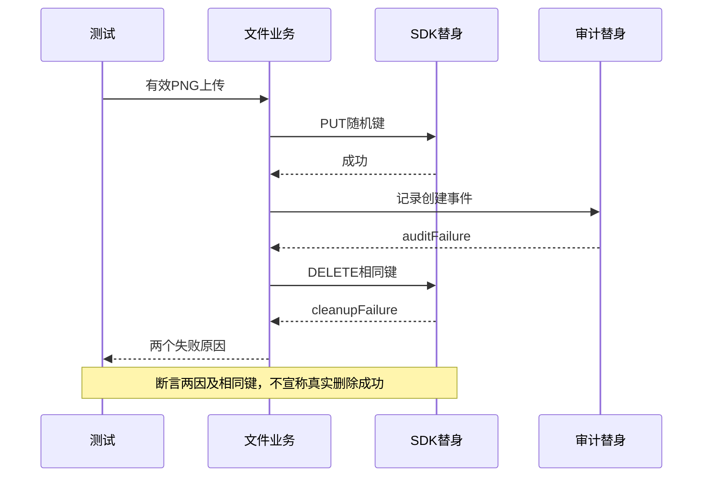

# 34 · 单元测试

## 章节范围与先修

先完成11/18/33章。运行物是既有PrivateFiles业务边界的[Java单测](../../examples/file-lab/src/test/java/dev/javafornestjs/files/PrivateFilesUnitTest.java)、[Node单测](../../examples/nestjs-security-reference/src/files.unit.spec.ts)、[Vitest参照](../../examples/nestjs-security-reference/src/files.vitest.spec.ts)，不是复制实现的纯语法练习。真实PNG校验器仍执行，外部SDK和审计可替换。单测无需SQL/Redis/S3；对象服务测试继续独立运行。依赖及显式Mockito agent见[ADR0009](../adr/0009-testing-and-diagnostics-runtime.md)。

## 知识点

### 测试生命周期与每例隔离 {#ch34-kp01}

#### 1. 一句话定义

测试隔离让每个用例拥有自己的可变夹具，并在结束时释放资源、恢复替身，从而不依赖其他用例的执行顺序。

#### 2. 为什么需要它

一个测试改了全局spy而没恢复，后续测试可能根本没调用真正依赖却仍通过。换到并行CI或单独运行就失败，往往不是业务随机，而是夹具共享或资源泄漏。

#### 3. 生活类比

每次化验先用干净试管，结束后丢弃样本并清洁仪器。试管对应每例fixture，样本残留对应共享可变状态，仪器恢复对应spy还原。无菌试管不能证明实验方法正确，隔离也不能替代业务断言。

#### 4. Node.js / TypeScript / NestJS 技术对照

Vitest beforeEach/afterEach、Jest同名钩子和JUnit BeforeEach/AfterEach承担类似职责，但测试实例、模块缓存和mock恢复语义不同。本例实际运行Vitest和node:test，没有执行Jest。Java默认每方法测试实例不意味着静态字段、外部数据库和Spring缓存上下文自动隔离。

#### 5. 两端代码对照

Vitest每例建立自己的客户端，结束恢复spy并释放资源：

```ts
beforeEach(() => {
  client = new S3Client({ region: 'us-east-1', credentials: {
    accessKeyId: 'unit-only', secretAccessKey: 'unit-only',
  } })
})
afterEach(() => { vi.restoreAllMocks(); client.destroy() })
```

Java每例重新mock内部SDK边界：

```java
@BeforeEach
void freshBoundary() { client = mock(MinioClient.class); }
```

Java单测没有创建真实客户端连接，因此没有真实存储要清理；PNG每次生成新字节数组。Node调用被spy替换，不以假凭据访问网络。常量KEY是不可变String，不是共享可变对象。

#### 6. 原理与流程图

新fixture→配置本例替身→执行业务→断言→恢复/关闭。这是每例线性生命周期，无跨请求并发状态；文字流程足以定位当前资源归属。外部数据库隔离在35章单独处理，不能从这个流程推断。

#### 7. 类比边界与错误直觉

重复通过不证明没有竞态，进程隔离也不能清理远端数据。Vitest restoreAllMocks恢复spy方法，不会自动删除你写入的数据库行或重置所有模块单例。不要仅为追求“完全隔离”而mock掉被测规则本身。

#### 8. 企业应用场景与选型

纯业务边界优先小fixture与显式依赖；真正框架装配、SQL和存储协议交给对应集成测试。开启并行前先确认测试是否拥有独立资源；共享库清理脚本不能在多个worker里互相删数据。

#### 9. 常见错误与排查

单独绿、整套红先查共享状态与恢复；整套绿、单独红先查前置测试偷偷创建的对象。不要先加sleep或强制排序掩盖依赖。未恢复spy时断言mock调用次数也会被其他用例污染。

#### 10. 实操练习与验收

基础题：找出两端每例新建的可变对象。迁移题：说明JUnit生命周期不能替代Vitest spy恢复。思考题：使用静态Map后哪条隔离假设失效？仓库根目录：

```powershell
.\mvnw.cmd -f examples/file-lab/pom.xml '-Dtest=PrivateFilesUnitTest' verify
pnpm security:build
pnpm --filter @java-for-nestjs/nestjs-security-reference exec vitest run src/files.vitest.spec.ts
```

不启动外部服务，Java4项、Vitest2项应成功；再次以新进程运行同一命令仍成功，不能靠上一轮fixture。跨平台重复CI结果以章末进度为准。

### 替换外部协作者并验证关键交互 {#ch34-kp02}

#### 1. 一句话定义

mock替换外部协作者以控制失败或返回值，但被测业务仍真实执行；交互断言只约束具有业务意义的副作用。

#### 2. 为什么需要它

每次都让真实存储网络恰好失败才能测补偿，慢且不稳定。把整个PrivateFiles.upload mock掉又只是在证明替身返回自己设定的值。需要在业务和外部系统之间选正确替换位置。

#### 3. 生活类比

演练让“仓库窗口”按指定方式响应，实际领货流程照常执行。窗口替身对应SDK mock，实际流程对应PrivateFiles，出库次数对应关键写操作。替身不会还原仓库全部规章，单测也不证明S3协议和真实权限配置正确。

#### 4. Node.js / TypeScript / NestJS 技术对照

Vitest vi.spyOn替换已建客户端方法，Mockito mock创建客户端替身；两端可配合函数注入审计/扫描。不能根据“mock”和“spy”的词面推断默认是否执行真实方法。本例Mockito mock默认不联网，Node spy显式提供实现，避免真实send。

#### 5. 两端代码对照

Vitest替换SDK调用，真实规范化与扫描流程仍执行：

```ts
const send = vi.spyOn(client, 'send').mockImplementation(async () => ({ $metadata: {} }))
```

Java验证拒绝归属后不得读取对象正文：

```java
when(stat.userMetadata()).thenReturn(Map.of("owner-id", "2"));
when(client.statObject(any(StatObjectArgs.class))).thenReturn(stat);
assertThatThrownBy(() -> files.download(1, KEY))
        .isInstanceOf(SecurityException.class).hasMessage("Forbidden");
verify(client, never()).getObject(any(GetObjectArgs.class));
```

完整上下文在章首测试文件。未断言所有内部调用顺序；“越权不GET正文”“感染不PUT”“补偿删除同一随机键”是业务保证，而非固定每个方法的实现步骤。

#### 6. 原理与流程图

fixture配置外部结果→业务实际做owner/扫描/审计判断→记录有意义的SDK命令→核对没有错误副作用。Node scanner与audit用vi.fn，Java用实际lambda；不要求两端替身API一一同名。

#### 7. 类比边界与错误直觉

默认空返回值可能让测试漏过应配置的响应，真实集成必须再检。mock调用次数全对也可能存错字节，所以保留PNG像素及真实SDK往返。不要断言随机UUID具体值，用捕获参数比较PUT和删除的键是否相同。

#### 8. 企业应用场景与选型

适合稀有故障、负向副作用和昂贵协作者。对数据库事务、序列化协议或权限配置的结论，必须用真实系统。若测试需要模拟几十层对象，往往说明边界过宽，应改善接口，而非添加更多脆弱stub。

#### 9. 常见错误与排查

意外联网先查spy是否被覆盖、是否调用了另一客户端实例。TS重载send会影响mock类型：本例mockResolvedValue被推断为void，改符合重载的mockImplementation，不能把运行测试成功当编译成功。Mockito在新JDK动态附加受限时用显式agent，不修改业务代码绕过。

#### 10. 实操练习与验收

基础题：指出被替换与实际执行的部分。迁移题：把Mockito never()表达成Node未发生GetObject计数。思考题：只mock upload自身为什么无法验证补偿？

```powershell
.\mvnw.cmd -f examples/file-lab/pom.xml '-Dtest=PrivateFilesUnitTest#foreignOwnerNeverReadsObjectBody' test
node --test --test-name-pattern='foreign owner' examples/nestjs-security-reference/dist/files.unit.spec.js
```

必须同时断言预期拒绝与读取次数0；抛了任意异常或网络恰好坏掉不算通过。

### 精确异常断言与双重失败 {#ch34-kp03}

#### 1. 一句话定义

测试失败路径要核对预期原因和最终副作用，双重失败保留主因与补偿错误，而不是只要求函数抛异常。

#### 2. 为什么需要它

补偿失败若吞掉主因，排查只能看到删除错误；过宽assertThrows(Exception.class)可能把空指针当安全拒绝。下载审计失败还要证明字节没交给调用者且资源已关闭。

#### 3. 生活类比

出库后记账坏了，退货窗口也关了，事故单应同时写两件事。主事故对应审计异常，退货失败对应补偿异常，事故单对应异常链/聚合错误。记录双因不等于已经恢复库存，异常信息本身也须避免携带秘密。

#### 4. Node.js / TypeScript / NestJS 技术对照

Java suppressed异常与Node AggregateError都能保留多因，表现结构不同，不强行统一异常类。本例Java用AssertJ流式断言同一实例与附加异常，Node用assert检查AggregateError.errors，Vitest用rejects.toThrow验证扫描原因。异步断言必须await。

#### 5. 两端代码对照

Node同题关键断言来自files.unit.spec.ts：

```ts
assert.ok(error instanceof AggregateError)
assert.deepEqual(error.errors, [auditFailure, cleanupFailure])
```

Java同题：

```java
assertThatThrownBy(() -> files.upload(1, "a.png", "image/png", source))
        .isSameAs(auditFailure).hasSuppressedException(cleanupFailure);
```

片段中的source对应完整测试生成的有效PNG流，不是任意空流；否则输入校验先失败，无法测试补偿。完整用例还捕获PUT/DELETE参数，比较同一对象键。

#### 6. 原理与流程图



#### 7. 类比边界与错误直觉

“保留错误”不等于业务恢复。单测中删除失败后没有真实对象可检查，真实服务补偿成功另有集成证据。错误字符串检查仅用于稳定内部拒绝原因，不要求绑定第三方全部堆栈或底层随机错误消息。

#### 8. 企业应用场景与选型

支付补偿、文件审计、外部消息等多系统流程都需明确失败模型。关键状态可进一步用可靠事件和恢复任务，不能靠catch中再试一次就承诺原子性。测试应覆盖既有承诺，不为尚未实现的恢复队列编造通过结果。

#### 9. 常见错误与排查

异步断言未await可能出现假绿；断言错误类型过宽会混淆拒绝与程序缺陷；只断言调用次数会忽略删错键。Mockito替身不能替你验证真实传输，结合下一章的协议/服务测试定位边界。

#### 10. 实操练习与验收

基础题：识别主失败与补偿失败。迁移题：解释suppressed与AggregateError的结构差异。思考题：如果只断言“抛异常”，输入损坏会怎样造成假绿？

```powershell
.\mvnw.cmd -f examples/file-lab/pom.xml '-Dtest=PrivateFilesUnitTest#auditAndCleanupFailuresRetainBothCausesAndSameRandomKey' test
node --test --test-name-pattern='audit and cleanup' examples/nestjs-security-reference/dist/files.unit.spec.js
```

检查同一失败实例/两因/相同键，完整4项还检查下载审计异常关闭流。重复成功与跨平台结果详见进度，不由本段命令推断所有测试环境已通过。

## 章末验收与审查记录

本章in_review。[P4-02进度](../progress/P4-02.md)区分本机Java8项、Node4项、Vitest2项与跨平台两轮CI。[独立全文审查](../reviews/P4-02-unit.md)及四环境两轮[Unit43817767580](https://github.com/zrayjay/java-for-nestjs/actions/runs/43817767580)通过。参考：[JUnit5.12指南](https://docs.junit.org/5.12.2/user-guide/)、[Mockito](https://javadoc.io/doc/org.mockito/mockito-core/5.17.0/org/mockito/Mockito.html)、[AssertJ](https://assertj.github.io/doc/)、[Vitest mocks](https://vitest.dev/guide/mocking.html)。
