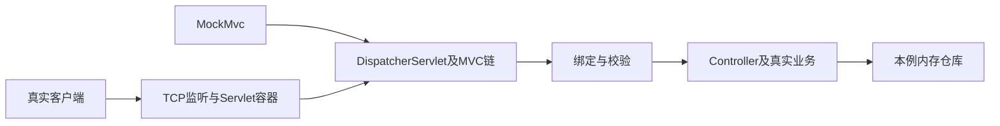
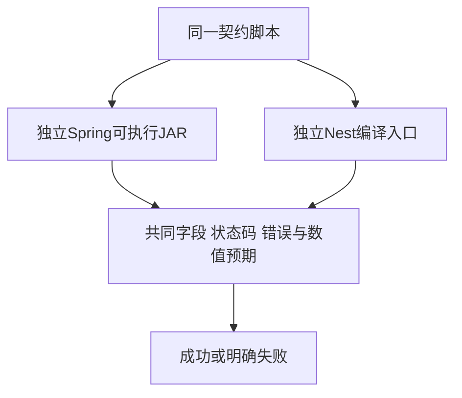

# 35 · 集成与契约测试

## 章节范围与先修

先完成34章。复用真实[Spring Web测试](../../examples/spring-web-lab/src/test/java/dev/javafornestjs/web/WebApiTest.java)、[Nest HTTP测试](../../examples/nestjs-reference/src/api/api.test.ts)、[Testcontainers探针](../../examples/compatibility-probe/src/test/java/dev/javafornestjs/probe/CompatibilityTest.java)、[双进程契约脚本](../../scripts/verify-http-contract.mjs)。探针是基线小应用，不冒称毕业项目或P4安全入口；各自覆盖范围必须分开。

## 知识点

### MockMvc与真实HTTP的不同边界 {#ch35-kp01}

#### 1. 一句话定义

MockMvc在进程内经过Spring MVC的实际绑定、校验和处理链；真实HTTP另验证监听端口、客户端传输及部署运行物。

#### 2. 为什么需要它

Controller方法单测绕过JSON解析和Validation，真实HTTP又比进程内测试更依赖环境。把其中一种当作所有层都验证，会漏掉容器链或网络问题，也会让排障无从分层。

#### 3. 生活类比

先在柜台内演练订单受理，再让客人从大门实际进店。柜台演练对应MockMvc，真实进店对应TCP HTTP，订单校验对应MVC绑定。店内演练仍可用真收银规则，但不能据此证明大门和道路畅通。

#### 4. Node.js / TypeScript / NestJS 技术对照

Supertest可向Node HTTP应用发请求；本仓库实际用Nest启动随机环回端口与fetch，属于真实HTTP e2e入口验证，没有安装Supertest，不声称执行其内部机制。Spring MockMvc不是简单等价的fetch替代品，两者进入点不同。

#### 5. 两端代码对照

Node实际Nest测试启动应用、发网络请求、核对JSON及关闭应用：

```ts
const app = await createApi()
try {
  const base = await app.getUrl()
  const response = await fetch(base + '/tasks')
  assert.equal(response.status, 200)
} finally { await app.close() }
```

Java MockMvc正例使用真实MVC和内存仓库：

```java
mvc.perform(post("/tasks").contentType(MediaType.APPLICATION_JSON)
        .content("{\"title\":\"Learn MVC\",\"details\":{\"priority\":2}}"))
    .andExpect(status().isCreated())
    .andExpect(jsonPath("$.details.priority").value(2));
```

完整方法mockMvcExercisesRealBindingValidationAndStorageWithoutATcpClient另发缺字段、小数priority及ownerId未知字段，逐项400/invalid_request，再确认列表仅有合法创建的1条。没有直接调用Controller，也没有把仓库方法完全mock掉。

#### 6. 原理与流程图



测试类同时配置RANDOM_PORT和AutoConfigureMockMvc：类会启动实际服务，但MockMvc那条调用不经TCP客户端。不能把“本次调用不经TCP”错误扩写成“此测试类完全没启动服务器”。

#### 7. 类比边界与错误直觉

两类测试在本例使用内存仓库，不证明SQL事务或JWT安全入口。MockMvc真实MVC不意味着与所有Servlet容器行为一致。真实HTTP200也可能漏测请求体错误、响应字段和拒绝原因，必须检查具体断言。

#### 8. 企业应用场景与选型

大量请求映射和校验可用MockMvc；启动、传输、代理及真正打包进程用HTTP测试。数据库及权限需叠加对应真实组件，不能因名称叫integration就默认覆盖。测试越重，越应缩小场景并控制夹具。

#### 9. 常见错误与排查

MockMvc绿、HTTP红先查服务器配置、端口/路径、过滤器注册与客户端；两者都400先查绑定/校验。Windows JDK客户端套接字问题已有独立探针，不能把环境连接失败误判业务拒绝。错误请求不应产生数据，除状态码外要查最终存储。

#### 10. 实操练习与验收

基础题：标出两入口的共同与独有层。迁移题：解释Nest fetch测试为什么属于HTTP而非MockMvc等价物。思考题：直接调用Controller会绕过哪些校验？仓库根目录：

```powershell
.\mvnw.cmd -pl examples/spring-web-lab -am verify
pnpm examples:build
pnpm examples:test
```

新增MockMvc正例及3种负例通过、无效请求不新增行；真实HTTPCRUD和错误响应仍要通过。若使用已记录Windows套接字修正，说明进程参数，不将其当所有机器的通用修复。

### Testcontainers、动态连接与数据隔离 {#ch35-kp02}

#### 1. 一句话定义

Testcontainers为测试管理真实依赖容器，连接地址来自运行时映射；容器生命周期与每例数据隔离是两项独立设计。

#### 2. 为什么需要它

H2不完全模拟MySQL锁、SQL和迁移；共用开发库又容易污染数据。即使使用容器，类内多个测试仍可能共享同一个库，需要明确只读、回滚或重置策略。

#### 3. 生活类比

每轮考试搭一间临时实验室，仪器地址按当天安排发放；同屋学生仍要各自管理样本。实验室对应容器，分配地址对应mapped port，样本隔离对应数据夹具。拆掉整间实验室不能补救考试过程中互相污染的样本。

#### 4. Node.js / TypeScript / NestJS 技术对照

Node也有Testcontainers库，但本仓库Node数据库实验实际使用CI service MySQL及显式清理夹具，没有安装Node Testcontainers。它们都使用真实MySQL，却由不同主体管理生命周期。不要把Prisma事务回滚当容器销毁，也不要从Java注解推断Node清理行为。

#### 5. 两端代码对照

Node安全实验beforeEach按固定教学表允许列表删除夹具，数据客户端拒绝非专用教学库；完整[测试](../../examples/nestjs-security-reference/src/security.test.ts)与[守卫](../../examples/prisma-reference/src/data-client.ts)可核对：

```ts
client = createDataClient(process.env.DATA_DATABASE_URL)
await client.secAudit.deleteMany()
await client.secRefreshToken.deleteMany()
```

这些只是完整清理顺序的节选，不能复制两行就声称已清理所有关联表。Java独立探针：

```java
@Container
static final MySQLContainer<?> MYSQL = new MySQLContainer<>("mysql:8.4.7");

@DynamicPropertySource
static void properties(DynamicPropertyRegistry registry) {
    registry.add("spring.datasource.url", MYSQL::getJdbcUrl);
    registry.add("spring.datasource.username", MYSQL::getUsername);
    registry.add("spring.datasource.password", MYSQL::getPassword);
}
```

Redis同样取getHost/getMappedPort，不硬编码宿主机端口。Flyway迁移真实执行；失败事务插入后抛异常，断言新增行不存在、基线仍1条。

#### 6. 原理与流程图

容器启动→获取实际连接→注册Spring动态属性→启动上下文并迁移→执行HTTP/Mapper/Redis断言→类结束清理。static容器在类内共享，探针只读或事务回滚，Redis每例重设probe:status；它不是每个方法重建数据库。业务安全测试另用专用库清理，禁止跨套并发清同表。

#### 7. 类比边界与错误直觉

探针Basic认证仅检基线，不代替RS256/RBAC测试。Testcontainers不是对生产网络、存储性能或备份恢复的完整仿真。真实容器测试失败/跳过不能当通过；Docker不可用时保留失败原因，不能静默换内存库。

#### 8. 企业应用场景与选型

验证迁移、驱动、数据库语义时用真实服务；无服务单测继续快速跑。类共享容器节省时间但要设计重置与并行策略。临时库也须限制清理范围，随机命名或明确守卫优于对用户库执行广泛删除。

#### 9. 常见错误与排查

先确认Docker Linux容器可运行，再查镜像拉取、Ryuk、端口和动态属性。连接到错误库要立即修守卫，不继续“清理试试”。事务回滚测试不能同时负责证明commit后的事件可见性；需要真正提交的场景不能靠测试方法自动回滚掩盖。

#### 10. 实操练习与验收

基础题：区分类级容器与方法级样本。迁移题：对照CI services与Testcontainers谁负责起停。思考题：共享库中的两个worker都beforeEach删表会发生什么？启动Docker后从仓库根目录：

```powershell
.\mvnw.cmd -f examples/compatibility-probe/pom.xml clean verify
```

4项、0失败/错误/跳过，并真实启动MySQL/Redis与Flyway。Boot4另有对照POM，只证明小探针，不表示课程主线切换。当前阶段已触发新CI，结果单列进度。

### 同题契约与打包进程验证 {#ch35-kp03}

#### 1. 一句话定义

共同契约用同一外部输入和预期检查两个独立运行物，比较可观察行为，避免两端各自通过却语义不同。

#### 2. 为什么需要它

Java BigDecimal与JavaScript Number对JSON词法精度的处理不同，DTO类型相近不保证行为相同。仅各写一套CRUD绿测也可能掩盖状态码、Location、错误字段或整数接受范围漂移。

#### 3. 生活类比

同一张验收单分别检查两家工厂成品。验收单对应共享契约，成品对应打包进程，合格尺寸对应状态码/字段/数值语义。验收单没检查的性能、安全和内部工艺不能凭合格章推断。

#### 4. Node.js / TypeScript / NestJS 技术对照

脚本由Node编排Java可执行JAR与Nest编译后入口，各自绑定随机端口，使用相同fetch/断言。它是共享黑盒契约测试，不是Pact消费者驱动合同，也不直接证明OpenAPI全部schema一致。两端内部容器、依赖和线程仍不同。

#### 5. 两端代码对照

完整脚本见章首。Nest运行`dist/api/main.js`，Spring运行`spring-web-lab-0.1.0-SNAPSHOT-exec.jar`。同一断言应用于两者：

```ts
assert.equal(created.headers.get('location'), path)
assert.deepEqual(task, { id: task.id, title: 'Learn Java', details: { priority: 2 } })
```

Java输入端用PriorityRequest的BigDecimal与整数性检查；Node端在转换前读原始JSON token，不能先舍入再判整数。脚本发送`1.0000000000000001`等负例以及`1.0`/指数表达整数等正例，两端按数学整数语义一致处理。此点Java没有另一份独立契约脚本，避免复制预期造成漂移；被测Java行为是真实打包进程。

#### 6. 原理与流程图



启动标记有45秒上限；异常或结束在finally停止子进程，等待后必要时终止。脚本按进程各运行一套完整夹具，内存仓库隔离；没有使用同一共享业务库。

#### 7. 类比边界与错误直觉

只覆盖内存任务API，不覆盖数据库、JWT、文件或分布式事务。OpenAPI检查只核对路径与201存在，不能算生成客户端完整验收。共享脚本通过还依赖它的预期是否正确，需对照规范和独立审查。

#### 8. 企业应用场景与选型

适用于迁移、跨语言参照和兼容性回归；消费者驱动合同适用于服务边界协作，两者可并存。先定义共同语义，再处理允许差异；不为强行一致而牺牲某端必要约束或隐藏精度损失。

#### 9. 常见错误与排查

启动失败先查打包产物和端口标记，不把超时当业务错误。单端小数负例通过另一端失败，检查是否已发生浮点舍入。脚本源码正确但旧dist/JAR被运行会造成假结果，必须先完成构建并记录提交。

#### 10. 实操练习与验收

基础题：列出共同契约实际覆盖的5类外部结果。迁移题：解释为何Node需原始token而Java需数学整数性检查。思考题：两个端都200但响应字段不同，哪条断言能发现？

```powershell
.\mvnw.cmd -pl examples/spring-web-lab -am verify
pnpm examples:build
pnpm http:verify
```

两个打包进程都报告合同通过，包含CRUD、Location、空204、未知字段/精度/参数负例和正整数词法变体。不能把其中一个进程成功当整体完成。

## 章末验收与审查记录

本章in_review，88e29ef新增MockMvc场景CI及本阶段Testcontainers重跑按[P4-02](../progress/P4-02.md)记录。[独立双轴审查](../reviews/P4-02-integration.md)、Foundation43818392057和Compatibility43818595517均通过。参考：[Spring MVC Test](https://docs.spring.io/spring-framework/reference/6.2/testing/mockmvc.html)、[Testcontainers](https://java.testcontainers.org/)、[动态属性](https://docs.spring.io/spring-framework/reference/6.2/testing/testcontext-framework/ctx-management/dynamic-property-sources.html)、[Nest测试](https://docs.nestjs.com/fundamentals/testing)。
