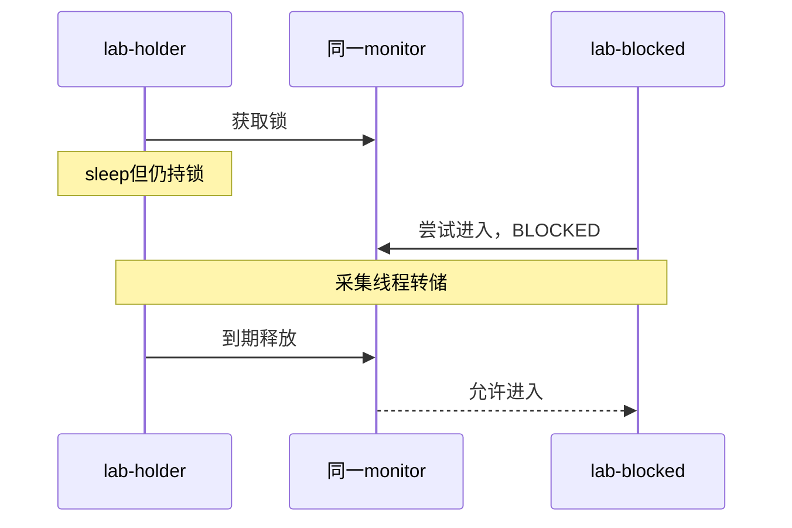

# 36 · JVM 性能诊断

## 章节范围与先修

先完成05/12/35章。运行步骤见[诊断说明](../../examples/jvm-diagnostics/README.md)，源码为[Java夹具](../../examples/jvm-diagnostics/DiagnosticsWorkload.java)、[Node夹具](../../examples/jvm-diagnostics/node-workload.mjs)、[JVM采集器](../../scripts/measure-jvm-diagnostics.ps1)、[Node采集器](../../scripts/measure-node-diagnostics.mjs)、[HTTP负载](../../scripts/load-http-lab.mjs)。所有转储只来自人工数据的可丢弃进程；完整二进制保留在忽略的target，正文记录可核对数字。不同夹具不是公平性能基准，不推断生产容量或语言排名。

## 知识点

### ch36-kp01 · JFR与CPU采样归属

#### 1. 一句话定义

采样记录运行中的调用栈，以实际样本及事件回答CPU时间可能集中在哪里；方法名出现不等于它被采样命中。

#### 2. 为什么需要它

请求慢可能来自CPU、锁、GC或I/O，盲目改线程数无法区分。日志说某方法被调用也不证明它占CPU；需要可重现负载与时间范围，再检查真实栈证据。

#### 3. 生活类比

观察员定时拍车间照片，统计工人当时在哪个工位。照片对应采样，工位链对应栈，拍摄设置对应录制配置。照片数量受频率和遮挡影响，不能把未拍到的工位说成永远没工作，也不能直接把出现次数当完整耗时。

#### 4. Node.js / TypeScript / NestJS 技术对照

V8 CPU profile与JFR ExecutionSample都能帮助定位栈，但事件、采样频率、线程模型和优化器不同。Node脚本核对实际sample节点及父链归属cpuWork，Java从ExecutionSample事件中核对DiagnosticsWorkload.cpu；不比较两者样本数排名。

#### 5. 两端代码对照

Node启动参数节选：

```text
node --cpu-prof --cpu-prof-dir=<新目录> --cpu-prof-name=node.cpuprofile ...
```

Java实际启动参数节选：

```text
-Xms64m -Xmx96m
-XX:StartFlightRecording=filename=<新目录>/lab.jfr,settings=profile,dumponexit=true
```

两端完整命令由采集脚本组织，不能直接把省略号当可执行命令。Java使用jfr summary统计事件，再jfr print读取实际CPU栈；Node不是只检查nodes里有函数名，而是沿每个sample的父链核对归属。

#### 6. 原理与流程图

人工CPU循环→运行中采样→进程完成写录制→解析事件/样本→核对栈→形成限定假设。这里没有跨系统状态，文字顺序足以说明；录制本身也会增加开销，因此不把录制时的耗时当未观测基线。

#### 7. 类比边界与错误直觉

一次采样不能证明所有CPU根因；JIT内联和栈截断影响归属。JFR profile不是所有事件全量记录。Node事件循环忙不等于所有请求都CPU密集；本例CPU夹具与后面的HTTP负载是两个独立实验。

#### 8. 企业应用场景与选型

先选有代表性的窗口和负载，采集后定位方法，再用更小实验验证假设。慢I/O应结合等待/网络证据，不能因为CPU栈里出现JSON就立刻改序列化。跨线程异步因果还需观测上下文，下一章另讲。

#### 9. 常见错误与排查

录制空先查进程寿命和采样配置。只有函数定义没有样本归属不能报“热点已证实”。采集器应限制工具执行时间，错误/超时保留日志并清理自己启动的进程，不让诊断挂起成为新故障。

#### 10. 实操练习与验收

基础题：区分节点与sample。迁移题：解释JFR事件栈和V8样本父链的共同目标。思考题：为什么样本多不等于另一个语言更慢？仓库根目录使用未存在的证据目录：

```powershell
.\scripts\measure-jvm-diagnostics.ps1 -OutputDirectory target/diagnostics-cpu-run1
node scripts/measure-node-diagnostics.mjs target/node-cpu-run1
```

本机增强轮次Java ExecutionSample1058，Node3696总样本中3330归属cpuWork栈；这些是具体观察，不是应硬编码的下次计数。脚本要求实际事件/归属大于0，无法采集时必须失败。

### ch36-kp02 · GC、堆转储与保留假设

#### 1. 一句话定义

GC日志描述回收行为，堆转储描述对象图；对象多、堆文件大或一次GC都不能单独证明内存泄漏。

#### 2. 为什么需要它

分配速度高但都可回收，与对象被长期保留是不同问题。只看-Xmx或文件大小会把正常缓存、人工夹具与泄漏混淆，需要类分布、时间趋势和保留链共同解释。

#### 3. 生活类比

垃圾车记录什么时候清运，仓库盘点记录还剩什么，钥匙链记录谁不让物品离开。清运对应GC日志，盘点对应heap snapshot/histogram，钥匙链对应GC roots保留关系。仓库大不说明非法囤积，正如一次大堆不说明泄漏。

#### 4. Node.js / TypeScript / NestJS 技术对照

V8 heapsnapshot与JVM HPROF都描述对象关系，格式不能互换；采样分配profile也不是完整对象普查。Node显式global根保留人工对象，Java静态RETAINED列表保留byte[]；两种数据布局不同，不比较快照体积大小。

#### 5. 两端代码对照

Node实际使用32KiB采样间隔和人工数据heap snapshot：

```text
--heap-prof --heap-prof-interval=32768
```

```js
globalThis.diagnosticsRetained = retained
writeHeapSnapshot(join(output, 'node.heapsnapshot'))
```

Java以真实原生命令读取类分布与转储：

```text
jcmd <教学进程PID> GC.class_histogram
jcmd <教学进程PID> GC.heap_dump <新目录>/lab.hprof
```

不要对运行Codex或业务服务器的进程直接照抄PID。当前脚本只处理自己启动的夹具，核HPROF头和[B字节量，并保存完整结果；没有假造一个空文件当转储。

#### 6. 原理与流程图


本机实际直方图[B为13236实例/17631960字节，HPROF24136030字节；夹具明确保留16MiB，其余byte[]含运行时数据，不能全归给业务。Node快照240277节点/18698548字节、分配采样216。Java GC10次也含直方图/堆转储可能触发的回收，不能称作自然请求GC频率。

#### 7. 类比边界与错误直觉

当前自动化完成采集、格式、类分布及事件检查，尚未运行MAT dominator/完整保留链分析。源码预期链是静态RETAINED→ArrayList→对象数组→byte[]，不是已由转储工具证明的完整链。扩展练习可用MAT核对，再比较多时点；不能把它写成已执行。

#### 8. 企业应用场景与选型

泄漏调查要在可比负载下看GC后存活趋势、对象增长和保留者；正常缓存也有强根。heap dump可能停顿、触发GC并占磁盘，采集本身干扰被测进程。只对可丢弃夹具练习，再按实际系统约束设计采集窗口。

#### 9. 常见错误与排查

Node分配profile为空并非证明没有分配；本机第二轮曾因此失败，显式保留根并调整采样后才稳定获得样本。不可删除非空断言求绿。堆文件不是HPROF/JSON时先排查命令失败或路径，不能只看扩展名。

#### 10. 实操练习与验收

基础题：区分分配与保留。迁移题：比较JVM静态字段和Node global根，不推断对象体积相同。思考题：为什么单个快照不能宣布泄漏？

```powershell
.\scripts\measure-jvm-diagnostics.ps1 -OutputDirectory target/diagnostics-heap-run1
node scripts/measure-node-diagnostics.mjs target/node-heap-run1
```

核对真实文件、直方图、非空分配样本及GC事件。MAT根链分析是未自动执行的扩展验收，完成后应另记工具/路径/结果；基础通过不依赖虚构扩展结果。

### ch36-kp03 · 线程状态与锁竞争

#### 1. 一句话定义

线程转储提供某时刻的栈和锁状态；把等待者、锁对象和持有者连起来，才能提出锁竞争原因。

#### 2. 为什么需要它

低CPU但请求慢可能在等锁或I/O。仅见WAITING就宣布死锁，或见某线程睡眠就说它无害，都会漏掉“睡眠时仍持有monitor”等关键关系。

#### 3. 生活类比

有人站在门外等钥匙，持钥匙的人在屋里休息。门外人对应BLOCKED，钥匙对应monitor，持钥匙休息者对应在synchronized内部sleep的线程。普通排队不等于环形死锁，类比不能把所有等待都归为同一机制。

#### 4. Node.js / TypeScript / NestJS 技术对照

无直接等价物：Java平台线程monitor BLOCKED与Node异步Promise等待不同；一个CPU长循环阻塞事件循环也不等于monitor竞争。本实验Node不伪造Java线程转储，只用其CPU/GC证据说明可观测范围，Node worker/native栈需另选工具。

#### 5. 两端代码对照

Node夹具cpuWork长循环会占事件循环，不包含互斥monitor；它不是本Java机制的等价实现。Java人工持锁片段：

```java
synchronized (MONITOR) {
    held.countDown();
    while (System.nanoTime() < deadline) {
        Thread.sleep(10);
    }
}
```

这是省略中断处理的说明片段，完整可编译版本见DiagnosticsWorkload。另一线程也synchronized同一MONITOR，实际jcmd Thread.print -l采集两者。不能把Thread.sleep理解成自动释放已持monitor。

#### 6. 原理与流程图



作者读本机增强轮threads.txt，holder为TIMED_WAITING且locked对象地址，与blocked的waiting to lock地址一致；自动化只断言lab-blocked的BLOCKED，地址配对是实际人工核对，不冒称脚本全部解析。JFR另有JavaMonitorEnter1项，说明实际记录到竞争后进入，不是只匹配配置参数。

#### 7. 类比边界与错误直觉

一个快照不证明永远阻塞；夹具到期会释放锁，不是死锁。RUNNABLE也可能在系统调用，不能仅凭状态判CPU消耗。真正死锁需等待图成环及持续证据，不把此单向竞争教材改名为死锁实证。

#### 8. 企业应用场景与选型

锁争用排查结合多次线程快照、持锁栈和JFR持续时间。缩小临界区前需理解共享状态，不直接删除锁。异步服务还应检查连接池、执行器和队列等待，不能只看业务线程名字。

#### 9. 常见错误与排查

只找到等待者时沿相同锁ID找持有者；找不到可能快照时序、不同锁机制或工具细节不符。采样晚了夹具已释放，应使用脚本就绪标记后及时采集，而不是硬编码系统PID反复碰运气。

#### 10. 实操练习与验收

基础题：解释sleep与释放monitor的区别。迁移题：指出Node这项无直接等价机制。思考题：两线程争同一锁为什么不一定死锁？

```powershell
.\scripts\measure-jvm-diagnostics.ps1 -OutputDirectory target/diagnostics-thread-run1
```

确认自动BLOCKED断言与JFR竞争事件，再人工在threads.txt配对锁地址/持有栈。若只见线程名字而无状态与锁证据，不能算通过。

### ch36-kp04 · 受控负载、延迟分位与证据边界

#### 1. 一句话定义

负载实验在明确并发、时长、请求和环境下统计成功/错误及延迟分位；数字只描述这次实验的条件。

#### 2. 为什么需要它

只报告平均延迟会隐藏尾部，忽略错误则可把快速失败误当高吞吐。没有预热、接口范围和服务依赖说明的RPS，无法解释，更无法指导生产容量。

#### 3. 生活类比

固定四个窗口办同一手续三秒，既数办成几件，也记等待时间和失败件。窗口数对应并发，手续对应GET请求，分位对应一批请求的延迟排序。只办空白表不代表复杂审批容量，本例空列表也不代表真实数据库业务。

#### 4. Node.js / TypeScript / NestJS 技术对照

同一Node驱动器分别启动Spring JAR和Nest编译入口，均预热20次、并发4、约3秒。驱动器自身事件循环、连接复用和主机资源也影响观测，不能用这次短环回实验宣布两种运行时的公平性能排名。

#### 5. 两端代码对照

两个端同用真实fetch与状态/空列表断言，Java目标为spring-web-lab的exec JAR，Node目标为dist/api/main.js。公共统计逻辑：

```js
const requestsPerSecond = latencies.length * 1000 / measuredMs
const percentile = fraction => latencies[Math.min(
  latencies.length - 1, Math.ceil(latencies.length * fraction) - 1,
)]
```

该片段对应已排序成功请求延迟；脚本要求errors=0，否则整体失败，不把失败请求悄悄混入“高性能成功”结论。每请求2秒上限，启动45秒上限，finally关闭自己启动的服务。

#### 6. 原理与流程图

准备实际运行物→随机端口启动→预热→四并发循环→验证每个响应→统计排序→保存报告→清理。HTTP与上面人工JFR实验分别执行；这里没有一份覆盖HTTP窗口的JFR，不能拿人工cpuWork来解释GET的p95。

#### 7. 类比边界与错误直觉

当前无TLS、数据库、认证或外部存储，客户端与服务同机，时长很短；不覆盖稳态、峰值、长尾置信区间或故障恢复。p95也不是“最慢5%平均值”，而是排序分位位置。

#### 8. 企业应用场景与选型

容量评估需有代表性数据、独立驱动机、足够时长和依赖负载，同时记录资源与错误。性能回归先建立可比环境与阈值，再讨论优化；课程此处只训练可核对报告，不设任意RPS达标线。

#### 9. 常见错误与排查

启动失败先看保存日志；本机首跑遇已记录的UnixDomainSockets错误，设置已实测临时目录属性后才成功。不能将启动失败算0延迟。数字变好但错误增长应先修失败，不择取成功数据宣传性能。

#### 10. 实操练习与验收

基础题：解释p50/p95和错误数。迁移题：说明同一驱动器如何避免两套验收预期漂移。思考题：为什么本实验不能推算生产实例数？仓库根目录：

```powershell
.\mvnw.cmd -pl examples/spring-web-lab -am package -DskipTests
pnpm examples:build
node scripts/load-http-lab.mjs target/http-load-run1
```

打包跳测只准备运行物。实际本机Spring12066请求/0错误/p95 2.2613ms，Nest17211/0错误/p95 1.5936ms；完整条件与失败修复见进度，非下次硬编码目标。检查原始report和响应断言，不以任一端单独成功代替整体。

## 章末验收与审查记录

本章draft。初版Diagnostics43820307129四环境成功；增强采样归属/工具超时/直方图后需对应新CI，见[P4-02](../progress/P4-02.md)。独立全文审查待完成。参考：[JFR命令](https://docs.oracle.com/en/java/javase/21/docs/specs/man/jfr.html)、[jcmd](https://docs.oracle.com/en/java/javase/21/docs/specs/man/jcmd.html)、[Node诊断](https://nodejs.org/en/learn/diagnostics)、[Node CLI profiles](https://nodejs.org/api/cli.html)。
