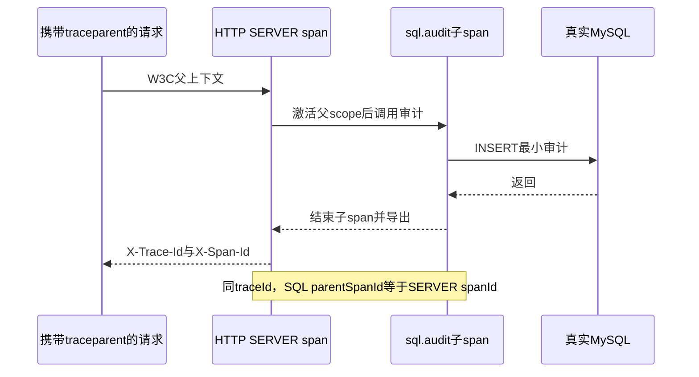
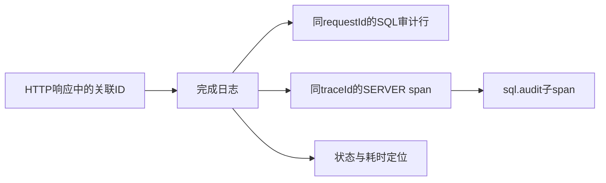

# 37 · 可观测性

## 章节范围与先修

先完成23/36章。运行物在安全入口：[Java配置](../../examples/security-lab/src/main/java/dev/javafornestjs/security/SecurityConfiguration.java)、[完成日志](../../examples/security-lab/src/main/java/dev/javafornestjs/security/RequestTelemetry.java)、[真实Tracing](../../examples/security-lab/src/main/java/dev/javafornestjs/security/RequestTracing.java)、[Node指标/日志](../../examples/nestjs-security-reference/src/observability.ts)、[Node Tracing](../../examples/nestjs-security-reference/src/tracing.ts)。按两端安全README准备一次性MySQL与测试夹具；真实HTTP/SQL测试分别记录，不以编译代替。没有外部Collector、Prometheus或可视化追踪后端部署声明。

## 知识点

### ch37-kp01 · 健康检查、指标与有限标签

#### 1. 一句话定义

健康检查回答已配置探针的状态，指标按有限标签聚合次数和耗时；二者都不能单独证明业务请求正确。

#### 2. 为什么需要它

服务进程活着仍可能频繁500；只看平均耗时会忽略错误和尾延迟。把每个用户或requestId加入指标标签还会让时序数量不断增长，增加存储与查询负担。

#### 3. 生活类比

门口营业灯表示店在营业，计数器统计每类业务办理数，计时器累计耗时。灯对应health，计数/计时对应metric，业务类别对应标签。营业灯不保证每张申请都办对；给每张单独设计数器也不适合长期汇总。

#### 4. Node.js / TypeScript / NestJS 技术对照

Java使用真正Actuator与Micrometer的http.server.requests Timer；Node示例用有限Map汇总count/totalMs/errors，不宣称实现Micrometer导出协议。两端health覆盖也不同，不能因为端点名字相似就推断检查了同样依赖。

#### 5. 两端代码对照

Node先归一化method/route，再按status建键：

```ts
const key = `${safeMethod} ${route} ${status}`
const current = this.timers.get(key) ?? { count: 0, totalMs: 0, errors: 0 }
current.count++
current.totalMs += elapsedMs
if (status >= 400) current.errors++
```

Java显式限制Actuator指标权限：

```java
.requestMatchers("/actuator/metrics", "/actuator/metrics/**")
    .hasAuthority("role:manage")
```

安全profile只暴露health/metrics，未配置的管理端点不因这个规则自动开放。Java测试真实读取`/actuator/metrics/http.server.requests?tag=uri:/tasks`核对COUNT；Node读`/actuator/metrics`核对GET /tasks 200的次数与耗时。匿名401、普通成员403、管理员200均有请求断言。

#### 6. 原理与流程图

请求→认证/权限→实际路由处理→结束时观察状态与单调耗时→按有限标签累计→管理员读取。route用`/tasks/{id}`等固定模板，未知路径统一`<unmatched>`，不把实际id、query、用户或requestId变成标签。该聚合流程无复杂跨系统状态，文字顺序足以说明。

#### 7. 类比边界与错误直觉

Node totalMs为毫秒，Micrometer Actuator Timer通常以baseUnit标注时间单位，不能直接拿两个数字相加。total/count是平均值，不是p95；当前Node摘要没有直方图。health UP不代替真实授权、CRUD或数据库事务测试。

#### 8. 企业应用场景与选型

生产指标应定义有意义的业务分类、错误率和延迟分布，并限制标签基数。运维端点也需要权限、网络和暴露策略；本例只演示环回与数据库管理权限，不声称已完成监控平台、告警或生产网络部署。

#### 9. 常见错误与排查

指标读不到先查暴露配置与权限，不能直接permitAll。计数随每个id长出新序列要查路由模板。用requestId查单次请求应转向日志/trace，不能把它加入metric标签。读取指标的请求本身可能在完成后才计入下一次快照。

#### 10. 实操练习与验收

基础题：区分health、counter、timer。迁移题：对照Actuator Timer与Node摘要的单位和能力。思考题：为什么每用户一个标签可能失控？仓库根目录按安全README完成前置后：

```powershell
.\mvnw.cmd -f examples/security-lab/pom.xml '-Dtest=SecurityApiTest#actuatorMetricsRequireAdministrativePermissionAndExposeRealHttpTimer' test
node --test --test-name-pattern='metrics require administrative' examples/nestjs-security-reference/dist/security.test.js
```

同时核对权限负例与实际请求计数，不只检查端点200。结构化日志与标签中均不应出现Access/Refresh或输入正文。

### ch37-kp02 · Trace、span与W3C上下文传播

#### 1. 一句话定义

trace连接一组因果相关操作，span表示其中一段有起止与状态的工作，W3C traceparent携带父上下文；requestId本身不是Tracing。

#### 2. 为什么需要它

单个请求ID能查日志，却不能自动表达父子关系或跨边界传播。业务请求进入SQL审计时，需要知道它属于哪个SERVER span、耗时多少、是否失败，而不是只给所有日志贴相同字符串。

#### 3. 生活类比

一张总工单派出子工单，接手窗口知道上一级编号并记录自己的处理段。总工单对应trace，处理段对应span，父编号对应parent span ID。传来的编号不等于通行证，traceparent也不能授予访问权限。

#### 4. Node.js / TypeScript / NestJS 技术对照

两端都运行真实OpenTelemetry SDK，不手写随机ID冒充span。Java用Context/Scope在当前同步Servlet链管理上下文；Node每应用独立AsyncLocalStorageContextManager，以显式parent和with跨Promise传播，不重复注册全局provider。SDK JS2.12使用统一sdk-trace包，API1.9满足peer范围，版本不要求与Java SDK数字一致。

#### 5. 两端代码对照

Node SERVER span从提取的父上下文创建：

```ts
const span = this.tracer.startSpan(`http ${route}`, {
  kind: SpanKind.SERVER,
  attributes: { 'http.route': route, 'request.id': requestId },
}, parent)
const current = trace.setSpan(parent, span)
```

Java同题真实SDK构建：

```java
Context parent = W3CTraceContextPropagator.getInstance()
        .extract(Context.root(), request, HEADERS);
return tracer.spanBuilder("http " + RequestTelemetry.route(request.getRequestURI()))
        .setSpanKind(SpanKind.SERVER).setParent(parent)
        .setAttribute("request.id", requestId)
        .setAttribute("http.route", RequestTelemetry.route(request.getRequestURI()))
        .startSpan();
```

AuthService实际SQL审计调用包在sql.audit子span中，工作真实执行；不采集SQL语句/参数或异常文本。Java测试Memory+实际日志exporter，Node实际SDK export回调输出最小JSON，均未向外部服务发送。

#### 6. 原理与流程图



SDK测试检查真实父子ID、SERVER kind、SQL成功状态与非负持续时间。无效traceparent生成新trace，合法traceparent但无Bearer仍401。当前sql.audit span覆盖该次数据库调用，不承诺完整事务commit span或所有Mapper自动插桩。

#### 7. 类比边界与错误直觉

本例只验证入站W3C提取及本服务HTTP→SQL子span，没有证明两服务出站注入、跨集群网络或Collector部署。采样设为100%便于人工实验，不是默认生产建议；4xx并不自动等于服务器错误，500被标ERROR。requestId连接SQL审计行与日志，trace/span ID另有自己的语义。

#### 8. 企业应用场景与选型

需要跨服务追踪时继续配置出站传播、采样与可用的导出后端，并定义敏感字段策略。Spring Micrometer metrics与本例直接OTel tracing并行存在，不据依赖BOM包含Tracing就声称配置了Micrometer Tracing bridge。此处没有运行远端链路查询界面。

#### 9. 常见错误与排查

SQL span成根而非子节点，先查scope在异步边界是否丢失。未结束span不会自动变成完整记录。Node客户端早断开可能没有finish，当前finish/close共享一次性收尾，标ERROR/aborted；内部日志499表示中止，客户端没有收到HTTP499。它不保证取消已经开始的数据库事务。Java当前覆盖同步Servlet链，不外推所有异步dispatch。

#### 10. 实操练习与验收

基础题：分别解释requestId/traceId/spanId。迁移题：对照Java Scope与Node本地context manager。思考题：为什么传入合法traceparent仍不能读取受保护任务？

```powershell
.\mvnw.cmd -f examples/security-lab/pom.xml '-Dtest=SecurityApiTest#w3cParentPropagatesToServerAndActualSqlSpansWithoutGrantingAccess' test
node --test --test-name-pattern='W3C parent|real aborted connection' examples/nestjs-security-reference/dist/security.test.js
```

检查真实父子关系、无效上下文、匿名拒绝和结束次数。Node中止测试真实销毁HTTP连接，必须导出一次ERROR/aborted span；不能只手动调用finalizer后宣布断连已验证。

### ch37-kp03 · 结构化日志、最终编码与跨层排查

#### 1. 一句话定义

结构化日志以稳定字段记录事件，最终输出还需经过真实编码验证；只保留排障所需字段，不能直接序列化请求或异常。

#### 2. 为什么需要它

拼字符串难以按请求、路由、状态查询，直接记录整个request会泄漏凭据。测试看见一个日志事件也不证明控制台编码成功：本例最终JSON断言真实发现过MDC重复字段导致的ECS失败。

#### 3. 生活类比

事故单用固定栏位填写编号、环节、结果和耗时，打印后再检查是否可读。栏位对应JSON字段，编号对应关联上下文，打印对应encoder。草稿内容正确不保证打印机没出错，事件对象存在也不保证最终日志可用。

#### 4. Node.js / TypeScript / NestJS 技术对照

Node使用Pino输出实际JSON，Java使用SLF4J键值事件与Boot ECS控制台编码。字段白名单相近但完整schema不同，不要求全行相等。Java MDC与显式键值可能重复，Node也不能让多事件类型的同名status字段未经event区分就混用。

#### 5. 两端代码对照

Node完成事件只有明确字段：

```ts
const entry = {
  event: 'request.completed', requestId, traceId, spanId,
  method: safeMethod, route, status, elapsedMs, aborted,
}
```

Java记录同类键值，requestId由MDC提供，避免重复：

```java
event.addKeyValue("event", "request.completed")
    .addKeyValue("traceId", context.getTraceId())
    .addKeyValue("spanId", context.getSpanId())
    .addKeyValue("method", METHODS.contains(method) ? method : "OTHER")
    .addKeyValue("route", route(path)).addKeyValue("status", status)
    .addKeyValue("elapsedMs", Math.max(0, System.nanoTime() - started) / 1_000_000.0).log("Teaching request completed");
```

这是完整实现的字段节选，耗时由单调时钟差换算。span exporter按SpanData输出并临时清空/恢复MDC，既避免重复字段，也不把导出线程上的其他请求MDC误当当前span。

#### 6. 原理与流程图



测试不是只查内存事件：Node解析Pino JSON，JavaCapturedOutput解析最终ECS行，核对requestId/traceId。真实任务创建的响应requestId必须等于MySQL审计行；注入审计失败后HTTP500和span ERROR可见，完成日志不带Throwable或异常文本。

#### 7. 类比边界与错误直觉

当前证明本应用完成/span事件不含指定敏感标记，不代表所有代理、第三方库、文件内容、运维平台或堆转储都已脱敏。审计失败注入的异常细节只用于测试，不导出。日志有字段不等于不可篡改审计库，也不保证进程崩溃时日志可靠送达。

#### 8. 企业应用场景与选型

用metrics找异常范围，用trace看操作关系，用日志看稳定业务事件，再核对数据库事实。为事件定义有限schema和版本，设置保留/访问策略；本例不提供集中日志部署和告警。敏感信息应尽量不进入事件，而非寄希望于事后正则替换。

#### 9. 常见错误与排查

有ILoggingEvent但无JSON行要查encoder；初稿requestId同时进MDC与键值，ECS报重复，保留最终JSON断言后修来源，不删断言求绿。查跨请求串线时核对MDC finally清理、Node局部状态和span parent；不要把身份写成全局变量方便日志。

#### 10. 实操练习与验收

基础题：列出完成日志白名单。迁移题：解释MDC与Pino显式对象的不同风险。思考题：为什么只断言logger被调用不足以验收结构化日志？

```powershell
.\mvnw.cmd -f examples/security-lab/pom.xml '-Dtest=SecurityApiTest#structuredCompletionLogsCorrelateSqlAuditWithoutRawSecrets' test
node --test --test-name-pattern='structured completion logs' examples/nestjs-security-reference/dist/security.test.js
```

核最终JSON、真实SQL关联、耗时/500、span错误，以及密码/Access/Refresh/正文标题/私有路径/异常marker缺席。不要输出完整原始令牌作为排障附件；完整矩阵结果按对应提交记录。

## 章末验收与审查记录

本章in_review。初始日志21+21矩阵成功，但实际span版本1a7106c的Java最终JSON失败，且未执行Node；d1d35af修编码/MDC与断连后[Security43857439628](https://github.com/zrayjay/java-for-nestjs/actions/runs/43857439628)两JDK各Java22、Node23完整通过，[独立全文审查](../reviews/P4-02-observability.md)通过，详见[P4-02](../progress/P4-02.md)。参考：[Actuator metrics](https://docs.spring.io/spring-boot/3.5/actuator/metrics.html)、[Micrometer](https://docs.micrometer.io/micrometer/reference/)、[W3C Trace Context](https://www.w3.org/TR/trace-context/)、[OpenTelemetry Java](https://opentelemetry.io/docs/languages/java/)、[OpenTelemetry JS](https://opentelemetry.io/docs/languages/js/)、[Pino](https://getpino.io/)、[Boot结构化日志](https://docs.spring.io/spring-boot/3.5/reference/features/logging.html)。
