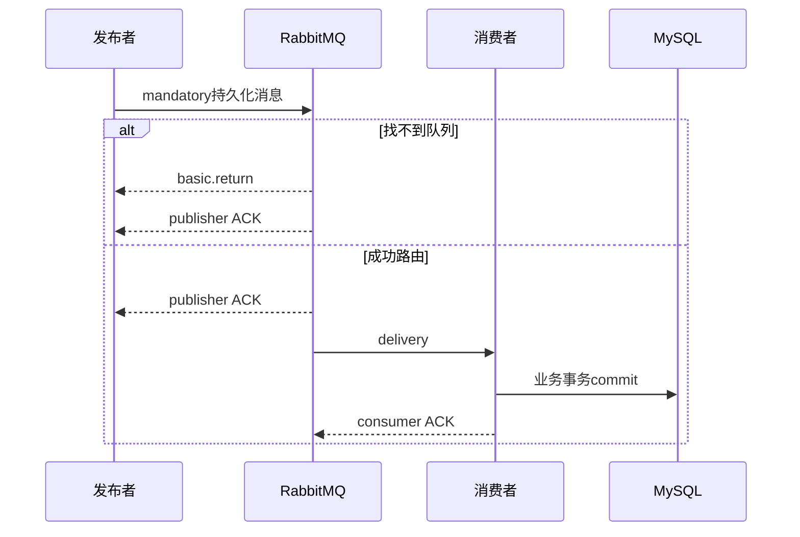
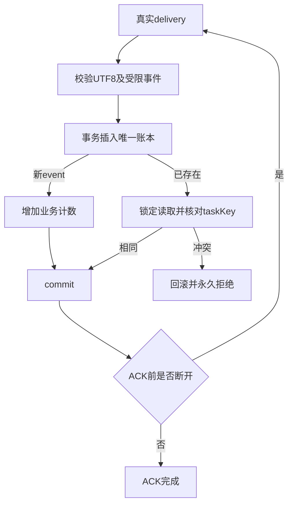
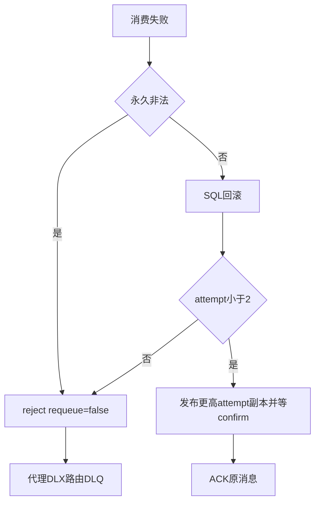

# 38 · 消息队列

## 章节范围与先修

先完成12/27章。按[实验README](../../examples/messaging-lab/README.md)准备独占一次性MySQL与RabbitMQ，编译双端并先跑Java迁移。本文片段分别摘自[Node协议实现](../../examples/nestjs-message-reference/src/message.ts)、[Java协议实现](../../examples/messaging-lab/src/main/java/dev/javafornestjs/messaging/BrokerLab.java)与[事务存储](../../examples/messaging-lab/src/main/java/dev/javafornestjs/messaging/MessageStore.java)，省略声明/资源清理须回完整源码核对。两端用底层AMQP SDK展示边界，未集成Nest transporter或RabbitTemplate；测试basicGet控制单次处理，不是常驻消费者生产入口。

## 知识点

### ch38-kp01 · 发布确认与消费者确认

#### 1. 一句话定义

publisher confirm回答代理是否接受发布，consumer ACK回答一条投递是否处理完成，两者分属不同通道责任。

#### 2. 为什么需要它

把调用SDK没有抛错当发送成功，会遗漏代理拒绝或连接中断；把代理确认当业务完成，又会在消费者尚未写数据库时向用户报喜。消息需要在哪个边界负责必须先说清。

#### 3. 生活类比

寄件柜台回执对应publisher confirm，找不到收件窗口退回对应mandatory return，收件人办完回执对应consumer ACK。柜台接件、找到窗口、收件人办妥是三件事。现实签收可能靠口头约定；协议必须按channel和投递标记确认，故事不能证明磁盘断电后数据还在。

#### 4. Node.js / TypeScript / NestJS 技术对照

Node amqplib ConfirmChannel与Java Channel.confirmSelect都使用RabbitMQ实际确认协议。Node publish布尔值主要表示客户端背压，不能当代理确认；Java basicPublish返回也不是confirm。BullMQ依赖Redis，有自己的任务生命周期，不可照搬AMQP ACK和DLX命令。Nest transporter的noAck配置也不能由底层示例推断默认值。

#### 5. 两端代码对照

Node在publish回调获得confirm，return事件另行记录（错误、超时与关闭见完整源码）：

```ts
channel.on('return', () => { returned = true })
channel.publish('', routing, bytes, {
  mandatory: true, persistent: true, messageId: randomUUID(),
  headers: { attempt },
}, (error) => { if (error) reject(error); else resolve() })
```

Java发布通道启用confirm并等待有界结果：

```java
channel.confirmSelect();
channel.addReturnListener((code, text, exchange, key, properties, body) -> returned.set(true));
channel.basicPublish("", routing, true, properties, bytes);
channel.waitForConfirmsOrDie(5000);
```

properties设置deliveryMode2、UTF8 JSON。两端向不存在的routing key发送时必须同时观察confirmed=true和returned=true；正常路由先得到confirm，再消费并断言SQL计数1。

#### 6. 原理与流程图



return先于该消息的confirm到达；代码分别记录，不能只检查一个布尔值。发布超时的结果可能未知，不能推断代理一定没有接收。

#### 7. 类比边界与错误直觉

durable是拓扑属性，persistent是消息属性，confirm是协议结果。组合仍不证明物理断电可靠性、quorum集群或业务处理成功。本例真实服务断言仅覆盖当前可用的单代理环境。

#### 8. 企业应用场景与选型

RabbitMQ适合明确路由与任务分发；Kafka侧重持久日志、分区和消费组位置，offset提交与重放模型不同，不能把ACK/DLQ代码改名当Kafka实现。需保留历史回放和分区顺序时评估Kafka；本章选择一个真实RabbitMQ实现控制变量，没有Kafka运行证据。小型同步事务不必为展示技术引入队列。

#### 9. 常见错误与排查

出现“已确认却没消费”，先查mandatory return、routing key、绑定和vhost，再查消费者；不要删除return检查。publish=false时应处理背压而非重复假定代理拒绝。本例每次独立channel只发一条小消息，不提供高吞吐背压策略。

#### 10. 实操练习与验收

基础题：列出三种回执的责任方。迁移题：对照回调与waitForConfirmsOrDie。思考题：确认超时后为何重发仍要幂等？按README准备后从根目录运行：

```powershell
.\mvnw.cmd -f examples/messaging-lab/pom.xml '-Dtest=BrokerIntegrationTest#confirmsAndMandatoryReturnsDescribeDifferentBoundaries' test
node --test --test-name-pattern='publisher ACK' examples/nestjs-message-reference/dist/message.test.js
```

应同时断言未路由发布的confirm/return和正常消费的真实SQL效果，不仅看日志。

### ch38-kp02 · 提交后ACK与事务幂等

#### 1. 一句话定义

消费者把消费账本和业务效果同事务提交，再ACK，用唯一消费身份抵御重复投递。

#### 2. 为什么需要它

先ACK后写库会在进程崩溃时丢业务；先写库后ACK又存在已提交却重投的窗口。两套系统不共享本地事务，必须设计重复到达时的行为。

#### 3. 生活类比

办事窗口把工单号与办理结果写在同一本登记簿，落笔后再通知送件员。送件员没听到通知再次送来时，按工单号查已办记录。工单号对应eventId，窗口编号对应consumer_name，登记簿原子记录对应MySQL事务。若登记簿和结果分开写，类比失效；外部转账/邮件不在这本SQL簿内。

#### 4. Node.js / TypeScript / NestJS 技术对照

两端共享`processed_events`复合主键及`projection_effects`表。Java TransactionTemplate和Node显式begin/commit都让插入账本、增加计数一同回滚。账本重复后读取原taskKey采用FOR UPDATE当前读，避免把旧快照误当当前事实。事件身份是正文eventId；SDK messageId每次发布重新生成，不能用它跨重试去重。

#### 5. 两端代码对照

Node MessageStore.apply新事件路径（重复路径另读锁检查相同payload）：

```ts
await connection.beginTransaction()
await connection.query("INSERT IGNORE INTO processed_events(consumer_name,event_id,task_key) VALUES ('projection-v1',?,?)", [event.eventId, event.taskKey])
// 完整源码先判断affectedRows；仅新事件增加效果。
await connection.query('INSERT INTO projection_effects(task_key,applied_count) VALUES (?,1) ON DUPLICATE KEY UPDATE applied_count=applied_count+1', [event.taskKey])
await beforeCommit()
await connection.commit()
```

Java在事务模板中执行同题SQL，返回后才ACK：

```java
// 控制流缩写：完整源码有SQL失败分支及永久拒绝逻辑。
result = store.apply(event, beforeCommit);
// 此处代表完整源码中已经离开SQL异常处理，提交已经成功。
channel.basicAck(tag, false);
```

该Java片段为方法内控制流缩写，完整源码保留失败分支。Node同样在apply成功后channel.ack。提交后关闭channel的实验不ACK，下一通道收到redelivered=true且效果仍1。

#### 6. 原理与流程图



并发相同eventId由唯一键竞争序列化；一方提交后另一方识别重复。SQL effect只执行一次不等于代理只投一次。

#### 7. 类比边界与错误直觉

eventId必须稳定且payload受限，重复ID不同taskKey进入死信，不能悄悄接受不同业务。此例只有task.created及字符串字段，没有金额序列化或任意事件版本兼容承诺。账本保留周期决定可去重窗口；本例没有清理策略，生产不能未经分析定时删除。

#### 8. 企业应用场景与选型

适用于SQL内可原子记录的投影或业务变更。发邮件、第三方扣款需对方幂等键或额外状态机；本地账本不能让远程API加入MySQL事务。发布侧数据库提交与发消息的空档由后续Outbox解决，本章没有实现。

#### 9. 常见错误与排查

效果翻倍先核对eventId是否每次重建、账本与effect是否同事务、唯一键是否包括消费者。不要捕获ACK失败后再“回滚已提交业务”；BrokerLab刻意让ACK操作在SQL失败处理之外。重复事件测试若仍调用业务hook，说明去重放错位置。

#### 10. 实操练习与验收

基础题：说明ACK前后的两个崩溃窗口。迁移题：比较TransactionTemplate与显式事务释放。思考题：账本保留多久才能支撑历史重放？按README准备后：

```powershell
.\mvnw.cmd -f examples/messaging-lab/pom.xml '-Dtest=BrokerIntegrationTest#commitBeforeAckCanRedeliverWithoutRepeatingSqlEffect+concurrentDuplicatesHaveOneTransactionalSqlEffect' test
node --test --test-name-pattern='commit then close|concurrent duplicate' examples/nestjs-message-reference/dist/message.test.js
```

验收必须含真实channel关闭后的redelivered=true、DUPLICATE、效果1/账本1，并发两条消息结果为一个APPLIED和一个DUPLICATE。

### ch38-kp03 · 有界重试与原生死信

#### 1. 一句话定义

把可恢复处理失败限制在有限重试链内，把非法或耗尽消息拒绝到死信队列供检查。

#### 2. 为什么需要它

无条件requeue会让毒消息永久占用资源；把所有失败ACK掉又失去恢复机会。重试策略必须说明何时回滚、怎样重新投递、重试副本何时算接收和何时终止。

#### 3. 生活类比

窗口退回临时缺材料的单据并加盖尝试次数章，次数用完转问题档案；格式根本不对的单据直接归档。次数章对应attempt，问题档案对应DLQ，转交规则对应DLX。转交途中也可能丢件，故事不能推出两个队列跨系统原子流转或无限可靠存储。

#### 4. Node.js / TypeScript / NestJS 技术对照

两端attempt只接受整数0/1/2；处理失败先回滚SQL，再发布同正文/更高attempt并等confirm，最后ACK原投递。永久非法或attempt2处理失败用reject(requeue=false)，由代理DLX转到DLQ。不是使用业务代码手动写一个“死信数组”，也不是BullMQ attempts选项的直接语法映射。

#### 5. 两端代码对照

Node回滚后的临时失败路径：

```ts
await this.sendRaw(message.content, attempt + 1)
channel.ack(message)
return observed('RETRY', attempt, event.eventId)
```

Java对应路径及永久终止：

```java
if (current >= 2) {
    channel.basicReject(tag, false);
    return observed(Outcome.DEAD, current, redelivered, event.eventId());
}
sendRaw(delivery.getBody(), current + 1);
channel.basicAck(tag, false);
```

非法UTF8、非三字段JSON、超1KiB、无效attempt和身份冲突走永久拒绝；不包含异常消息正文的错误日志。Java/Node测试读取真实dead队列并检查代理生成的x-death原因。

#### 6. 原理与流程图



解析失败在事务前拒绝，SQL失败则先回滚。副本confirm后、原消息ACK前崩溃可能留下两条链，幂等不可省。新副本的redelivered可以为false，因为它是新发布，不是代理重投标志失效。

#### 7. 类比边界与错误直觉

每链最多三次处理不等于全局最多三次投递；代理连接中断可额外重投。当前是立即重试，没有退避/延迟插件，也没有按错误码精细分类；本例将SQL运行时错误纳入有限尝试，不能直接当生产故障分类方案。默认classic DLX转发不提供目标confirm的无损保证，目标不可用需另行设计与演练。

#### 8. 企业应用场景与选型

临时依赖故障可采用有界退避、速率限制和熔断，格式/版本不支持则隔离修复。DLQ需权限、告警、查看与受控重放流程；修复后保留原eventId才能延续幂等语义。本章没有自动恢复/无限重放承诺。

#### 9. 常见错误与排查

attempt不增长查重发属性，SQL残留查事务是否在失败hook前提交，DLQ为空查DLX绑定/队列可用性和reject的requeue参数。不要把直接打印DEAD当死信成功；必须读取真实队列及x-death。测试准备不足应失败，不能缺少环境就skip。

#### 10. 实操练习与验收

基础题：画出attempt0→1→2。迁移题：在双端比较永久失败与临时失败路径。思考题：副本confirm后ACK前崩溃为何能派生重复链？按README准备后：

```powershell
.\mvnw.cmd -f examples/messaging-lab/pom.xml '-Dtest=BrokerIntegrationTest#boundedRetriesRollbackBeforeNativeDeadLettering+transientFailureCanRecoverAndPermanentPayloadsNeverTouchSql' test
node --test --test-name-pattern='three precommit|transient recovery' examples/nestjs-message-reference/dist/message.test.js
```

连续失败时每轮效果/账本均0，第三轮真实DLQ出现reason=rejected；临时一次失败后attempt1应用成功；毒消息及冲突event不污染数据库。完整套件命令及结果范围见README和[进度](../progress/P5-01.md)。

## 练习提示与官方资料

先标出SQL commit、发布confirm、消费ACK三个独立边界，再枚举边界间崩溃。Kafka消费位置与Rabbit delivery tag不是相同身份。练习的通过条件是断言而非手动修改日志。

- [RabbitMQ publisher confirms与consumer acknowledgements](https://www.rabbitmq.com/docs/4.2/confirms)
- [RabbitMQ dead letter exchanges及安全边界](https://www.rabbitmq.com/docs/4.2/dlx)
- [RabbitMQ v4.2.2发布](https://github.com/rabbitmq/rabbitmq-server/releases/tag/v4.2.2)
- [Java client API](https://www.rabbitmq.com/client-libraries/java-api-guide)
- [amqplib channel API](https://amqp-node.github.io/amqplib/channel_api.html)
- [Kafka设计](https://kafka.apache.org/documentation/#design)
- [ADR0010](../adr/0010-messaging-and-outbox-runtime.md)
