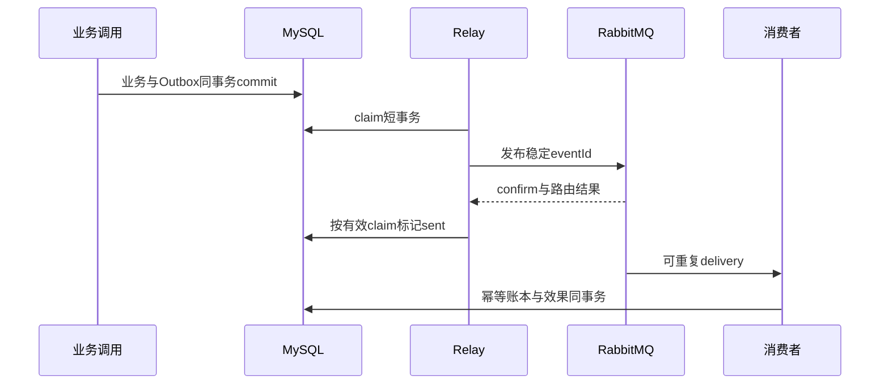
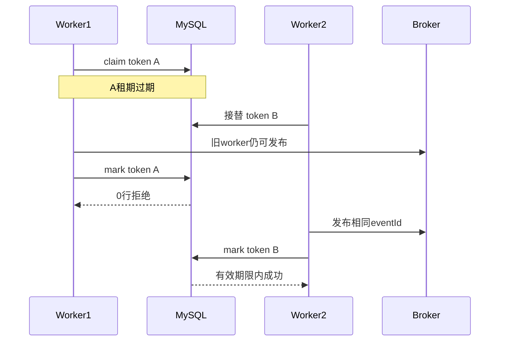
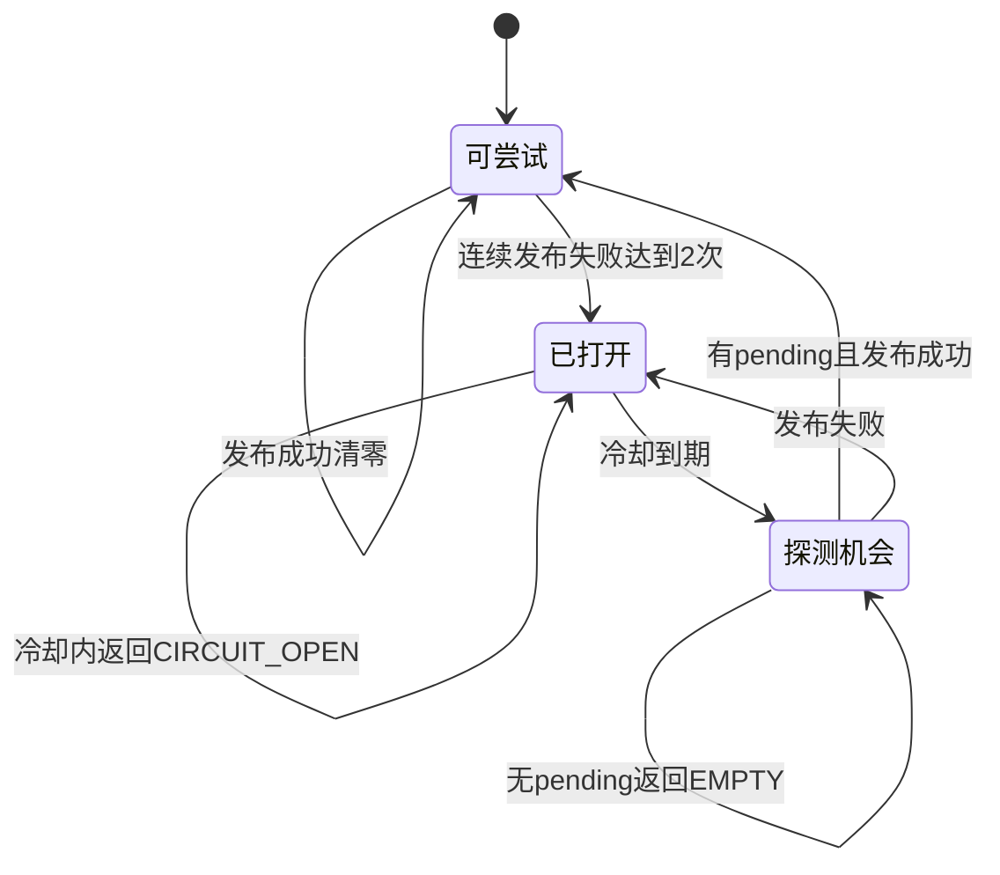

# 39 · 分布式可靠性

## 章节范围与先修

先完成27/32/38章，按[实验README](../../examples/messaging-lab/README.md)准备独占一次性数据库和代理。完整实现：[Java存储](../../examples/messaging-lab/src/main/java/dev/javafornestjs/messaging/MessageStore.java)、[Java Relay](../../examples/messaging-lab/src/main/java/dev/javafornestjs/messaging/OutboxRelay.java)、[Node存储](../../examples/nestjs-message-reference/src/message.ts)、[Node Relay](../../examples/nestjs-message-reference/src/outbox.ts)。两端共用Java Flyway V2迁移；先Java再Node、逐文件串行，避免互相清库。真实消息/SQL测试与受控本地超时模型分别报告，见[P5-02](../progress/P5-02.md)。

这是显式调用runOnce的可靠性原语，不是已部署的常驻Agent Worker或生产多副本服务。受控hook异常不称OS进程崩溃，真实mandatory return不称代理断电。

## 知识点

### ch39-kp01 · 事务Outbox与最终一致性

#### 1. 一句话定义

Outbox把业务变更与待发事件同事务写入数据库，再由独立发送步骤推进交付，接受重复并依赖幂等。

#### 2. 为什么需要它

业务commit后直接发送，进程在两步之间失败会留下没有消息的业务；先发送再commit，又可能把最终回滚的业务传给消费者。本地SQL事务无法同时原子提交RabbitMQ。

#### 3. 生活类比

窗口把办妥结果和待寄通知一同登记，邮务员按待寄簿送件，拿到柜台回执后划掉待寄状态。办妥结果对应outbox_tasks，待寄簿对应message_outbox，邮务员对应Relay。划掉前忘记回执会重复寄，不能从登记簿推出邮路只送一次；两份登记若不在同一本事务簿，类比失效。

#### 4. Node.js / TypeScript / NestJS 技术对照

Node beginTransaction/commit与Java TransactionTemplate都在同一连接事务插入业务和Outbox；网络发布在事务外。Nest的事件总线进程内emit不是可持久恢复的Outbox；Spring事务事件回调也不自动持久化未发送状态。这里直接SQL帮助看清跨系统窗口，不声称已有CDC或框架自动恢复。

#### 5. 两端代码对照

Node enqueueTask的事务主体（rollback/release见完整源码）：

```ts
await connection.beginTransaction()
await connection.query('INSERT INTO outbox_tasks(task_key,event_id) VALUES (?,?)', [event.taskKey, event.eventId])
await connection.query('INSERT INTO message_outbox(event_id,task_key) VALUES (?,?)', [event.eventId, event.taskKey])
await beforeCommit()
await connection.commit()
```

Java同一业务事务：

```java
transactions.executeWithoutResult(status -> {
    jdbc.update("INSERT INTO outbox_tasks(task_key,event_id) VALUES (?,?)", event.taskKey(), event.eventId());
    jdbc.update("INSERT INTO message_outbox(event_id,task_key) VALUES (?,?)", event.eventId(), event.taskKey());
    beforeCommit.run();
});
```

两端Relay都先claim、实际publish并等confirm，再markSent。SENT表示本轮确认且成功标记，不表示消费者业务已经执行。

#### 6. 原理与流程图



发送失败保留pending；代理已接收但mark前中断也保留pending，恢复后可能重复。最终送达需要调用者持续重试、数据库/代理恢复、事件可路由且消费者可处理，不是无条件期限保证。

#### 7. 类比边界与错误直觉

Outbox只消除“业务已提交但没有待发记录”的窗口；它没有把SQL、代理和消费者变成同一个原子事务。当前事件不可变、没有清理策略或严格跨事件顺序，不能用于推断有序余额变更。第38章去重仍必需。

#### 8. 企业应用场景与选型

适用于业务提交后必须通知投影或异步任务。高吞吐时可评估CDC、分片、批量和监控，但要明确事件兼容、积压、重放与清理策略。数据库轮询有负担，增加队列也增加运维成本；单库同步工作不必多跨一条消息链。

#### 9. 常见错误与排查

业务有记录但pending0且没有消费，查Outbox是否与业务同事务、是否在publish前标记。pending长期增加，查路由return、失败日志、租期和调度是否再次调用。确认成功不应删掉身份或重建eventId；mark失败应保留重复交付可能性。

#### 10. 实操练习与验收

基础题：列出commit、publish、mark三个边界。迁移题：对照两端rollback与mark的位置。思考题：为什么消费者已成功而Outbox仍pending并不矛盾？准备README前置后在根目录执行：

```powershell
.\mvnw.cmd -f examples/messaging-lab/pom.xml '-Dtest=OutboxIntegrationTest#businessAndOutboxRollbackTogether+committedBusinessSurvivesActualUnroutablePublishThenRecovers+confirmBeforeMarkCrashDuplicatesDeliveryButNotEffect' test
node --test --test-name-pattern='rollback together|committed business|real confirm' examples/nestjs-message-reference/dist/outbox.test.js
```

回滚时业务/pending均0；实际mandatory return后业务1/pending1；恢复后pending0/效果1。confirm后注入mark前异常，第一次APPLIED、恢复重发DUPLICATE、账本和效果仍1。没有模拟代理日志代替实际协议。

### ch39-kp02 · 数据库时钟租约与标记保护

#### 1. 一句话定义

租约在有限时间内授予处理资格，随机claim token只允许当前有效持有者更新发送状态，不能自动阻止外部操作。

#### 2. 为什么需要它

多worker不能都把同一pending行当自己的任务；永久锁住又会让死worker阻塞恢复。允许过期接替后，旧worker仍可能从网络阻塞中回来，所以仅检查“曾经拿到锁”不够。

#### 3. 生活类比

保管柜给领取人一张限时编号牌，过期后发新牌；登记柜只认当前牌。编号牌对应lease_token，有效时间对应lease_until，柜台时钟对应数据库CURRENT_TIMESTAMP。旧领取人可能已拿着材料走到邮局，登记柜换牌不能让邮局忘掉这人；这就是租约不等于外部fencing。

#### 4. Node.js / TypeScript / NestJS 技术对照

两端用真实MySQL `FOR UPDATE SKIP LOCKED`短事务选行，再写随机token及数据库时钟期限，不依赖各进程墙钟一致。Java使用Optional空值，Node使用undefined；SQL规则相同。Redis SET NX锁或本机Promise队列不能直接替代当前SQL事务与持久租期。

#### 5. 两端代码对照

Node claim事务先选可领取行：

```ts
const rows = await connection.query('SELECT event_id,task_key FROM message_outbox WHERE sent_at IS NULL AND (lease_until IS NULL OR lease_until<=CURRENT_TIMESTAMP(6)) ORDER BY event_id LIMIT 1 FOR UPDATE SKIP LOCKED')
```

Java mark只接受当前且未过期token：

```java
return jdbc.update("UPDATE message_outbox SET sent_at=CURRENT_TIMESTAMP(6),lease_token=NULL,lease_until=NULL WHERE event_id=? AND lease_token=? AND sent_at IS NULL AND lease_until>CURRENT_TIMESTAMP(6)",
        claim.event().eventId(), claim.token()) == 1;
```

Node mark执行同一条件并检查affectedRows===1，Java claim也采用同一选行SQL。所有网络工作在claim事务提交后执行，不长时间持有行锁等网络。

#### 6. 原理与流程图



随机token用于等值比较，不是传给Broker的单调fencing号；代理也没有在此验证token。LEASE_LOST需要允许重复与后续恢复，不能当消费者处理失败。

#### 7. 类比边界与错误直觉

数据库时钟解决本例worker墙钟不一致，不保证数据库主从切换/时钟跳变下任意生产租约性质。100..5000ms是短实验限制，不是生产建议。短租期会在正常慢发布后失效；长租期则延迟故障接管，生产需续租、超时预算及监控。

#### 8. 企业应用场景与选型

适用于任务领取与短处理接管，必须与被写资源的能力一起设计。真正排斥旧worker外部写入需目标资源校验fencing或版本；本例无法对RabbitMQ发布执行该检查，选择稳定eventId与消费者幂等。大表应评估索引、锁范围、批量和积压，本例不是性能基准。

#### 9. 常见错误与排查

旧worker覆盖状态，查UPDATE是否缺token或期限条件；多个worker都拿到行，查是否在同事务完成选择与租期写入。看到重复发布不代表租约SQL失效，应分别核对claim身份、实际外部发布和mark结果。

#### 10. 实操练习与验收

基础题：区分持有行锁与已提交租期。迁移题：检查双端mark SQL。思考题：能否只靠random token让代理拒绝旧worker？准备README前置后：

```powershell
.\mvnw.cmd -f examples/messaging-lab/pom.xml '-Dtest=OutboxIntegrationTest#concurrentLeaseAndStaleWorkerCannotMarkButCanStillPublish' test
node --test --test-name-pattern='leases exclude concurrent' examples/nestjs-message-reference/dist/outbox.test.js
```

有效期内第二次claim为空；过期接替后旧token标记false、新token标记true；两次真实发送导致APPLIED/DUPLICATE且效果1。并发两次claim恰好一个成功，不能只看不同token值。

### ch39-kp03 · 超时是观察期限

#### 1. 一句话定义

本地等待超时表示调用者不再按当前方式等待，不能据此认定远端操作未执行或已撤销。

#### 2. 为什么需要它

Agent Worker等待确认超时后，原请求可能仍在执行，或远端成功但回执丢失。立刻重发又没有幂等，就会放大副作用；永远等待又会耗尽资源。

#### 3. 生活类比

取件人等到约定时刻离开窗口，后台办理仍可能完成。离开对应本地等待超时，后台办理对应已启动操作，回执对应观察结果。现实中喊一句“取消”可能被听到；技术上需明确取消协议及生效点，不能靠离开动作推断取消成功。

#### 4. Node.js / TypeScript / NestJS 技术对照

Promise.race不会自动取消落败Promise；Future.get(timeout)也不会自动cancel任务。即使AbortSignal或线程中断被发送，外部系统已提交的效果通常不能撤销。本例用受控门实证本地等待语义，真实AMQP的confirm期限另在SDK中配置，不冒充已经模拟网络丢包。

#### 5. 两端代码对照

Node [本地实验](../../examples/nestjs-message-reference/src/deadline.test.ts)等待race失败后释放门：

```ts
await assert.rejects(Promise.race([operation, delay(30).then(() => {
  throw new Error('Local observation deadline')
})]), /Local observation deadline/)
// finally中释放gate；原operation随后完成，效果从0变1。
```

Java [对应实验](../../examples/messaging-lab/src/test/java/dev/javafornestjs/messaging/DeadlineContractTest.java)：

```java
assertThrows(TimeoutException.class, () -> operation.get(30, TimeUnit.MILLISECONDS));
assertFalse(operation.isCancelled());
assertEquals(0, effects.get());
// finally释放受控门，再get确认原操作返回1。
```

两端测试都断言门释放后原任务实际完成，不能只断言抛了timeout。门控制因果顺序，30ms不是性能阈值。

#### 6. 原理与流程图

调用启动操作→操作停在测试门→本地等待到期→检查效果0→释放门→原操作完成效果1。顺序由门和完成等待约束，单进程小模型无需跨系统图。真实协议则需单独记录发送、接收、提交与回执，不能从此推导具体代理时序。

#### 7. 类比边界与错误直觉

实验没有真正远程取消能力或confirm丢包注入。真实BrokerLab的连接/握手期限与5秒confirm期限限制不同阶段，读取投递的5秒轮询边界也不是全部流程的总期限。Node Promise.race只能限等待，不能修复SDK网络请求泄漏。

#### 8. 企业应用场景与选型

为连接、处理和总预算分别设期限，并设计结果未知时查询或稳定幂等重试。只读请求常能安全重试，扣款或发消息必须考虑重复。取消若需要业务保证，应有目标确认与补偿状态；关闭channel不能从代理撤销已接收消息。

#### 9. 常见错误与排查

超时后效果仍出现，先检查实际提交点及取消支持，不把它当“Promise失效”。本例Outbox不因超时标记sent，租期后可再次领取；重复由消费者处理。永远pending还要查调用者是否继续调度，单个期限不能保证最终送达。

#### 10. 实操练习与验收

基础题：解释“结果未知”。迁移题：比较Future.get与Promise.race。思考题：关闭代理channel能否撤销已进入队列的消息？无需服务，先编译Node后运行：

```powershell
.\mvnw.cmd -f examples/messaging-lab/pom.xml '-Dtest=DeadlineContractTest' test
node --test examples/nestjs-message-reference/dist/deadline.test.js
```

必须同时看到本地超时被断言、效果先0后1和原操作完成，完整命令退出0；这不替代真实消息恢复实验。

### ch39-kp04 · 实例熔断与恢复探测

#### 1. 一句话定义

熔断在连续调用失败后暂时停止尝试，冷却后允许探测；它限制失败压力，不能修复依赖或保证全局一致状态。

#### 2. 为什么需要它

Outbox积压时每次都立即调用坏路由会持续制造失败，浪费代理和应用资源。无限重试、死信与熔断是不同机制：熔断暂缓新调用，不直接改变业务事实或消息有效性。

#### 3. 生活类比

一个邮务员连续发现两次窗口不可用，暂时不再排队，稍后再试。邮务员对应一个Relay实例，失败计数对应连续发布异常，冷却对应单调时间间隔。另一个邮务员未必知道这件事；类比不能让本地计数自动变成跨副本共享状态。

#### 4. Node.js / TypeScript / NestJS 技术对照

两端是小型自实现模型，非Resilience4j或框架生产策略。Java synchronized让同实例调用串行等待，Node busy标志直接拒绝同实例重入；不把同步阻塞与事件循环Promise说成一样。两者只统计publish抛出的异常，claim数据库错误不计入该发布熔断，afterConfirm hook也在其外。

#### 5. 两端代码对照

Node用performance.now测冷却间隔：

```ts
if (this.failures >= 2 && performance.now() - this.openedAt < this.cooldownMillis)
  return 'CIRCUIT_OPEN'
```

Java用System.nanoTime，不用墙钟比较持续时间：

```java
if (failures >= 2 && System.nanoTime() - openedAt < cooldownNanos) {
    return Result.CIRCUIT_OPEN;
}
```

冷却后串行的一次runOnce充当探测；publish成功将failures清零，失败重新记录打开时刻。没有pending任务返回EMPTY，不虚构一次依赖健康探测。

#### 6. 原理与流程图



租期和冷却不是一个时钟状态；即使冷却结束，行仍在别人有效租期内也可能EMPTY。调用者必须再次runOnce，示例没有后台定时自动恢复。

#### 7. 类比边界与错误直觉

当前只在一个对象内串行，重建对象会丢失失败计数；没有集群熔断、滑动窗口/错误率或用户级隔离。成功发布后mark失败也不能据此说代理故障；代码仅保护选定的发布边界。

#### 8. 企业应用场景与选型

生产可评估成熟库、并发限制、退避抖动与指标，按下游和故障类型分隔策略。不能把权限错误永远当临时故障，不能用熔断替代DLQ修复或Outbox积压告警。这里选择小模型让状态可验证，不宣称生产参数合适。

#### 9. 常见错误与排查

一直不恢复，分别查冷却、pending租期和是否还有调用者；恢复却重复业务，查消费幂等。测试用5秒租约避免要求正常网络发布必须在100ms内完成，并真实等待租期结束；短租期仅保留给专门过期实验。

#### 10. 实操练习与验收

基础题：区分熔断与每消息重试次数。迁移题：解释Java串行阻塞与Node重入拒绝。思考题：数据库claim失败是否该计入同一个代理熔断？准备README服务后：

```powershell
.\mvnw.cmd -f examples/messaging-lab/pom.xml '-Dtest=OutboxIntegrationTest#localCircuitStopsRepeatedActualRoutingFailuresAndAllowsRecoveryProbe' test
node --test --test-name-pattern='local circuit blocks' examples/nestjs-message-reference/dist/outbox.test.js
```

实际mandatory return连续两次后返回CIRCUIT_OPEN、业务仍1/pending1；等待冷却和租期、恢复正常路由，再次runOnce为SENT、消费者APPLIED、pending0。结果不能仅通过手工切换变量伪造：失败和恢复路径均使用真实代理协议。

## 练习提示与官方资料

把数据库事实、代理事实和本地观察分开写在纸上，再逐个插入失败点。最终一致性依赖恢复条件与持续推进；“还没送达”和“永远丢失”需要不同证据。

- [事务Outbox模式与重复消息边界](https://microservices.io/patterns/data/transactional-outbox.html)
- [MySQL8.4锁定读取与SKIP LOCKED](https://dev.mysql.com/doc/refman/8.4/en/innodb-locking-reads.html)
- [Java Future API](https://docs.oracle.com/en/java/javase/21/docs/api/java.base/java/util/concurrent/Future.html)
- [Promise.race](https://developer.mozilla.org/en-US/docs/Web/JavaScript/Reference/Global_Objects/Promise/race)
- [RabbitMQ可靠性与故障恢复](https://www.rabbitmq.com/docs/reliability)
- [熔断模式](https://martinfowler.com/bliki/CircuitBreaker.html)
- [ADR0010](../adr/0010-messaging-and-outbox-runtime.md)
