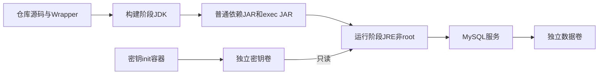
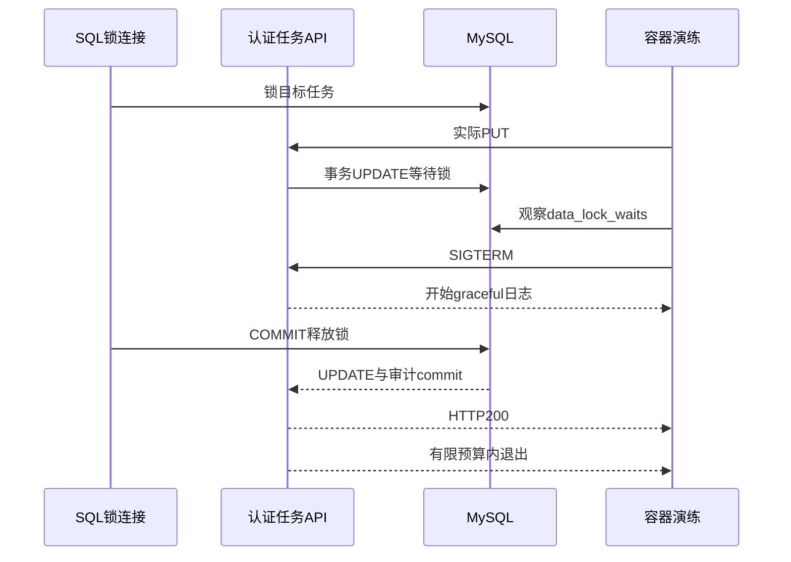
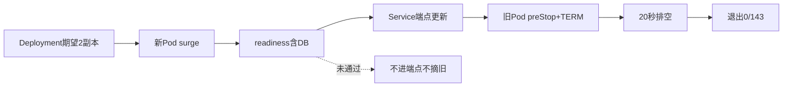

# 40 · 容器与编排

## 章节范围与先修

先完成16/23/28章。Docker部分由P5-03交付，K8s Deployment/Service/探针/资源限制与滚动更新由P5-04交付；两部分均已实现并通过真实演练，进入in_review。完整[Compose操作说明](../../project/deploy/compose/TEACHING.md)、[K8s操作说明](../../project/deploy/k8s/TEACHING.md)、[Dockerfile](../../project/deploy/compose/Dockerfile)、[Compose](../../project/deploy/compose/teaching.yaml)、[K8s清单](../../project/deploy/k8s/teaching.yaml)及[真实演练脚本](../../scripts/verify-compose-teaching.mjs)、[K8s演练脚本](../../scripts/verify-k8s-teaching.mjs)均可定位。运行链是P4认证任务API与真实MySQL，不声称P6全部业务集成。

## 知识点

### ch40-kp01 · 镜像、运行进程与持久卷

#### 1. 一句话定义

镜像提供可重复启动的文件系统与入口，容器运行进程，命名卷把需要保留的数据移出容器可写层。

#### 2. 为什么需要它

宿主能运行JAR不代表另一台机器有同样JRE和配置；重建容器若把数据库或签名私钥放在可写层，会丢数据或让已有Token失效。镜像应承载代码，运行身份、配置与数据需另行设计。

#### 3. 生活类比

统一设备箱对应镜像，开机工作的设备对应容器进程，独立档案柜对应卷。设备箱能复制，不代表档案柜内容也该装进每份箱子。现实箱子与建筑隔离方式不同；容器共享宿主内核，不是另一台完整虚拟机，也不会自动隔离所有网络风险。

#### 4. Node.js / TypeScript / NestJS 技术对照

Node也需要明确运行时与启动入口，不能把本机node_modules复制当所有平台通用。当前生产式多阶段镜像只交付Java/MySQL链；Node是[原生HTTP生命周期模型](../../examples/container-node-reference/README.md)，没有声称已有同题Nest业务镜像。TypeScript构建产物与JAR只是各自运行物，不能据一个镜像构建通过推断另一个可部署。

#### 5. 两端代码对照

Node模型在完整源码中启动真实服务器，测试用独立子进程运行它：

```js
server.listen(0, '127.0.0.1', () => {
  process.send?.({ type: 'listening', port: server.address().port })
})
```

Java镜像在构建阶段准备exec JAR，运行阶段只复制该产物：

```dockerfile
COPY --from=build /src/examples/security-lab/target/security-lab-0.1.0-SNAPSHOT-exec.jar /app/app.jar
USER 10001:10001
ENTRYPOINT ["java", "-jar", "/app/app.jar"]
```

完整Dockerfile安装unzip以保持Wrapper固定zip与SHA256合同。构建中的skipTests仅准备产物，真实回归在独立CI；不能把绿色docker build等同测试通过。exec数组使Java直接接收容器信号。

#### 6. 原理与流程图



构建上下文通过.dockerignore排除本机target/node_modules/.env，密钥不进入镜像。新卷初始化遵循镜像目录所有者；实际权限还须由容器运行验证，静态USER不能证明挂载可读。

#### 7. 类比边界与错误直觉

非root与只读根文件系统降低误写面，不表示生产隔离或零漏洞。卷保留也不是备份；down通常留卷，down --volumes明确丢弃。Tag可被重指，真正回溯还需摘要/源码版本，发布扫描与回滚见后续41章。

#### 8. 企业应用场景与选型

单体教学部署采用一个API进程与真实DB，不为展示容器拆分业务。私钥生命周期与业务DB分别管理；本例只在可丢弃本机环境生成实验密钥和已知演示账号，生产需独立凭据管理和TLS方案。

#### 9. 常见错误与排查

启动报缺类，先查普通JAR与exec JAR复用路径；密钥读不到，查卷初始化权限与只读挂载。Wrapper校验失败先核对下载的是zip还是tar.gz，不能删SHA校验。改环境密码不等于重置已有BCrypt账号。

#### 10. 实操练习与验收

基础题：区分image/container/volume。迁移题：说明Node构建产物与JAR如何进入各自运行时，当前哪些尚未交付。思考题：把私钥打进镜像会怎样影响复制与轮换？根目录按说明运行：

```powershell
docker compose -f project/deploy/compose/teaching.yaml up -d --build --wait --wait-timeout 240
docker compose -f project/deploy/compose/teaching.yaml ps
```

检查API为healthy、keys为成功退出、MySQL为healthy；再按说明真实登录/创建。完整自动验收还检查Config.User=10001:10001、重启保留数据库与签名会话，不只看容器状态running。

### ch40-kp02 · 依赖就绪与健康探针

#### 1. 一句话定义

liveness回答进程是否仍可工作，readiness回答当前是否适合接流量，依赖启动顺序不能代替持续就绪判断。

#### 2. 为什么需要它

MySQL进程启动不代表数据库用户和库已可用；API端口打开也可能尚未迁移或初始化。依赖短暂故障时，直接按DB故障重启所有API可能加剧波动。

#### 3. 生活类比

窗口工作人员在岗对应liveness，材料系统可用并可受理对应readiness，开门前等依赖对应初次启动条件。工作人员在岗不保证每笔业务办对；门牌状态不能代替交易授权或SQL校验。

#### 4. Node.js / TypeScript / NestJS 技术对照

Node原生模型分别暴露live/ready，只有进程状态，没有DB探针；Java真实Actuator readiness包括readinessState及db，liveness不把db故障计入。Nest可用专门健康模块组合检查，示例没有安装该模块，不能因URL类似就声称两端依赖检查等价。

#### 5. 两端代码对照

Node模型中的ready状态：

```js
response.statusCode = draining ? 503 : 200
response.end(draining ? 'DRAINING' : 'READY')
```

Java容器环境及Compose依赖条件：

```yaml
depends_on:
  mysql:
    condition: service_healthy
  keys:
    condition: service_completed_successfully
environment:
  MANAGEMENT_ENDPOINT_HEALTH_PROBES_ENABLED: 'true'
  MANAGEMENT_ENDPOINT_HEALTH_GROUP_READINESS_INCLUDE: readinessState,db
```

API自身healthcheck实际curl readiness；匿名只放行三个health路径，不因此开放受保护metrics。健康正文不暴露连接细节。管理员fixture完成后才进入Boot应用就绪阶段。

#### 6. 原理与流程图

MySQL实际登录SELECT1成功→keys成功完成→API迁移/装配/教学初始化→readiness UP→接业务请求。运行中DB停止→readiness503、liveness仍200→DB恢复后readiness UP。启动顺序是一次约束，持续探针是后续观察，两者不能互相替代；该线性关系用文字足以说明。

#### 7. 类比边界与错误直觉

Compose healthcheck变unhealthy不会自动等同K8s摘流或重启策略，当前未交付K8s。depends_on不保证依赖永不掉线。Node模型ready只代表自身标志；Java DB UP也不证明所有表的每笔业务正确。

#### 8. 企业应用场景与选型

探针应快速、有限、避免昂贵全量查询和高敏细节。把必需依赖纳入ready、把可恢复远端故障排除live需按应用实际能力决定；不是每种依赖都应相同处理。本例以唯一关键SQL库展示区别。

#### 9. 常见错误与排查

ready401查精确安全规则，不应permitAll所有管理端点；ready超时查DB健康和连接预算，不靠无限重试掩盖。Compose up退出0仍需检查迁移/登录/写库，不能只curl一个自写静态UP接口。

#### 10. 实操练习与验收

基础题：解释端口开放和就绪的差别。迁移题：列出Node模型没有覆盖的依赖检查。思考题：为何数据库临时故障不一定该令liveness失败？执行完整演练：

```powershell
node scripts/verify-compose-teaching.mjs
```

要求真实停MySQL后ready503/live200，恢复后ready200，并完成后续业务与排空阶段。不能把构建失败或静态YAML检查当该演练通过；实际版本/日志见[P5-03](../progress/P5-03.md)。

### ch40-kp03 · SIGTERM、在途事务与优雅停止

#### 1. 一句话定义

优雅停止先停止接纳新工作，再在有限预算内等待已接纳工作完成，最后释放资源并退出。

#### 2. 为什么需要它

容器被停止时，HTTP请求可能已通过认证并在SQL事务中等待锁。直接杀掉进程会中断响应或回滚；仅演示空闲stop无法证明处理了这种窗口。无限等待又可能阻止部署完成。

#### 3. 生活类比

下班先关取号口，再处理已在窗口的单据，超过关门预算只能按规则收尾。取号口对应新连接接纳，已受理单据对应在途请求，等待预算对应shutdown timeout。现实中“办完”可能只指交接；技术上需核对HTTP、事务和进程退出三个事实。

#### 4. Node.js / TypeScript / NestJS 技术对照

Node原生server.close等待活动HTTP连接，进程signal handler需显式安装；它不会自动关闭任意数据库池或后台任务。Java Boot/Tomcat使用graceful配置驱动应用关闭阶段，事务由真实Spring/MySQL链执行。Nest shutdown hooks需单独启用与管理，本章没有把原生模型说成完整Nest部署。

#### 5. 两端代码对照

Node模型真实处理SIGTERM，设置期限并等待server.close回调：

```js
draining = true
const deadline = setTimeout(() => {
  process.exitCode = 1
  server.closeAllConnections()
}, 5000)
server.close(() => {
  clearTimeout(deadline)
  process.disconnect?.()
})
```

Java运行物的配置：

```yaml
environment:
  SERVER_SHUTDOWN: graceful
  SPRING_LIFECYCLE_TIMEOUT_PER_SHUTDOWN_PHASE: 20s
stop_grace_period: 30s
```

exec ENTRYPOINT确保Java为PID1；应用预算短于Compose强杀宽限。Node模型预算5秒只供测试，不与Java20秒比较性能。

#### 6. 原理与流程图



脚本必须先看到实际锁等待再停止，不能用固定sleep假定请求已经进入事务。重启后用原Token读取新标题，核对业务/审计和会话密钥持久性。

#### 7. 类比边界与错误直觉

20秒预算不是任意长请求都成功。超过预算、SIGKILL、主机断电和网络响应丢失仍需业务恢复设计。退出0/143且非OOM/SIGKILL仅为一个证据，必须结合HTTP与SQL结果；143本身也不能证明已排空。

#### 8. 企业应用场景与选型

部署时需要按网关摘流、请求预算、后台工作和连接池安排关闭顺序。事务已提交但响应未到达时仍需第38/39章的稳定身份与结果查询策略。此例只验证明确受控窗口，不声称生产滚动部署零错误。

#### 9. 常见错误与排查

停止立刻断连接查shell是否吞信号、Java是否PID1；137查强杀/OOM及预算。锁未释放会耗尽预算，不能把非零退出改成成功断言。驱动finally先尝试回滚锁再收日志，最外层总尝试仅清自己随机项目；日志写失败不能跳过资源清理。

#### 10. 实操练习与验收

基础题：解释TERM与KILL的差别。迁移题：对照原生Node close与Boot关闭阶段。思考题：HTTP响应丢失但SQL已提交该如何重试？Linux上执行Node真实信号模型，再执行容器完整演练：

```sh
node --test examples/container-node-reference/lifecycle.test.mjs
node scripts/verify-compose-teaching.mjs
```

Node等待实际admitted通知后TERM，draining后补齐正文，HTTP200并退出0。Java必须真实SQL等待后TERM，释放锁后HTTP200、任务更新及单条task.updated审计、退出非137、重启读取成功。两项验证各自边界，不能把Node字节模型当SQL事务证据。

### ch40-kp04 · K8s 编排：副本、探针摘除与滚动更新

#### 1. 一句话定义

Deployment声明期望副本数与替换策略，探针决定何时接流与重启，滚动更新以先备新再停旧的方式替换Pod。

#### 2. 为什么需要它

Compose面向单机依赖编排；副本、端点摘除与按序替换需要集群控制面。写死副本数不等于高可用，探针通过也不等于业务正确；滚动期间的可用性必须由真实持续流量证明。

#### 3. 生活类比

值班表对应期望副本数，前台可派号对应readiness通过并进入Service端点，健康巡查对应liveness，换班必须先有新人到位再让旧人离开对应maxUnavailable为0。换班完成不证明新员工业务必然正确，只是岗位始终有人。

#### 4. Node.js / TypeScript / NestJS 技术对照

Nest应用同样以容器镜像交付后由编排系统管理，Pod/Service/Deployment概念不因语言不同而变化。当前仓库的Node参照是[原生HTTP生命周期模型](../../examples/container-node-reference/README.md)，未部署同题Nest业务到K8s；不能据Java链通过声称Node链等价。K8s健康检查消费的是HTTP语义，与第26/29章的health端点约定一致。

#### 5. 两端代码对照

API Deployment的核心声明（完整清单见[teaching.yaml](../../project/deploy/k8s/teaching.yaml)）：

```yaml
strategy:
  rollingUpdate:
    maxUnavailable: 0
    maxSurge: 1
startupProbe:
  httpGet: { path: /actuator/health/liveness, port: http }
readinessProbe:
  httpGet: { path: /actuator/health/readiness, port: http }
lifecycle:
  preStop:
    exec: { command: ['sh', '-c', 'sleep 5'] }
terminationGracePeriodSeconds: 40
```

startupProbe避免初延误差杀慢迁移；readiness含真实DB，未就绪的Pod不进Service端点；preStop等待摘除传播后再收SIGTERM。数据库Service命名为`mysql`，与API同命名空间，使已验证数据层守卫的固定URL在集群内DNS直接解析，不放宽安全约束。

#### 6. 原理与流程图



滚动期间集群内客户端Pod持续请求Service；新Pod就绪前旧Pod继续接流，就绪后旧Pod才进入有限宽限的终止。MySQL使用RWO卷与Recreate策略，不会同时双写同一数据目录。

#### 7. 类比边界与错误直觉

kind是测试集群，通过不等于生产K8s能力；本清单未声明Ingress、TLS、HPA、NetworkPolicy或多可用区。replicas=2不是高可用证明：节点、存储与数据库仍是单点。同镜像rollout restart验证的是Pod替换机制，不是新版本发布；版本化镜像与回滚见41章P5-05。探针路径permitAll范围与Compose一致，仅三个health路径。

#### 8. 企业应用场景与选型

生产滚动发布需要镜像标签、就绪门禁与快速回滚配合；PodDisruptionBudget与反亲和在此教学规模未引入。JVM按容器内存限制感知堆（MaxRAMPercentage），requests与limits显式声明避免与邻居争抢。密钥与数据各自独立PVC，节点存储由StorageClass提供。

#### 9. 常见错误与排查

新Pod卡NotReady查init容器、DB迁移与Secret密码；滚动卡住查新Pod readiness与`kubectl rollout status`；旧Pod退出137查grace预算与preStop；请求间歇失败查端点摘除传播与readiness抖动。空库首启的seed竞态靠首副本Ready后再扩容避免，不能靠重试掩盖。

#### 10. 实操练习与验收

基础题：解释maxUnavailable=0与maxSurge=1的替换顺序。迁移题：对照Compose depends_on与init容器/探针两种就绪方案。思考题：为何readiness含DB而liveness不含？在kind集群执行真实演练：

```powershell
node scripts/verify-k8s-teaching.mjs
```

要求零失败完成：空卷迁移登录创建、DB停止时readiness503/liveness200并摘流、恢复、扩容2副本、rollout restart期间Service持续请求零失败、旧Pod优雅退出0/143、用滚动前的原refresh token轮换访问并读到任务。集群版本与真实日志见[P5-04](../progress/P5-04.md)；构建失败或静态清单检查不算演练通过。

## 练习提示与官方资料

先区分镜像、应用状态、依赖状态及业务事实，再决定使用何种探针和日志。镜像扫描、版本化发布与回滚演练见41章P5-05。

- [Docker多阶段构建](https://docs.docker.com/build/building/multi-stage/)
- [Compose启动顺序](https://docs.docker.com/compose/how-tos/startup-order/)
- [Compose服务规范](https://docs.docker.com/reference/compose-file/services/)
- [Deployment滚动更新](https://kubernetes.io/zh-cn/docs/concepts/workloads/controllers/deployment/#rolling-update-deployment)
- [容器探针](https://kubernetes.io/zh-cn/docs/tasks/configure-pod-container/configure-liveness-readiness-startup-probes/)
- [Spring Boot优雅停止](https://docs.spring.io/spring-boot/3.5/reference/web/graceful-shutdown.html)
- [Actuator Kubernetes probes](https://docs.spring.io/spring-boot/3.5/reference/actuator/endpoints.html#actuator.endpoints.kubernetes-probes)
- [Node HTTP server.close](https://nodejs.org/docs/latest-v22.x/api/http.html#serverclosecallback)
- [ADR0011](../adr/0011-teaching-container-runtime.md)
- [ADR0012](../adr/0012-k8s-teaching-runtime.md)
