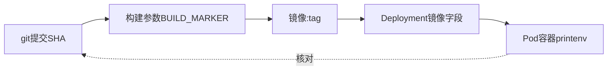
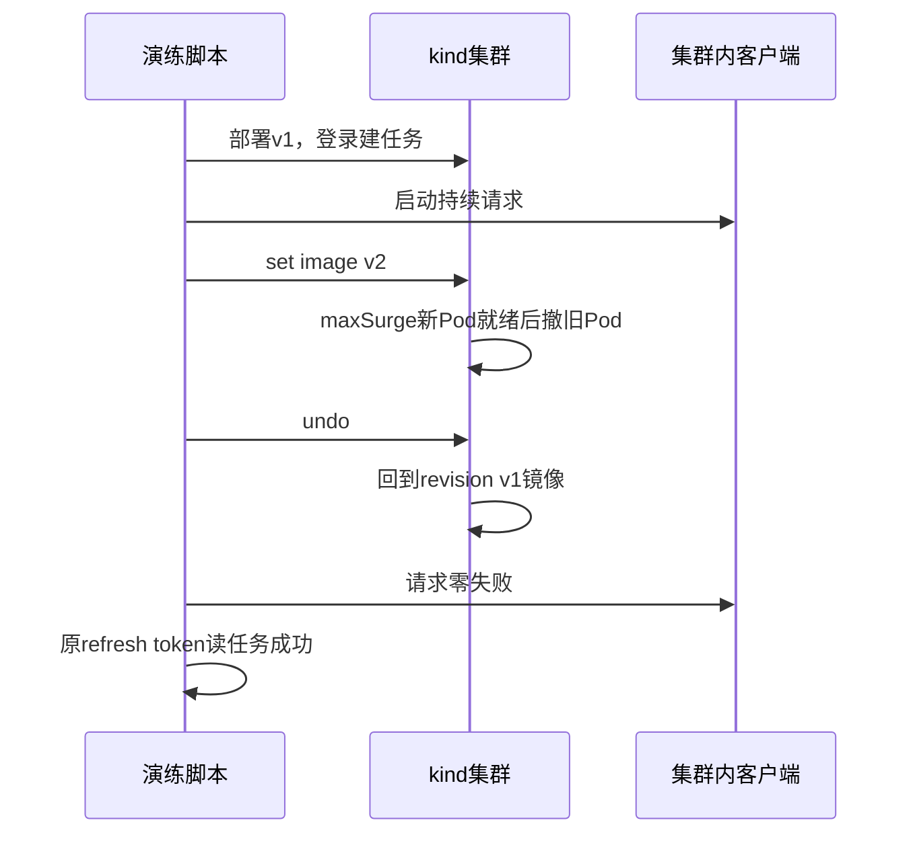

# 41 · 自动交付与回滚

## 章节范围与先修

先完成35/40章。本章在已验证的教学镜像与K8s清单上交付：CI构建测试、镜像漏洞扫描阻断、版本追溯链与真实部署/升级/回滚演练。GitHub Actions是本仓库唯一实际管道，不声称GitLab CI或生产CD能力；不发布外部registry镜像。[操作说明](../../project/deploy/k8s/TEACHING.md)、[交付清单](../../.github/workflows/delivery.yml)、[回滚演练脚本](../../scripts/verify-k8s-delivery.mjs)与[进度证据](../progress/P5-05.md)均可定位。

## 知识点

### 版本化镜像与追溯链 {#ch41-kp01}

#### 1. 一句话定义

每次交付产出唯一可追溯的镜像：git提交→镜像标签→容器内构建标记→Deployment镜像字段四点可同时核对。

#### 2. 为什么需要它

"最新代码"不是版本；镜像标签可被重指，回滚需要知道回到哪个具体产物。没有构建期标识，线上容器无法回答"我是什么时候的什么代码"。

#### 3. 生活类比

产品批次号对应镜像标签，装箱单对应构建标记。核对两处可以发现标签与单据不一致，装箱单本身无法证明箱中实物来自所写批次。

#### 4. Node.js / TypeScript / NestJS 技术对照

Node镜像同样以构建参数注入版本（如`npm version`或git SHA写进环境变量），追溯链概念与语言无关。当前仓库的Node参照仍是[原生HTTP生命周期模型](../../examples/container-node-reference/README.md)，未发布版本化Node镜像；不能据Java链通过声称Node交付链等价。

#### 5. 两端代码对照

**Node.js** · 采用同样构建参数的Node镜像可以用`node -p 'process.env.BUILD_MARKER'`读取标记。本仓库的[Node生命周期示例](../../examples/container-node-reference/README.md)只运行本地进程。

**Java** · 教学Dockerfile在构建期注入标记：

```dockerfile
ARG BUILD_MARKER=unversioned
ENV BUILD_MARKER=${BUILD_MARKER}
```

CI以提交SHA构造两个标记，例如`--build-arg BUILD_MARKER="drill-v1-$GITHUB_SHA"`。演练中`docker run --rm --entrypoint printenv <image> BUILD_MARKER`与`kubectl exec <pod> -- printenv BUILD_MARKER`分别验证镜像与集群内Pod的实际值。证据同时记录运行时的镜像ID，用于比对回滚前后的v1产物。

#### 6. 原理与流程图



演练核对构建时声明的提交标记、Deployment镜像标签和运行容器的镜像ID。错误的应用层也可能带预期标记，构建内容还需由构建和测试作业验证。回滚前后的镜像ID比对确认两次加载了同一个v1产物。

#### 7. 类比边界与错误直觉

latest标签不能作为版本；同一tag重复推送会静默改变含义。构建标记可被伪造（构建者自己写），不是密码学签名；不可信来源的镜像需要签名与摘要校验，不在本章范围。`unversioned`默认值的存在本身就是警示信号。

#### 8. 企业应用场景与选型

生产交付通常把镜像推到registry并用摘要或不可变tag引用；教学环境用kind本地load跳过registry，追溯链其余环节保持一致。SBOM、签名（cosign）与准入策略是后续演进，当前未声明。

#### 9. 常见错误与排查

Pod内marker与预期不符先查`kubectl rollout history`确认实际部署的revision与镜像字段；本地kind演练记得`kind load`两个tag；缓存命中的旧镜像层不会重新求值ARG，改标记必须传新构建参数。

#### 10. 实操练习与验收

基础题：解释tag与摘要的区别。迁移题：Nest镜像如何注入等价版本信息。思考题：为什么ENV标记可被`kubectl exec`看到而构建秘密不行？执行真实演练见kp03。

### 阻断式镜像扫描 {#ch41-kp02}

#### 1. 一句话定义

流水线扫描演练实际加载的两份镜像。发现未豁免的HIGH/CRITICAL漏洞时阻断交付。

#### 2. 为什么需要它

镜像含基础镜像、JRE与依赖三层来源的已知漏洞面；不阻断的扫描报告会被忽略。依赖升级会引入新CVE，阻断让漂移在合入前显形。

#### 3. 生活类比

出厂质检的拒收等级对应漏洞严重级别门槛。特定缺陷的临时放行单对应逐条豁免，放行单必须标明原因与有效期。

#### 4. Node.js / TypeScript / NestJS 技术对照

Node侧对应`pnpm audit --audit-level high`（本仓库已在用）与镜像扫描互补：npm audit看应用依赖，Trivy看整镜像包括基础层。两项检查各有独立的覆盖范围和严重级别阈值。

#### 5. 两端代码对照

**Node.js** · 仓库用`pnpm audit --audit-level high`检查工作区依赖。它没有检查镜像中的系统包。若为NestJS构建容器，扫描作业仍应引用实际要部署的镜像。

**Java** · CI扫描步骤，失败即阻断后续部署：

```yaml
- uses: aquasecurity/trivy-action@v0.36.0
  with:
    image-ref: java-for-nestjs-teaching:v1
    exit-code: '1'
    ignore-unfixed: false
    severity: HIGH,CRITICAL
```

v2使用同样的扫描规则。上传步骤归档已经生成的JSON报告，供失败时排查。

#### 6. 原理与流程图

构建→扫描→（阻断或放行）→集群演练。扫描器比对镜像内包版本与漏洞数据库。门禁报告受严重级别和豁免策略过滤，完整盘点要另行运行覆盖所有严重级别的扫描。

#### 7. 类比边界与错误直觉

门禁覆盖扫描数据库已知的HIGH和CRITICAL。没有上游补丁的高危问题也会触发阻断，维护者可替换组件或提交逐条豁免理由与到期时间。

#### 8. 企业应用场景与选型

生产通常每日重扫已发布镜像并把扫描接到准入控制。教学管道扫描当次构建，漏洞数据库会更新。GitLab CI中的扫描job和artifacts可表达相同的门禁与证据保留机制，仓库的可执行版本见GitHub Actions。

#### 9. 常见错误与排查

扫描失败先看JSON报告的VulnerabilityID与FixedVersion，优先升级依赖而不是忽略；Trivy数据库下载失败是网络问题不是漏洞问题，重跑即可；基础镜像升级要同步兼容矩阵。

#### 10. 实操练习与验收

基础题：为什么exit-code=1是阻断的关键。迁移题：对照pnpm audit与镜像扫描各自覆盖面。思考题：无上游修复时，逐条豁免要记录哪些条件和到期时间？完整验收见kp03的CI证据。

### 滚动升级与回滚闭环 {#ch41-kp03}

#### 1. 一句话定义

升级以滚动替换发布新版本，回滚以`rollout undo`回到上一revision。演练在两次切换前启动Service就绪请求并持续到切换完成，回滚后再用原会话验证业务数据。

#### 2. 为什么需要它

部署的价值在"坏了能回"。第40章验证了同镜像替换；本章验证真实版本差异（v1/v2内容不同）下的前进与后退，以及回滚后业务连续性。

#### 3. 生活类比

新版手册上架时旧版仍在柜台可用，新版确认可用才撤旧版；发现新版有错，直接从柜库取回上一版，顾客手中的办理凭证仍然有效。回滚恢复的是"曾经正确的版本"，不是时光倒流——期间产生的数据仍在新版数据卷里。

#### 4. Node.js / TypeScript / NestJS 技术对照

Node应用同样依赖编排系统的滚动与回滚；PM2等进程管理器的reload/restart不具备revision历史。当前仓库未部署同题Nest业务到K8s，回滚语义以Java链实测为准。

#### 5. 两端代码对照

**Node.js** · [本地生命周期模型](../../examples/container-node-reference/README.md)通过向进程发SIGTERM来验证请求排空。Deployment历史由Kubernetes管理，仓库没有对应的NestJS滚动实验。

**Java** · 演练核心命令链：

```sh
kubectl -n teaching set image deployment/api api=java-for-nestjs-teaching:v2
kubectl -n teaching rollout status deployment/api
kubectl -n teaching rollout undo deployment/api
kubectl -n teaching rollout history deployment/api
```

断言不只看退出码：Deployment镜像字段从v1→v2→v1、Pod内`printenv BUILD_MARKER`随之变化、两次滚动期间集群内客户端对Service持续请求零失败、回滚后用v1期间的原refresh token仍能换新令牌读到v1期间创建的任务。

部署配置也要与镜像版本兼容。[教学清单](../../project/deploy/k8s/teaching.yaml)从Secret注入数据库连接参数，`rollout undo`只恢复Pod模板，独立修改的Secret仍需另行处理。

#### 6. 原理与流程图



undo利用ReplicaSet历史恢复先前的Pod模板，新Pod仍需启动并通过就绪检查。任务与刷新会话保存在MySQL卷中，签名密钥保存在独立的keys PVC中。

#### 7. 类比边界与错误直觉

回滚应用不回滚数据：v2期间写入的数据在回滚后仍在，若v2做了不兼容schema迁移，undo救不了——需要前向修复或数据回滚，这是数据库迁移章节的契约（先兼容后破坏）。零失败依赖就绪门禁与摘除传播，恶意慢请求或预算耗尽仍可能失败。revision历史有限（默认10），不是无限后悔药。

#### 8. 企业应用场景与选型

生产把"回滚演练"作为发布前置检查：不能回滚的变更不上线。金丝雀/蓝绿是滚动更新的演进，教学规模未引入。恢复目标（RTO）以实测演练为准，不写空头承诺。

#### 9. 常见错误与排查

undo后marker没变查rollout history确认revision顺序；滚动卡住查新Pod readiness与镜像load；请求断言失败查Service端点与Pod事件；回滚后刷新失败分别检查MySQL会话记录与keys PVC。

#### 10. 实操练习与验收

基础题：解释revision与ReplicaSet的关系。迁移题：对照PM2 reload与Deployment滚动。思考题：什么schema变更会让undo失效？按[交付演练操作说明](../../project/deploy/k8s/TEACHING.md#版本发布与回滚演练)创建独立kind集群后执行驱动。

要求零失败完成：双marker镜像构建并验证、v1部署登录建任务、v2滚动零失败且marker实测为v2、undo后镜像与marker回到v1且零失败、原refresh token读回任务。CI见[delivery.yml](../../.github/workflows/delivery.yml)，真实证据见[P5-05](../progress/P5-05.md)；扫描阻断与回滚闭环都通过才算本章交付。

## 练习提示与官方资料

完成演练后，可在[P5 综合练习](../exercises/P5-capstone.md)中将应用回滚与消息重投、Outbox恢复和容器排空对照验证。

- [Deployment回滚](https://kubernetes.io/zh-cn/docs/concepts/workloads/controllers/deployment/#rollback-to-a-previous-revision)
- [Trivy Action](https://github.com/aquasecurity/trivy-action)
- [镜像与漏洞扫描](https://docs.github.com/zh-cn/code-security/supply-chain-security)
- [pnpm audit](https://pnpm.io/cli/audit)
- [ADR0013](../adr/0013-delivery-rollback-runtime.md)
