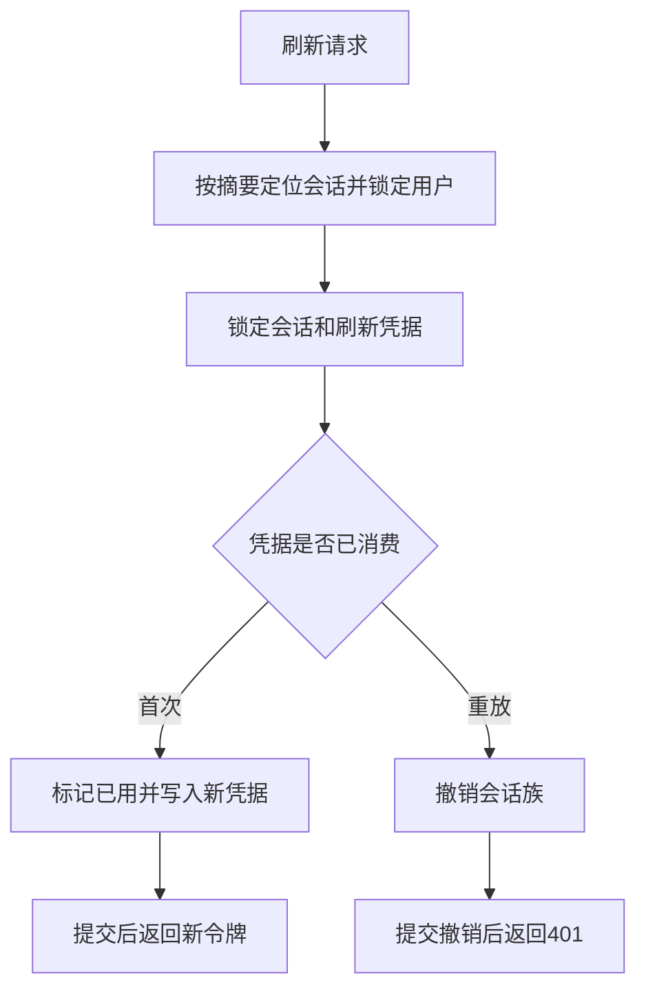

# 43 · Spring Boot 业务实现

## 章节范围与先修

先读[第42章](42-requirements-and-architecture.md)。本章通过真实HTTP与MySQL运行毕业项目，再对照NestJS的同题订单参考。Java后端启动命令与依赖见[项目手册](../../project/README.md)，业务字段和状态码见[项目契约](../../project/ARCHITECTURE.md)。

## 知识点

### 访问令牌与可撤销会话 {#ch43-kp01}

#### 1. 一句话定义

用短期签名令牌证明请求身份，用数据库会话决定该令牌此刻是否仍然有效。

#### 2. 为什么需要它

旧令牌在签名和时间上可能仍满足要求。密码更换、账号停用和刷新重放都需要在签名期限结束前停止旧会话。

#### 3. 生活类比

临时工牌上的期限和防伪印记对应令牌时间与签名，门卫查询的在岗名单对应数据库会话。补办卡后，旧卡即使外观完好也可能被拒绝。

#### 4. Node.js / TypeScript / NestJS 技术对照

NestJS Guard与Spring Security资源服务器都在业务入口前校验身份。两端都要将令牌内的会话族和凭据版本与当前状态比对，并在事务中轮换刷新凭据。

#### 5. 两端代码对照

**TS / NestJS端** · [认证参照](../../examples/nestjs-security-reference/src/auth.ts)及[运行说明](../../examples/nestjs-security-reference/README.md)展示JWT、SQL会话与刷新重放。

**Java / Spring Boot端** · [令牌配置](../../project/java-modules/common-security/src/main/java/dev/javafornestjs/capstone/security/TokenConfiguration.java)校验签名与会话，[会话服务](../../project/java-modules/module-system/src/main/java/dev/javafornestjs/capstone/system/SessionService.java)负责轮换。运行[项目手册](../../project/README.md)的测试，确认过期访问返回401且仍可刷新，已消费的刷新令牌再次使用后会话族失效。

#### 6. 原理与流程图

服务保存刷新凭据摘要，JWT通过外部RSA文件签名。密码变更或停用会增加凭据版本。访问令牌每次鉴权时读当前会话，已撤销会话无法继续访问。

#### 7. 类比边界与错误直觉

数字凭据容易复制，同一凭据可同时发出两个请求。数据库锁提供并发次序。重放分支要正常提交撤销，再构造HTTP拒绝，事务内直接抛异常会回滚撤销。

#### 8. 企业应用场景与选型

本单体选MySQL作为会话权威源，换取可验证的即时撤销。跨服务认证需要另外决定共享数据源、撤销传播延迟及缓存容错。

#### 9. 常见错误与排查

看到一次刷新返回401后，尝试用同会话族的新访问及刷新凭据访问。若还有一项成功，检查撤销事务是否真实提交，以及JWT验证是否核对会话族。

#### 10. 实操练习与验收

基础题：登录、刷新一次、重放旧刷新凭据。迁移题：对比Nest事务回调和Spring代理方法各自在何处提交。思考题：为什么审计写入出错也应保持已提交的撤销？真实集成测试要求后继访问及刷新均返回401。

### 角色、数据范围与按钮提示 {#ch43-kp02}

#### 1. 一句话定义

角色授予动作能力，数据范围约束该动作可操作的记录。界面提示由这两类规则和订单状态推导。

#### 2. 为什么需要它

员工可阅读同部门所有订单，同时只可取消自己的订单。若把两个权限合为角色的一个通用数据范围，读取能力会意外扩大修改范围。

#### 3. 生活类比

档案柜的阅览权限对应读取范围，订单上的签字权限对应变更动作。取出一份单据后，仍需检查该签字栏要求的经办人和单据当前状态。

#### 4. Node.js / TypeScript / NestJS 技术对照

Nest Guard适合统一认证，记录级权限适合在业务服务或存储调用中核对。Java以接口层接收可信身份，再由SQL表达指定动作的范围。

#### 5. 两端代码对照

**TS / NestJS端** · [同题控制器与范围判断](../../examples/nestjs-reference/src/api/order-reference.ts)使用固定测试身份、内存SQLite与真实HTTP。运行`pnpm examples:build`及`pnpm examples:test`。

**Java / Spring Boot端** · [当前权限装配](../../project/java-modules/module-system/src/main/java/dev/javafornestjs/capstone/system/CurrentOrderAccess.java)按动作合并角色，[SQL](../../project/java-modules/module-business/src/main/java/dev/javafornestjs/capstone/orders/OrdersMapper.java)将同一范围用于列表、总数、查询和更新。参照测试要求部门可读取同事的待复核订单，而本人取消权限对此订单返回404。

#### 6. 原理与流程图

收到请求后查当前角色，按动作合并同一权限的范围。查单时绑定经办人、部门与订单ID，结果不存在或超出范围时统一返回404。响应中的`allowedActions`依据当前状态、数据范围及是否自审批生成。写入时重新授权。

#### 7. 类比边界与错误直觉

菜单和按钮可隐藏操作入口，但客户端可自己组装HTTP请求。即使菜单缓存、页面或按钮提示是旧的，服务端也必须按当前权限决定结果。

#### 8. 企业应用场景与选型

把控制角色和修改角色的权限限制为平台管理员。订单角色只管理业务动作。授权锁保护最后一个启用管理员，并在取得锁后重新核对操作者。

#### 9. 常见错误与排查

同部门账号收到意外的200时，比对它的读权限和目标动作权限，跟踪使用了哪个本人与部门条件。补一个同身份同订单的读/写对照用例。

#### 10. 实操练习与验收

基础题：给同一账号部门读取与本人取消权限。迁移题：将Nest授权元数据改写为按动作检索的Java范围。思考题：为什么无动作权限与动作存在但记录越界应分别用403、404？直接调用真实接口检查。

### 并发状态变更与事务历史 {#ch43-kp03}

#### 1. 一句话定义

订单只允许定义中的状态流转，版本条件保护并发更新，状态和历史一起提交。

#### 2. 为什么需要它

两个复核员可能同时读到版本3并提交审批。若写入只按ID定位，两次请求都可能返回成功并产生重复历史。

#### 3. 生活类比

订单右上角的修订号对应版本。提交变更的人需交出看过的版本号，系统更新后产生新修订和处理记录。数据库将两步变更纳入一个提交。

#### 4. Node.js / TypeScript / NestJS 技术对照

Node参考显式执行SQLite的BEGIN、COMMIT和ROLLBACK。Java由Spring事务代理管理MySQL连接，更新语句同时限定旧版本和状态。内存SQLite参考用于约定一致的输入与输出。

#### 5. 两端代码对照

**TS / NestJS端** · [Node测试](../../examples/nestjs-reference/src/api/order-reference.test.ts)发真实HTTP，在更新之后、写历史之前注入失败，验证回到草稿、版本1与一条历史。

**Java / Spring Boot端** · [订单服务](../../project/java-modules/module-business/src/main/java/dev/javafornestjs/capstone/orders/OrdersService.java)与[HTTP集成测试](../../project/apps/admin-server/src/test/java/dev/javafornestjs/capstone/CapstoneIdentityTest.java)用真实MySQL历史键冲突触发回滚。另执行同版本并发批准，预期一个200、一个409和一条批准历史。

#### 6. 原理与流程图

先认证并确定动作能覆盖的记录，随后排除自审批，再核对版本和状态。按ID、范围、旧版本和旧状态更新。受影响行数必须为1。追加历史和审计后提交，任一步失败则回滚。

#### 7. 类比边界与错误直觉

Spring注解依赖事务代理及实际连接。SQLite模型展示状态、副作用和撤销规则，MySQL运行物用于验证真实并发语义。相同的HTTP结果不能证明两种数据库的锁机制相同。

#### 8. 企业应用场景与选型

状态历史保留操作者、版本和前后状态，适合需要追溯订单处理的内部流程。支付或跨服务副作用应按独立业务契约处理幂等和恢复。

#### 9. 常见错误与排查

如果返回500后版本仍变化，先查更新与历史写入是否经过同一事务入口，再检查内部异常是否被吞掉。再用旧版本重试并核对历史数量。

#### 10. 实操练习与验收

基础题：走草稿到批准并读取历史。迁移题：用Nest参考的失败夹具解释Java数据库键冲突。思考题：旧版本和状态已结束同时出现时为什么先返回`VERSION_CONFLICT`？两端测试均有固定预期。

### 请求关联与可重建菜单缓存 {#ch43-kp04}

#### 1. 一句话定义

请求ID将业务响应与审计事件关联，Redis按菜单定义版本加速导航读取。

#### 2. 为什么需要它

管理员反馈订单异常后，需要定位是哪一次写入产生了变化。导航读取频繁，但角色和菜单可变，随意缓存用户权限容易滞留旧授权。

#### 3. 生活类比

处理回执编号对应请求ID，柜台留档对应审计记录。办事指引的印刷版次对应缓存版本。更换版次后需要取新版指引，实际能办理什么仍由当前身份决定。

#### 4. Node.js / TypeScript / NestJS 技术对照

Nest实现可在中间件写入请求ID并经上下文传递。Java在Servlet过滤器中生成ID，再由业务事务保存固定的审计字段。两端都应避免把请求全文或凭据写进审计。

#### 5. 两端代码对照

**TS / NestJS端** · [请求关联](../../examples/nestjs-reference/src/api/trace.ts)及[Redis缓存参照](../../examples/nestjs-security-reference/src/cache.ts)分别展示传播机制和缓存失效基础。

**Java / Spring Boot端** · [事务审计](../../project/java-modules/module-system/src/main/java/dev/javafornestjs/capstone/system/AuditWriter.java)只收固定字段，[菜单缓存](../../project/java-modules/module-system/src/main/java/dev/javafornestjs/capstone/system/MenuCatalog.java)按MySQL版本缓存定义。真实Redis暂停期间接口回源，越权订单请求仍返回403。

#### 6. 原理与流程图

管理员先按资源类型与ID查审计，再将返回行的`requestId`与写入响应的`X-Request-Id`比对。读导航时，服务取得当前权限，再用MySQL快照里的菜单版本读取缓存或回源。菜单写入事务同时更换版本，旧键自然过期。刷新重放先提交会话撤销，后续审计异常只留下脱敏告警。

#### 7. 类比边界与错误直觉

审计记录描述持久化写入事件，访问日志范围更广。菜单缓存提供导航数据，接口权限始终实时计算。Redis缓存不存在也不会放行受限接口。

#### 8. 企业应用场景与选型

用明确事件类型、操作者和资源ID支持排查。导航可回源，因此缓存故障不成为业务授权依赖。其他业务缓存需另外规定一致性和超时边界。

#### 9. 常见错误与排查

权限刚改却仍可查看菜单时，先核对客户端是否重新请求导航，再比较Redis缓存内容与MySQL现行权限。发现日志含令牌时检查是否记录了原始请求或异常对象。

#### 10. 实操练习与验收

基础题：按目标用户筛选审计，并用一次改密响应的请求ID确认对应行。迁移题：用Nest上下文追踪代码标出Java对应的过滤器、应用服务和事务。思考题：为什么菜单缓存需要版本，刷新重放的撤销又不能依赖审计成功？真实测试断言缓存失效、回源、授权和脱敏。

## 章末验收与审查记录

从独立MySQL与Redis运行Java测试，验证用户、会话、角色、订单、审计和缓存。再运行Nest同题参考，比较HTTP接受、拒绝与状态回滚。两端各自运行方式及覆盖边界见[P6-02-F记录](../progress/P6-02-F.md)。
