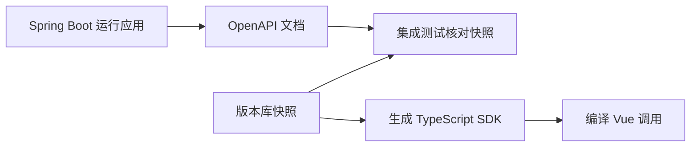
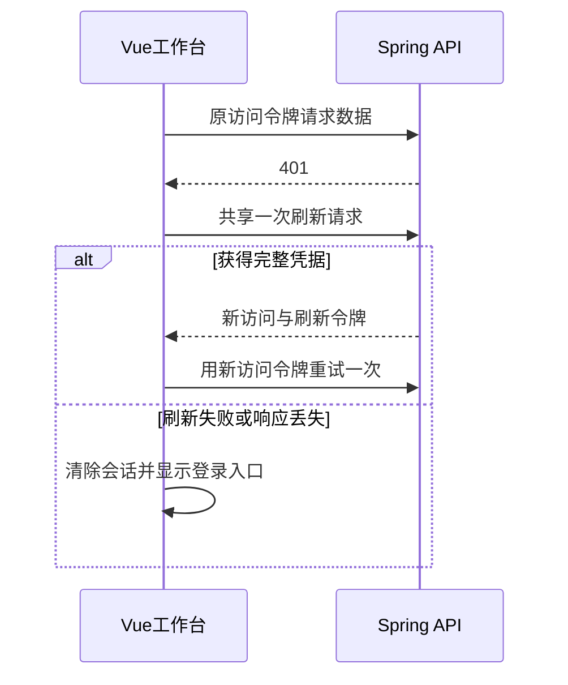
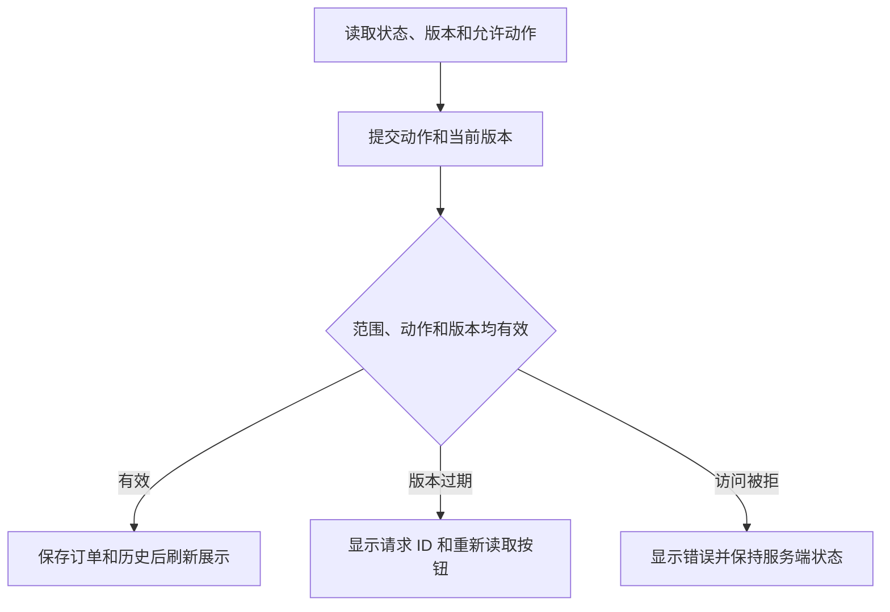

# 44 · Vue3 前后端联调

## 章节范围与先修

先完成[第43章的业务实现](43-business-implementation.md)。本章让录单员在浏览器中新建、编辑并提交订单，让同部门复核员批准订单，并核对两个账号都能读取操作历史。用[项目手册](../../project/README.md)启动隔离的MySQL、Java服务和Vite。接口字段、权限和状态见[项目契约](../../project/ARCHITECTURE.md)。

## 知识点

### ch44-kp01 · 从运行时 OpenAPI 生成客户端

#### 1. 一句话定义

Springdoc从运行中的应用生成OpenAPI，构建将审核过的快照转换成Vue可调用的TypeScript SDK。

#### 2. 为什么需要它

前端和后端分别手写一份请求描述，容易在参数名称、必填项和ID类型上分歧。比较运行时与快照，再编译客户端，能发现接口变更遗漏的消费端。

#### 3. 生活类比

仓库发布统一的发货单，柜台按当前版印制表格。订单版本成为必填栏时，柜台也要换表。

#### 4. Node.js / TypeScript / NestJS 技术对照

在NestJS，用DTO、控制器和Swagger模块发布OpenAPI。此处Java由Springdoc导出，Vue的生成步骤仍依据同一种文档格式。TypeScript在构建时核对调用参数，浏览器执行生成的HTTP请求。

#### 5. 两端代码对照

[Java订单控制器](../../project/apps/admin-server/src/main/java/dev/javafornestjs/capstone/OrdersController.java)明确创建操作ID与请求字段。[Vue订单面板](../../project/apps/admin-web/src/components/orders/OrderPanel.vue)调用生成的`createOrder`和`edit`。更新操作携带查询详情时看到的`version`，ID在两端契约中以字符串传输。对照[NestJS同题订单入口](../../examples/nestjs-reference/src/api/order-reference.ts)观察相同的路由和版本语义。

#### 6. 原理与流程图

#### 7. 类比边界与错误直觉

表格通常由人工核对。生成的类型在运行时会被擦除，网关错误、意外响应和业务拒绝仍由请求层处理。服务端继续验证来自任意客户端的请求。

#### 8. 企业应用场景与选型

前后端分别交付时，把快照放在版本控制中，审核API变化时同时检查客户端会受到哪些影响。部署环境可保留默认配置，集成测试单独启用契约端点。

#### 9. 常见错误与排查

新字段编译失败时，先检查运行时模型、快照和客户端生成顺序。核对`required`、`operationId`和响应状态。修改生成目录会被下一次构建覆盖。

#### 10. 实操练习与验收

执行`pnpm --filter @java-for-nestjs/admin-web build`。在[快照](../../project/apps/admin-web/openapi.json)找到创建订单、详情和提交审批三个操作。确认创建不传部门或所有者，编辑和提交传输当前版本。按[手册](../../project/README.md#管理端与-openapi)运行快照比较测试。

### ch44-kp02 · 会话轮换与权限导航

#### 1. 一句话定义

工作台将访问和刷新凭据保存在当前页面内存，并根据服务端返回的用户身份、权限和菜单装配界面。

#### 2. 为什么需要它

页面可能同时查询多份数据。访问令牌到期时，每个请求分别刷新会并发发送同一个单次令牌。多个页面调用应等待同一个刷新结果。

#### 3. 生活类比

同一个人用一张可换取新门票的凭证进站。几位同行人先等他换票成功，再一起走验票通道。

#### 4. Node.js / TypeScript / NestJS 技术对照

可以把请求层理解为客户端的统一调用入口。NestJS Guard与Spring端授权在服务端处理身份与权限，Vue的`provide/inject`在同一工作台中共享状态，`computed`从该状态派生菜单。

#### 5. 两端代码对照

[会话模块](../../project/apps/admin-web/src/session.ts)封装登录、401后的共享刷新、一次重试和退出。[导航](../../project/apps/admin-web/src/components/WorkspaceShell.vue)只装配已知且当前账号有权访问的页面。[认证控制器](../../project/apps/admin-server/src/main/java/dev/javafornestjs/capstone/AuthController.java)提供真实轮换与身份接口。

#### 6. 原理与流程图

#### 7. 类比边界与错误直觉

刷新响应丢失时，客户端无法判断服务端是否已经消费旧凭据。再次发送旧凭据可能触发重放撤销。403代表请求被拒绝，刷新流程只在401触发。隐藏链接只改变界面，服务端仍校验直接请求。

#### 8. 企业应用场景与选型

内存会话为本项目提供简单生命周期。重新加载页面需要登录。希望跨页重载保留会话时，应结合认证架构另行设计Cookie、CSRF和同源部署，再决定凭据处理方式。

#### 9. 常见错误与排查

先检查Network中的原请求状态、刷新次数和重试次数。禁止访问的反馈应有403和请求ID。登录成功却缺菜单时，分别核对`/me`权限、`/me/menus`路由键和服务端菜单定义。

#### 10. 实操练习与验收

执行`pnpm --filter @java-for-nestjs/admin-web test`核对并发401、轮换失败和撤销。以录单员进入工作台，确认仅显示订单入口。使用该账号令牌直接请求`GET /api/v1/users`，预期403。在浏览器空置页面超过5分钟，执行一次查询并观察旧访问请求返回401、一次刷新及重试成功。

### ch44-kp03 · 把订单约束接到按钮和错误提示

#### 1. 一句话定义

订单页按服务端返回的`allowedActions`显示动作，并随写请求提交当前记录的版本。

#### 2. 为什么需要它

同一个订单在录单员与复核员界面上能执行的动作不同。另一会话可能已修改订单，旧页面应提示重新读取并让操作人核对最新状态。

#### 3. 生活类比

不同岗位的员工收到同一张订单流转单。流转单上的修订号变更后，员工先看最新版，再签名确认。

#### 4. Node.js / TypeScript / NestJS 技术对照

对照[NestJS同题参考](../../examples/nestjs-reference/src/api/order-reference.ts)的所有权、部门判断和版本检查。前端使用Vue响应式列表与详情消费结果。审批和取消走各自的命令接口。Java更新将版本加入SQL条件，以检测并发写入。

#### 5. 两端代码对照

[列表](../../project/apps/admin-web/src/components/orders/OrdersView.vue)传状态、页码和页大小。[详情](../../project/apps/admin-web/src/components/orders/OrderPanel.vue)读取按钮权限和历史。服务端[订单模块](../../project/java-modules/module-business/src/main/java/dev/javafornestjs/capstone/orders/OrdersService.java)在事务中检查权限、状态和版本并写入历史。

#### 6. 原理与流程图

#### 7. 类比边界与错误直觉

按钮出现时只是服务端读请求的判断。权限、订单状态或版本随后变化时，写请求仍可能拒绝。跨部门详情使用404，与不存在的订单共用响应，界面不会泄露跨范围订单信息。

#### 8. 企业应用场景与选型

订单筛选和分页由服务端执行，确保总数与可见范围一致。金额传整数分，输入的元按字符串拆分后换算。重复或过期的写操作交由版本检查和事务约束处理。

#### 9. 常见错误与排查

遇到409时重新读取详情，比较新版本和动作。请求层将状态映射成可操作提示并显示请求ID。管理员可按订单资源查询审计并比对成功写入的请求ID。审批入口缺失时，检查当前账号的范围、所有权和订单状态。

#### 10. 实操练习与验收

在同部门使用不同账号录单和复核。录单员创建并编辑草稿，另一个录单员会话更新后在旧窗口提交，看到409及请求ID。读取最新版本再提交。复核员批准并查看历史，跨部门复核员搜索不到该订单且直接读取返回404。新建第二单并验证取消。可用[浏览器验收脚本](../../project/apps/admin-web/e2e/orders.ego.mjs)复现。

## 章末验收与审查记录

- 契约比较、生成客户端、类型检查与前端构建应全部通过。
- 会话测试应核对共享刷新、失败清理和退出。浏览器应复现跨角色审批、冲突及跨部门访问拒绝。
- 运行证据见[P6-03-C](../progress/P6-03-C.md)。
