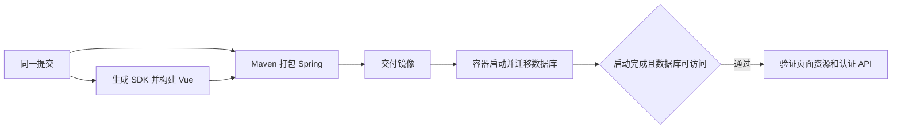
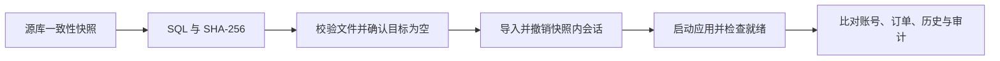
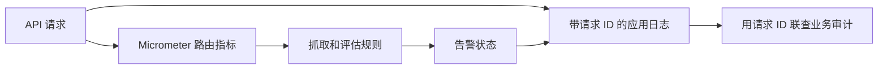

# 45 · 生产交付与验收

## 章节范围与先修

完成[第44章的订单工作台](44-frontend-integration.md)，回顾[第37章的可观测性](../07-testing-jvm/37-observability.md)。本章按[项目手册](../../project/README.md#从空环境完成交付演练)从空库启动毕业项目，验证业务数据恢复，并在隔离环境观察真实故障告警。记录提交、镜像标识、执行命令和可复查的结果。

## 知识点

### ch45-kp01 · 同源交付与就绪门禁

#### 1. 一句话定义

把同一提交的 Vue 静态产物与 Spring API 制成一个镜像，用就绪探测来决定何时将新实例交给客户端。

#### 2. 为什么需要它

进程启动后仍可能在迁移数据库、校验密钥或初始化首位管理员。端口接受连接时，首个业务请求仍可能失败。需要将应用已完成启动和数据库可访问纳入启动门禁。

#### 3. 生活类比

店门打开对应服务进程开始监听。交班时检查收银机、库存账本和当班人员，全部到位后才开始接单。

#### 4. Node.js / TypeScript / NestJS 技术对照

NestJS 也可在同一 OCI 镜像中装入编译产物和静态资源，并用 readiness endpoint 检查启动完成与依赖。Spring 的本例使用 Actuator readiness 组。两端需要明确实际依赖，避免用一次端口探测代替业务就绪。

#### 5. 两端代码对照

[多阶段构建](../../project/deploy/compose/Capstone.Dockerfile)先由 Node 和 pnpm 构建 Vue，将 Vite 的 `dist` 复制进 Spring 的静态资源，再由 Maven 制成 JAR。[Compose](../../project/deploy/compose/capstone.yaml)等待 MySQL、Redis 和密钥生成完成，随后用包含 `readinessState,db` 的探测门禁应用。对照 [Node 生命周期示例](../../examples/container-node-reference/server.mjs)中的就绪和停止状态。它用模拟工作展示生命周期，数据库检查由本项目的 readiness 组实际执行。

#### 6. 原理与流程图

#### 7. 类比边界与错误直觉

容器健康是持续变化的状态。启动时 ready 只证明探测所覆盖的条件在那一刻成立，接口权限、订单事务和前端资源还需要独立验证。更新镜像也不会替换已有持久卷。

#### 8. 企业应用场景与选型

同源单体适用于小型内部系统，可以降低跨域和版本配对成本。需要独立扩缩容时再分离前后端交付。此演练将应用绑定到回环地址，数据库和 Redis 留在 Compose 网络内。外部访问和生产运维需要额外设计 TLS、密钥托管、备份保留和容量。

#### 9. 常见错误与排查

若容器启动但未就绪，先看 `compose ps -a` 和应用、密钥及数据库日志。密钥服务失败时保留已有文件，确认同一对 PEM。若页面能打开但资源 404，核对 HTML 引用的哈希资产是否同一次构建产出。管理员密码只在首次空库初始化时创建。

#### 10. 实操练习与验收

按[交付手册](../../project/deploy/compose/CAPSTONE.md)使用新的 Compose 项目构建、启动并等待就绪。运行[部署探针](../../project/deploy/compose/verify-capstone.mjs)，要求健康、HTML、JS、CSS、匿名 401、登录、菜单和退出通过。记录 OCI 镜像修订标签和实际运行的镜像 ID。

### ch45-kp02 · 逻辑快照与隔离恢复

#### 1. 一句话定义

在一个一致性读视图中导出业务库，在隔离的空目标库完成校验、导入和业务数据比对。

#### 2. 为什么需要它

只保留一个备份文件无法证明它能恢复。业务需要核对用户、角色、订单、状态历史和审计是否共同恢复，也要防止基于历史快照重新激活已作废会话。

#### 3. 生活类比

档案管理员按同一时点复印账本，在备用办公室复核关键记录，再让员工重新领现行门禁卡。

#### 4. Node.js / TypeScript / NestJS 技术对照

MySQL 备份针对数据库。无论 API 使用 NestJS 还是 Spring，都可以通过 Node `child_process` 管道调用工具，把校验值和归档独立保存。恢复时要采用当前业务的会话策略。

#### 5. 两端代码对照

[备份工具](../../project/deploy/compose/database-backup.mjs)使用 Node 流处理 SQL 文件，调用 MySQL 工具并校验 SHA-256。[业务比对](../../project/deploy/compose/verify-recovery.mjs)使用真实 HTTP 验证 Spring 恢复后的订单和审计。NestJS/MySQL 系统可复用相同步骤，并按其实体与会话模型定义比对项。

#### 6. 原理与流程图

#### 7. 类比边界与错误直觉

一致性逻辑导出依赖 InnoDB 的一致读。备份期间需要避免修改表结构。校验值检测文件意外变化，可信存储和访问权限决定谁有权提供备份。导入中的 DDL 会提交，失败目标可能只有部分表，应使用另一个空目标重试。

#### 8. 企业应用场景与选型

逻辑备份适用于可接受按快照恢复的数据规模。需要时间点恢复时结合经过验证的日志链，并按业务约定 RPO 和 RTO。恢复演练测量的是该环境该次快照，不由一次演练推出生产容量。

#### 9. 常见错误与排查

校验不匹配时先核对归档与校验文件是否同一批。目标库非空或应用仍运行时，先确认项目名称与容器。应用启动后，Flyway 记录与库结构要同时来自恢复备份。恢复后的用户重新登录，Redis 缓存可由主库重建。

#### 10. 实操练习与验收

按[恢复手册](../../project/deploy/compose/RECOVERY.md)用一次性账号创建一张已提交订单，导出备份并恢复到新项目。验收要求原账号登录成功，订单金额、状态、版本及两条历史一致，审计可按请求 ID 核对。记录导入时长与恢复步骤，尝试损坏校验或非空目标负例。

### ch45-kp03 · 指标、关联日志与告警闭环

#### 1. 一句话定义

用时序指标识别异常，用结构化日志和请求 ID 定位影响，验证故障消失时告警能解除。

#### 2. 为什么需要它

故障发生时单份日志很难回答是否还有新请求受影响。指标可给出时间窗口内的趋势，日志和审计补充某次请求的具体上下文。

#### 3. 生活类比

收银台的排队计数器反映拥堵趋势，收据号用于追踪具体一单。故障灯亮起和熄灭的经过可用来核对响应流程。

#### 4. Node.js / TypeScript / NestJS 技术对照

NestJS 可使用请求拦截器和 Prometheus exporter 记录路由、状态与耗时。Spring 本例使用 Micrometer 及 Actuator。两端都应控制标签范围，用请求 ID 关联日志与审计。

#### 5. 两端代码对照

[请求过滤器](../../project/java-modules/common-web/src/main/java/dev/javafornestjs/capstone/web/RequestIds.java)生成响应中的请求 ID，记录路由模板、状态和耗时。对照 [NestJS 教学日志与指标](../../examples/nestjs-security-reference/src/observability.ts)在请求完成时写结构化记录并做有限聚合。毕业项目由 Micrometer 导出指标，[监控配置](../../project/deploy/compose/capstone-observability.yaml)从应用独立内部端口抓取，[规则](../../project/deploy/compose/monitoring/rules.yaml)声明抓取不可用和 API 5xx 告警。

#### 6. 原理与流程图

#### 7. 类比边界与错误直觉

指标抓取成功只说明监控端点可达，仍要查看应用 readiness 和 API 报错。将订单号、用户 ID 或请求 ID 用作指标标签会扩大基数，适合通过审计或日志查询。

#### 8. 企业应用场景与选型

内部应用从有限的一组请求、启动和抓取指标开始。告警规则应绑定负责人和故障手册。实际部署可加专门的通知路由，演练通过 Prometheus 直接查状态。

#### 9. 常见错误与排查

若请求成功但抓取失败，先看 Prometheus Targets 的错误及管理端口是否只在内网暴露。若请求报错，记录响应状态与请求 ID，用同一 ID 查询应用日志和相关审计。尽量按匹配路由模板过滤指标，避免对具体资源 ID 建立查询。

#### 10. 实操练习与验收

在隔离 Compose 项目启用监控并运行[告警探针](../../project/deploy/compose/verify-alert.mjs)。停应用前检查抓取为 1，停应用后等待告警 firing，再启动并确认抓取为 1 且告警消失。用一个认证拒绝请求的响应 ID 找到相关日志事件。记录时间和命令。

接着按[监控手册](../../project/deploy/compose/RECOVERY.md#指标请求日志与告警演练)停止演练库，验证登录接口返回带请求 ID 的500。重启数据库，检查应用就绪，并核对窗口内的 API 5xx 告警。

## 章末验收与审查记录

- 从空库构建同源镜像并通过部署烟雾和业务测试。
- 恢复另一数据库，验证账号、订单、历史与审计。观察告警从触发到解除。
- 构建与恢复记录见 [P6-04-A](../progress/P6-04-A.md) 和[备份与监控手册](../../project/deploy/compose/RECOVERY.md)。
- 独立规范和规格复核均已通过。见[复核记录](../reviews/P6-04-C.md)。
