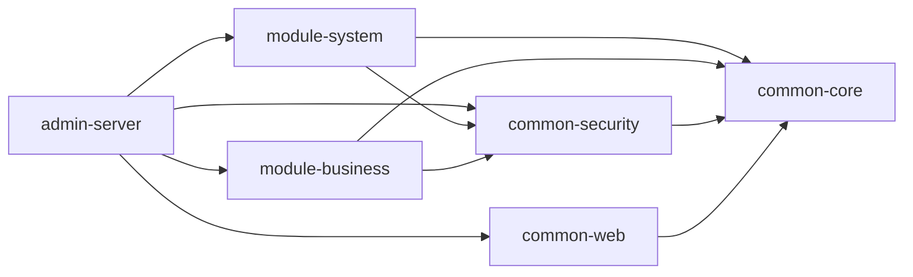
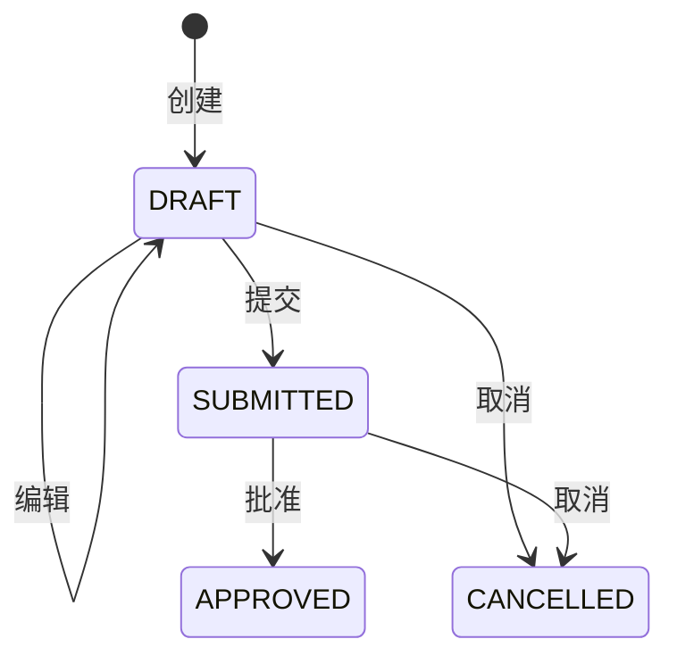

# 毕业项目 · 订单管理契约

本契约定义P6的后端、管理端和验收边界。订单记录限于人民币金额与内部复核流程，首版不接支付、库存、物流或外部客户系统。MySQL承载业务权威状态，Redis仅缓存可重建的导航数据。

## 用例与权限

| 用户 | 初始权限 |
|---|---|
| 录单员 | 创建本人草稿，查看本人订单，编辑本人的草稿，提交草稿，取消本人的草稿或待复核订单。 |
| 部门复核员 | 查看本部门订单，批准本部门他人提交的待复核订单，取消本部门待复核订单。 |
| 平台管理员 | 管理用户、角色、菜单和授权，读取全局订单及审计记录。业务写权限须由角色另行授予。 |

订单权限键为 `orders:read`、`orders:create`、`orders:edit`、`orders:submit`、`orders:approve`、`orders:cancel`。按当前用户获得的每个权限键分别计算授权，各角色对同一权限键的范围可合并。用户同时持有部门读权限和本人取消权限时，本人范围继续约束取消动作。创建与提交权限只接受 `OWN`，因此提交人始终是订单经办人。

本人范围同时匹配用户ID和当前部门，部门范围匹配当前部门，全局范围覆盖所有部门。订单的经办人与部门由服务端创建时写入，后续转岗或角色变化更新当前授权，订单历史归属保留。批准人不得是订单经办人，即使拥有全局批准范围。缺少已登录身份为401，缺少动作权限为403，具有动作权限但记录超出数据范围时返回404。列表采用相同的范围条件。

草稿编辑仅开放本人范围。取消动作把他人草稿视为范围外并返回404。部门或全局取消权限可覆盖符合授权范围的待复核订单。

## 模块依赖与归属

| 构件 | 职责 |
|---|---|
| `apps/admin-server` | Spring Boot入口、部署配置、REST控制器和OpenAPI生成。装配其余构件。 |
| `java-modules/common-core` | 可由多个模块使用的异常语义与基础值类型，无Spring Web依赖。 |
| `java-modules/common-web` | 错误响应、请求关联和公共Web配置。 |
| `java-modules/common-security` | Spring Security装配接口、当前用户与权限范围表达，定义由系统模块提供的身份读取接口。 |
| `java-modules/module-system` | 部门、用户、凭据、刷新会话、角色授权、菜单与系统审计。实现身份读取接口。 |
| `java-modules/module-business` | 订单状态、授权范围过滤、处理历史与订单事务。 |

用户和部门通过稳定ID进入订单模型，各模块维护自己的表和Mapper。有权读取订单历史的用户通过订单用例查询历史，应用入口组合数据，避免跨模块Mapper依赖。NestJS的`imports`与`exports`管理DI可见性，Maven构件依赖额外约束编译类路径。P6-02-A应验证公共模块无业务依赖、系统和订单模块彼此无构件依赖。

## 数据模型

| 表 | 关键字段与约束 |
|---|---|
| `sys_department` | 主键、唯一部门代码、名称。 |
| `sys_user` | 主键、唯一登录名、显示名、部门外键、密码哈希、状态、凭据版本、平台管理员标记。删除对外表现为停用，保留已有业务引用。 |
| `sys_role`、`sys_user_role` | 角色代码唯一，显示名称可改。用户与角色的关联键唯一。 |
| `sys_role_grant` | 角色、订单权限键与作用范围 `OWN`、`DEPARTMENT` 或 `ALL`。同一角色不能重复授予同一权限键。 |
| `sys_admin_guard` | 单行授权锁。平台管理员授予、撤销、停用及重新启用操作在同一事务内取得行锁后执行。 |
| `sys_menu` | 主键、父级、显示名称、已定义前端路由键、可见所需权限、显示顺序。父子关系无环。 |
| `sys_session_family`、`sys_refresh_session` | 会话族持有用户、凭据版本、到期和撤销状态。单次刷新凭据持有所属会话族、令牌摘要和使用时间。刷新轮换在同一事务内提交。 |
| `sales_order` | 主键、客户名称、总金额（分，正整数）、经办人与部门ID、状态、版本、创建和更新时间。常用列表索引以前缀部门ID或经办人ID配合主键。 |
| `sales_order_history` | 订单外键、操作者ID、动作、前后状态、订单版本及发生时间。订单ID与版本组合唯一。 |
| `sys_audit_event` | 请求ID、操作者、资源类型与ID、动作、事件时间。敏感字段不纳入事件。 |

可见姓名、密码和权限各用专门的应用操作修改。停用账号与提高凭据版本会使旧凭据失效。管理员启停和标记变更在取得授权锁后重新核对操作者仍是启用的平台管理员。停用或撤权若会使启用的平台管理员归零，事务拒绝并返回409。持有订单角色不能调用系统管理接口，也不能给自己授予平台管理员标记。首次部署从配置输入初始管理凭据。

创建记录初始版本1。编辑与状态转换校验方向、权限及请求版本，更新成功后版本加一并追加历史。同一事务内写入订单与历史。提交前注入历史写入失败时，订单状态、版本、历史条数均保持原值。并发请求使用条件更新，同一版本的竞争请求最多成功一个。取消和批准后的记录只允许查询。

## HTTP 契约

统一前缀 `/api/v1`。请求和响应使用JSON，时间为UTC ISO 8601字符串，ID在JSON中用十进制字符串表达，金额和版本用整数。错误包含 `code`、`message` 和 `requestId`。`/users`、`/roles`、`/orders`、`/audit-events`的列表响应分页，其余列表返回数组。分页包含 `items`、`page`、`size` 和 `total`，页码由1开始，默认20条，最大100条，按ID降序。分页及计数共用同一组过滤与授权条件。

| 操作 | 输入与成功输出 |
|---|---|
| `POST /auth/login` | `username, password` → 200 `accessToken, refreshToken, expiresIn`，`expiresIn`以秒计。 |
| `POST /auth/refresh` | `refreshToken` → 200 轮换后的令牌对。失效或重放返回401，重放撤销关联会话族。 |
| `POST /auth/logout` | 当前Bearer及 `refreshToken` → 204，撤销当前用户的匹配会话。 |
| `GET /me` | 200 用户ID、登录名、显示名、部门ID及当前权限键。 |
| `GET /me/menus` | 200 当前可见的菜单树。节点包含 `id, label, routeKey, children`。 |
| `GET /departments` | 200 部门ID、部门代码与名称集合，供用户管理选择。 |
| `GET /users`、`GET /users/{id}` | 200 分页用户或用户详情，字段为 `id, username, displayName, departmentId, status, roleIds, platformAdmin`。 |
| `POST /users`、`PATCH /users/{id}`、`DELETE /users/{id}` | 分别创建用户、编辑用户、停用用户，返回201、200、204。创建接收 `username, displayName, departmentId, password`；编辑接收 `displayName, departmentId, status` 中至少一项。状态为 `ACTIVE` 或 `DISABLED`。创建和编辑返回用户详情。 |
| `PUT /users/{id}/password`、`PUT /users/{id}/roles` | 204。分别替换密码和角色集合，输入 `password` 或 `roleIds`。 |
| `PUT /users/{id}/platform-admin` | `enabled`布尔值 → 204，设置平台管理员标记。 |
| `GET /roles`、`POST /roles`、`PATCH /roles/{id}` | 200角色分页、201创建、200更新显示名。角色输出为 `id, code, name, grants`；创建接收 `code, name`，编辑接收 `name`。 |
| `PUT /roles/{id}/grants` | `grants`为 `permission, scope` 数组，全量替换后返回204。 |
| `GET /menus`、`POST /menus`、`PATCH /menus/{id}`、`DELETE /menus/{id}` | 200列表、201创建、200修改、204删除叶节点。输入 `parentId, label, routeKey, permission, sortOrder`，详情另返回 `id`。编辑保留省略字段，`parentId: null`将菜单移到根层。 |
| `GET /orders`、`GET /orders/{id}` | 200 已授权的列表或详情。列表支持 `status`。订单含 `id, customerName, totalAmountCents, ownerId, departmentId, status, version, createdAt, updatedAt, allowedActions`。 |
| `POST /orders` | `customerName, totalAmountCents` → 201 草稿。 |
| `PATCH /orders/{id}` | `customerName, totalAmountCents, version` → 200 更新后的草稿。 |
| `POST /orders/{id}/submit`、`/approve`、`/cancel` | 分别提交、批准或取消，`version` → 200 更新后的订单。 |
| `GET /orders/{id}/history` | 200 订单范围内的处理历史，按版本升序，每项含 `actorId, action, fromStatus, toStatus, version, occurredAt`。 |
| `GET /audit-events` | 200 管理权限保护的分页审计，支持 `resourceType` 和 `resourceId`，每项含 `id, requestId, actorId, resourceType, resourceId, action, occurredAt`。 |

除登录和刷新外均要求Bearer访问令牌。`/me`和`/me/menus`对所有启用用户开放。部门、用户、角色、菜单配置和审计等系统管理接口全部限平台管理员。前端可用 `system:admin`能力显示这些入口，该能力来自平台管理员标记，角色只能授予订单权限。订单HTTP操作与同名订单权限一一对应，详情和历史均用 `orders:read`。导航和界面按钮仅消费能力，服务端独立判断每项操作。

`/me`提供入口级能力，订单响应中的 `allowedActions` 提供记录级按钮提示，枚举为 `EDIT`、`SUBMIT`、`APPROVE`、`CANCEL`。服务器按当前动作权限、数据范围、状态和职责分离计算提示。写入请求再次校验，处理页面打开后发生的授权或订单变化。

统一错误码包括 `VALIDATION_ERROR`（400）、`UNAUTHENTICATED`（401）、`FORBIDDEN`（403）、`SELF_APPROVAL_FORBIDDEN`（403）、`NOT_FOUND`（404）、`VERSION_CONFLICT`、`INVALID_TRANSITION` 和 `RESOURCE_CONFLICT`（均409）。通过身份与动作校验后，依次检查数据可见性、自审批、版本一致性、状态前置条件。这样越界记录不会暴露状态，且过期版本优先返回 `VERSION_CONFLICT`。金额上限为999999999分，客户名去除首尾空白后长度1至100。写操作拒绝未列出的字段。错误与审计数据省略密码、令牌、签名材料以及完整请求正文。

## 验收路径

1. 用两个部门各创建至少一名录单员，验证本人列表、同部门复核与跨部门拒绝。给订单经办人全局批准权限，批准本人待复核订单应返回403及 `SELF_APPROVAL_FORBIDDEN`，状态、版本与历史维持原值。另一名有权复核员应能批准同一张订单。
2. 创建草稿、提交、批准，核对版本与每条历史。对另一个草稿注入历史写入失败，重新读回原状态；同版本的两个批准请求最多一个成功。
3. 修改角色、密码、账号状态及菜单配置，分别核对当前身份、刷新重放、按钮和接口授权。验证普通用户无法编辑角色、重置管理员密码或给自己授予管理员标记。并发尝试撤掉全部平台管理员时至少一名仍可用。菜单缓存失效或Redis不可用时，接口授权继续以数据库为准。
4. 后端发布生成的OpenAPI快照，前端CI用固定工具生成客户端。对照本契约检查状态码、响应类型与主要负例。
5. 在独立Compose环境从空卷启动，可登录并完成订单流程。P6-04和P6-05再记录带环境与阈值的性能、备份恢复及告警实测结果。
